# How this video was made: Steamed Hams [4jXEuIHY9ic].mp4

**In one line**: A two-hander farce: a host ruins lunch for his boss and covers it with a chain of ever less plausible lies, each of which the boss challenges and then accepts.
**How it was made**: Mixed production: 2D animation 100% (100% of the duration lacks evidence for live action vs AI, to confirm)

- 2:48 · horizontal 16:9 · 56 shots, 3.0s each on average
- Confidence 69%, based on: tool measurements + AI assistant reviewed 56 shots
- ⚠️ 57 points are uncertain, see “Open questions”

<!--mix-->

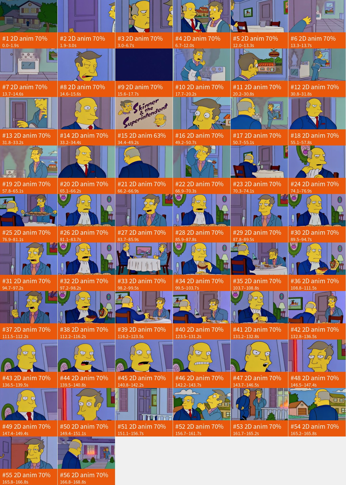

## What makes it work

- **The hook**: The first line at 3.7 s is an insult from the guest ('I made it, despite your directions'), so the power gap is clear before anything goes wrong; the oven is smoking by 13 s and the plan is spoken alo
- 21-30 s: the character tells the audience his plan in a push-in close-up, so every later lie plays as dramatic irony
- 34-49 s: a full mock sitcom title sequence with a sung jingle interrupts the scene at the moment of highest tension (he is caught climbing out of the window)
- 71-116 s: strict question / answer rhythm in alternating close-ups, shots as short as 0.7 s ('Yes.'), each answer inventing a fact the next question attacks
- 136-151 s: five punch-in cuts on one angle for the 'Aurora Borealis' tirade, then three near-silent one-line shots ('Yes.' / 'May I see it?' / 'No.') that drop the energy to nothing

## At a glance: picture, packaging, sound

Any short video splits into three layers: the picture, what is laid on top of it (subtitles, styled text, stickers), and the sound. Remake it one layer at a time.

| Layer | In this video | How to make it | Detail |
|---|---|---|---|
| **Picture** (base) | 2D animation 56 shots | AI in 28 generations | “Remake it yourself” |
| **Packaging** (on top) | subtitle, graphic, text, title | add in the editor: subtitles, styled text and stickers by the timeline | “Packaging layer” |
| **Sound** | voice（TTS voice-over）, 3 distinct effects (7 hits) | voice: TTS voice-over; effects: add from a library at the listed times | “Sound” |

## Content and structure

**Narrative line**

Keep this line in a remake: same order, same job at each step, with the point refilled from your own cases, numbers and material, so it is more than a change of subject.

| Time | Shots | Job | What it says |
|---|---|---|---|
| 0.0–3.0s | #1, #2 | set the scene | Open on the location and the arriving guest → The host goes to receive the guest |
| 3.0–6.7s | #3 | grab attention | The guest's first line is a jab that sets up who has the power |
| 6.7–13.3s | #4, #5 | set the scene | The host over-promises, which raises the stakes for what follows → Guest is seated, host leaves to fetch the meal |
| 13.3–20.2s | #6–#10 | turn | The door opens on the problem → Show the disaster plainly before the reaction → Reaction shot sells the panic → The planned meal is destroyed: the problem the rest of the piece has to hide → Panic turns into scheming |
| 20.2–31.8s | #11, #12 | add information | The character states his plan to the audience, so every later lie is dramatic irony → He acts on the plan immediately |
| 31.8–34.4s | #13, #14 | turn | Caught in the act → A silent stare builds the tension the next beat releases |
| 34.4–49.2s | #15 | set the mood | Interrupt the scene with a mock TV-show title sequence that names the format being parodied |
| 49.2–50.7s | #16 | turn | Back to the scene on the caught man's face |
| 50.7–55.1s | #17 | add information | First cover story: an absurd explanation delivered with full confidence |
| 55.1–57.8s | #18 | turn | The authority figure asks the direct question |
| 57.8–65.1s | #19 | add information | Second lie, and the one that plants the phrase the title pays off |
| 65.1–66.9s | #20, #21 | set the mood | A pause that lets the lie hang → Exit beat: the pressure is off for a moment |
| 66.9–70.3s | #22 | add information | The scheme goes ahead off-screen |
| 70.3–76.9s | #23, #24 | turn | The substitute meal is revealed and contradicts the earlier lie → The listener notices the contradiction |
| 76.9–81.1s | #25 | deliver the conclusion | The signature line: a lie patched with a made-up word |
| 81.1–83.7s | #26 | turn | Cross-examination begins |
| 83.7–85.9s | #27 | add information | Each answer invents a new fact |
| 85.9–87.8s | #28 | turn | The follow-up question tightens the trap |
| 87.8–89.5s | #29 | add information | A specific answer that can be checked |
| 89.5–94.7s | #30 | turn | The guest happens to be an expert on the invented fact |
| 94.7–97.2s | #31 | add information | Dodges by narrowing the claim |
| 97.2–99.5s | #32, #33 | set the mood | Reluctant acceptance: a breather before the next round → Reset the geography and let them eat |
| 99.5–103.7s | #34 | turn | A second line of attack: the food itself is the evidence |
| 103.7–108.8s | #35 | add information | Another instant fabrication |
| 108.8–111.5s | #36 | turn | He repeats the made-up word back |
| 111.5–112.2s | #37 | add information | One-word answer played for rhythm |
| 112.2–116.2s | #38 | show evidence | Physical proof on screen contradicts the story |
| 116.2–131.2s | #39, #40 | turn | The liar runs out of answers and breaks off → Tries to end the meeting before the problem is seen |
| 131.2–132.8s | #41 | set the mood | The guest starts to leave, which would let the host off |
| 132.8–139.5s | #42, #43 | turn | The hidden problem becomes impossible to miss → Start of the escalating rebuttal |
| 139.5–146.5s | #44–#47 | show evidence | List the reasons the lie is impossible, one per cut → Second reason → Third reason → Final reason, at peak volume and tightest framing |
| 146.5–147.4s | #48 | deliver the conclusion | A flat one-word confirmation deflates the tirade |
| 147.4–149.4s | #49 | turn | The accuser gives in and asks to share the wonder |
| 149.4–151.1s | #50 | deliver the conclusion | Refusal with no excuse at all |
| 151.1–156.7s | #51 | turn | A third party states the truth out loud and is talked over |
| 156.7–165.2s | #52, #53 | deliver the conclusion | The authority figure adopts the liar's made-up word: he got away with it → Reveal the scale of what was being hidden |
| 165.2–165.8s | #54 | set the mood | A last look back |
| 165.8–166.8s | #55 | deliver the conclusion | The closing gesture: keep smiling no matter what |
| 166.8–168.8s | #56 | set the mood | End on the unresolved disaster |

**Script** (local speech recognition, unchecked; trust on-screen subtitles for names and homophones)

<details class="ref"><summary>all 53 lines</summary>

| Time | Who | Line | Delivery |
|---|---|---|---|
| 3.7–6.8s | Speaker 1 | Well, Seymour, I made it despite your directions. | dry, clipped, slightly raised pitch; measured: rate normal (2.6 words/s), wide pitch movement, higher than this speaker's other lines |
| 6.8–8.6s | Speaker 2 | superintendent Thomass, welcome. | bright, over-polite; measured: rate slow (1.7 words/s), wide pitch movement |
| 9.2–11.1s | Speaker 2 | You're prepared for an unforgettable engineon. | bright, over-polite; measured: rate normal (3.2 words/s), wide pitch movement |
| 11.4–11.8s | Speaker 2 | う。 | bright, over-polite; measured: rate slow (2.6 words/s), quieter than the other lines; speech model hears disgusted |
| 14.7–15.5s | Speaker 3 | ぎ。 | gasp; measured: rate slow (1.3 words/s), flatter than the other lines, higher than this speaker's other lines, 2.9s pause before |
| 16.5–19.1s | Speaker 2 | Oh you gods, my roast is ruined. | muttering; measured: rate normal (2.7 words/s), wide pitch movement, higher than this speaker's other lines, 1.0s pause before |
| 21.4–22.0s | Speaker 2 | What if. | low, conspiratorial chuckle; measured: rate normal (3.2 words/s), flatter than the other lines, 2.2s pause before |
| 22.8–26.3s | Speaker 2 | I were to purchase fast food and disguise it as my own cooking. | low, conspiratorial chuckle; measured: rate fast (3.7 words/s), wide pitch movement, lower than this speaker's other lines, 0.8s pause before |
| 28.1–31.0s | Speaker 2 | OhDelightfully devilish Seymour. | low, conspiratorial chuckle; measured: rate slow (1.0 words/s), wide pitch movement, lower than this speaker's other lines, 1.8s pause before |
| 36.0–38.8s | Speaker 3 | Skinner with his crazy explanations, | sung jingle, then a shout; measured: rate slow (1.8 words/s), wide pitch movement, lower than this speaker's other lines, 5.0s pause before |
| 38.8–48.5s | Speaker 3 | The superintendent was going to need his medication when you hear skinner layme exaggerations they'll be tro in down tonight. | sung jingle, then a shout; measured: rate normal (2.1 words/s), wide pitch movement |
| 49.5–55.2s | Speaker 2 | Superintendent, I was just stretching my cs on the windowsill. I so exercise here to join me. | breezy, slightly too fast; measured: rate normal (2.9 words/s), wide pitch movement, 1.0s pause before |
| 55.6–56.3s | Speaker 4 | Why is there. | flat, accusing; measured: rate fast (4.3 words/s), wide pitch movement |
| 56.3–57.7s | Speaker 1 | Coming out of your ovenyour. | flat, accusing; measured: rate fast (3.5 words/s), flatter than the other lines, lower than this speaker's other lines |
| 57.7–63.5s | Speaker 2 | U oh, that isn't smoke, it's steam, steam from the steamed clams we're having. | hesitant start, then sing-song; measured: rate normal (2.4 words/s), wide pitch movement |
| 63.5–64.2s | Speaker 3 | うん。 | hesitant start, then sing-song; measured: rate slow (2.9 words/s), flatter than the other lines, quieter than the other lines; speech model hears happy |
| 64.2–65.3s | Speaker 2 | Steve Clas. | hesitant start, then sing-song; measured: rate slow (1.8 words/s), wide pitch movement, lower than this speaker's other lines |
| 67.1–67.6s | narration | うん。 | 'Phew'; measured: rate normal (4.3 words/s), flatter than the other lines, 1.8s pause before |
| 71.3–74.3s | Speaker 2 | Superintendent, I hope you're ready for mouthwatering hamburgers. | bright, panting; measured: rate normal (2.7 words/s), flatter than the other lines, 3.8s pause before |
| 74.3–77.2s | Speaker 1 | I thought we were having steamed clams. | level, questioning; measured: rate normal (2.4 words/s), flatter than the other lines |
| 77.2–80.2s | Speaker 2 | Oh no, I said steamed hams. | cheerful, improvised; measured: rate normal (2.0 words/s), wide pitch movement, lower than this speaker's other lines |
| 80.2–81.7s | Speaker 4 | I hamburgers. | cheerful, improvised; measured: rate slow (1.3 words/s), wide pitch movement |
| 81.7–83.5s | Speaker 1 | All hamburgers steamed ham. | slow, incredulous; measured: rate normal (2.2 words/s), flatter than the other lines, higher than this speaker's other lines |
| 83.8–84.7s | Speaker 5 | Yes. | casual; measured: rate slow (1.2 words/s), wide pitch movement |
| 84.7–85.9s | Speaker 2 | It's a regional dialect. | casual; measured: rate normal (3.3 words/s), wide pitch movement |
| 86.2–86.7s | Speaker 1 | あ。 | dry; measured: rate slow (2.3 words/s), flat pitch, lower than this speaker's other lines, quieter than the other lines; speech model hears disgusted |
| 87.0–87.6s | Speaker 1 | Yeah what. | dry; measured: rate normal (2.9 words/s), flatter than the other lines |
| 87.6–89.5s | Speaker 2 | state New York. | hesitant; measured: rate slow (1.6 words/s), wide pitch movement, lower than this speaker's other lines |
| 89.8–90.5s | Speaker 5 | Really. | measured, pointed; measured: rate slow (1.5 words/s), flatter than the other lines |
| 91.0–94.9s | Speaker 1 | Well, I'm from Utica and I' never heard anyone use the phrase steamed hams. | measured, pointed; measured: rate fast (3.6 words/s), wide pitch movement |
| 94.9–95.7s | Speaker 1 | Oh not a Utica. | quick, confident; measured: rate fast (5.2 words/s), wide pitch movement, lower than this speaker's other lines |
| 95.7–97.2s | Speaker 1 | no, it's an albany expression. | quick, confident; measured: rate normal (3.2 words/s), wide pitch movement, higher than this speaker's other lines, quieter than the other lines |
| 97.5–98.1s | Speaker 1 | 爱是。 | flat; measured: rate normal (3.6 words/s), flat pitch, lower than this speaker's other lines, quieter than the other lines |
| 100.5–104.2s | Speaker 1 | You know, these hamburgers are quite similar to the ones they have at Crsty burgerer. | thoughtful; measured: rate fast (4.1 words/s), wide pitch movement, higher than this speaker's other lines, 2.4s pause before |
| 104.2–108.8s | Speaker 2 | Oh no, Patten didn't get her burger's old family recipe. | hearty fake laugh; measured: rate normal (2.2 words/s), wide pitch movement, higher than this speaker's other lines |
| 109.5–111.2s | Speaker 1 | F steamed hams. | flat; measured: rate slow (1.8 words/s), flatter than the other lines, 0.7s pause before |
| 111.7–116.1s | Speaker 1 | Yes, yes, and you call them steamed ham, despite the fact that they're obvious to grow. | slow, emphatic on 'obviously grilled'; measured: rate fast (3.6 words/s), wide pitch movement |
| 117.7–118.1s | Speaker 2 | Yeah. | broken, stuttering; measured: rate normal (2.3 words/s), wide pitch movement, lower than this speaker's other lines, 1.6s pause before |
| 118.9–119.4s | Speaker 2 | You know the. | broken, stuttering; measured: rate fast (6.1 words/s), flatter than the other lines, 0.8s pause before |
| 121.2–122.1s | Speaker 2 | One thing I should. | broken, stuttering; measured: rate fast (4.3 words/s), wide pitch movement, higher than this speaker's other lines, 1.8s pause before |
| 123.5–125.1s | Speaker 2 | Excuse me for one second,. | fast, forced cheer; measured: rate normal (3.1 words/s), wide pitch movement, lower than this speaker's other lines, quieter than the other lines, 1.4s pause before |
| 126.8–127.8s | Speaker 3 | 嗯。 | fast, forced cheer; measured: rate slow (1.1 words/s), flatter than the other lines, higher than this speaker's other lines, louder than the other lines, 1.7s pause before |
| 128.3–131.1s | Speaker 2 | It was wonderful, good time was had by all I'm pooped. | fast, forced cheer; measured: rate fast (4.0 words/s), wide pitch movement, higher than this speaker's other lines |
| 131.8–135.1s | Speaker 1 | Yes, I should be good, Lord, what is happening in there? | shouted; measured: rate normal (3.3 words/s), wide pitch movement, higher than this speaker's other lines, 0.7s pause before |
| 135.4–136.5s | Speaker 2 | Aora boels. | shouted; measured: rate slow (1.9 words/s), flatter than the other lines |
| 137.7–139.2s | Speaker 1 | Aurora Borealis. | loud, rising; measured: rate slow (1.3 words/s), wide pitch movement, higher than this speaker's other lines, louder than the other lines, 1.2s pause before |
| 140.0–146.5s | Speaker 1 | time of year at this time of day in this part of the country localized entirely within your kitchen. | loud; measured: rate normal (2.9 words/s), wide pitch movement, higher than this speaker's other lines, 0.8s pause before |
| 146.8–147.4s | Speaker 2 | Yes. | bright, simple; measured: rate slow (1.9 words/s); speech model hears happy |
| 148.6–149.4s | Speaker 1 | Msh it. | quiet; measured: rate normal (2.5 words/s), wide pitch movement, lower than this speaker's other lines, quieter than the other lines, 1.2s pause before |
| 152.1–152.6s | Speaker 6 | St more. | raised voice; measured: rate fast (4.1 words/s), wide pitch movement, 2.7s pause before |
| 154.8–156.2s | Speaker 2 | No mother, it's just the. | raised voice; measured: rate fast (3.6 words/s), flatter than the other lines, higher than this speaker's other lines, 2.3s pause before |
| 156.2–160.2s | Speaker 1 | Well, Seymour, you are an odd fellow, but I must say. | warm, measured; measured: rate normal (2.7 words/s), wide pitch movement, higher than this speaker's other lines |
| 160.6–161.9s | Speaker 1 | You steam a good ham. | warm, measured; measured: rate fast (3.6 words/s), flatter than the other lines, quieter than the other lines |

</details>
- The “Who” column is filled from the voices separated by timbre; each one's own track is under “Sound”

## Shot list

Picture, Camera and Overlays are what is visible on screen; Made with and Material are the tools' inference, with the basis in the shot-by-shot appendix.

| # | Frames | Time | Length | What it says | Picture | Camera | Overlays | Made with (inferred) | Material (inferred) | Remake |
|---|---|---|---|---|---|---|---|---|---|---|
| 1 | 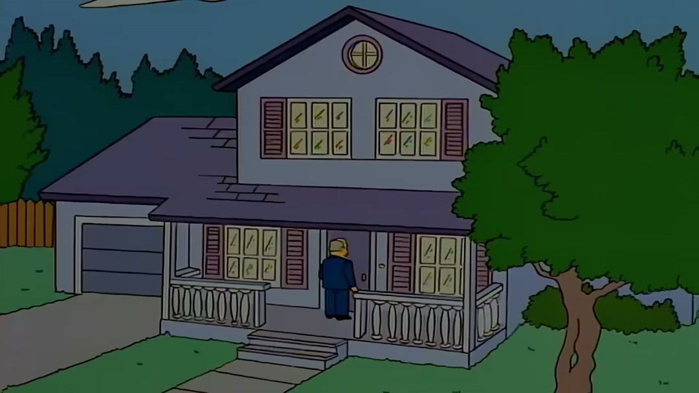 | 0:00.0 | 1.9s | set the scene: Open on the location and the arri… | Wide exterior establishing shot of a two… | static | subtitle | 2D animation 70% | to confirm | AI generation (2D animation) · G1 |
| 2 | 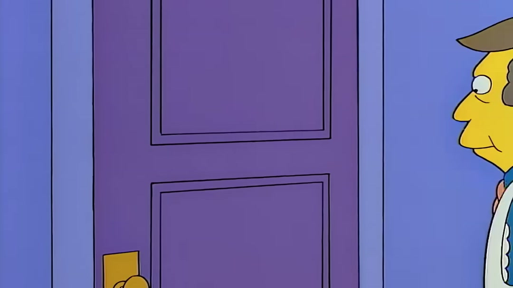 | 0:01.9 | 1.1s | set the scene: The host goes to receive the gues… | Interior, medium shot: Skinner in a whit… | handheld shake | graphic | 2D animation 70% | to confirm | AI generation (2D animation) · G2 |
| 3 | 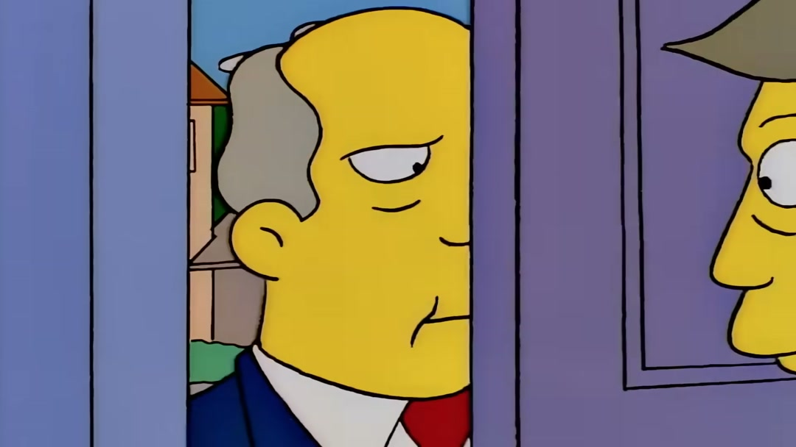 | 0:03.0 | 3.7s | grab attention: The guest's first line is a jab … | Close-up of Chalmers in the doorway agai… | static | graphic | 2D animation 70% | to confirm | AI generation (2D animation) · G3 |
| 4 | 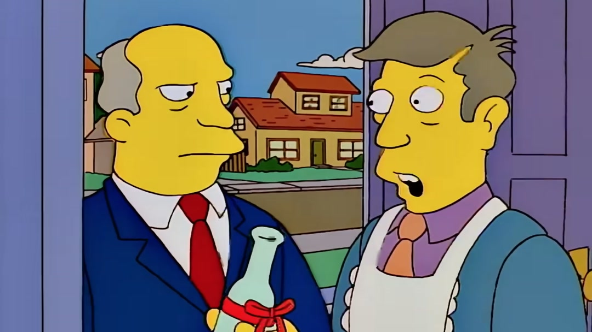 | 0:06.7 | 5.3s | set the scene: The host over-promises, which rai… | Two-shot on the doorstep: Chalmers holds… | static | text | 2D animation 70% | to confirm | AI generation (2D animation) · G4 |
| 5 | 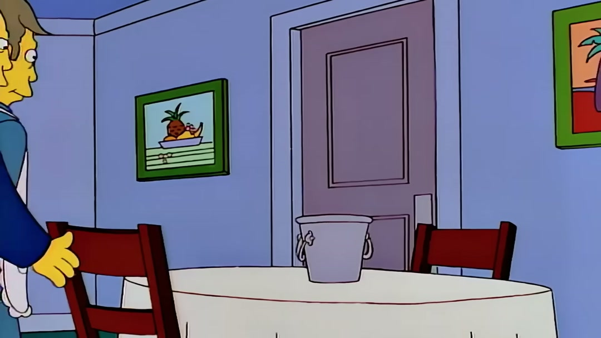 | 0:12.0 | 1.3s | set the scene: Guest is seated, host leaves to f… | Dining room, wide: table with white clot… | static (subject moves) | graphic | 2D animation 70% | to confirm | AI generation (2D animation) · G5 |
| 6 | 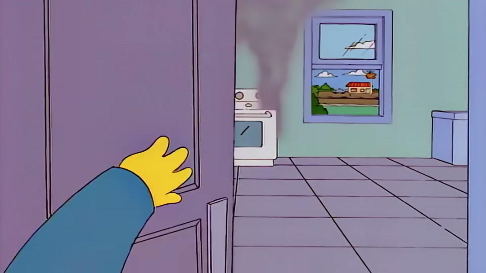 | 0:13.3 | 0.4s | turn: The door opens on the problem | Insert: Skinner's arm pushes the kitchen… | static | graphic | 2D animation 70% | to confirm | AI generation (2D animation) · G6 |
| 7 | 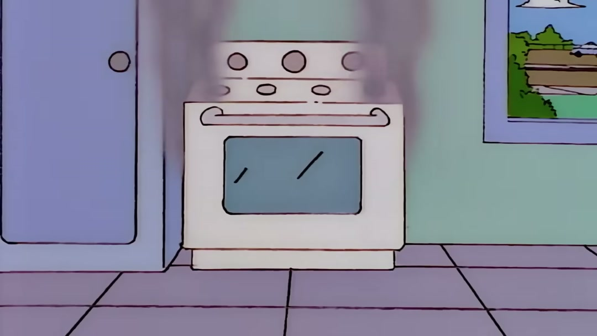 | 0:13.7 | 0.9s | turn: Show the disaster plainly before the react… | Insert on the white oven, smoke pouring … | static | — | 2D animation 70% | to confirm | AI generation (2D animation) · G6 |
| 8 | 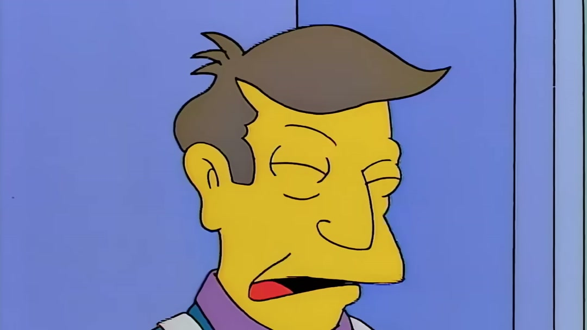 | 0:14.6 | 0.9s | turn: Reaction shot sells the panic | Close-up reaction: Skinner's eyes close,… | static (subject moves) | text | 2D animation 70% | to confirm | AI generation (2D animation) · G6 |
| 9 |  | 0:15.6 | 2.1s | turn: The planned meal is destroyed: the problem… | Point of view from inside the oven: blac… | static | — | 2D animation 70% | to confirm | AI generation (2D animation) · G7 |
| 10 | 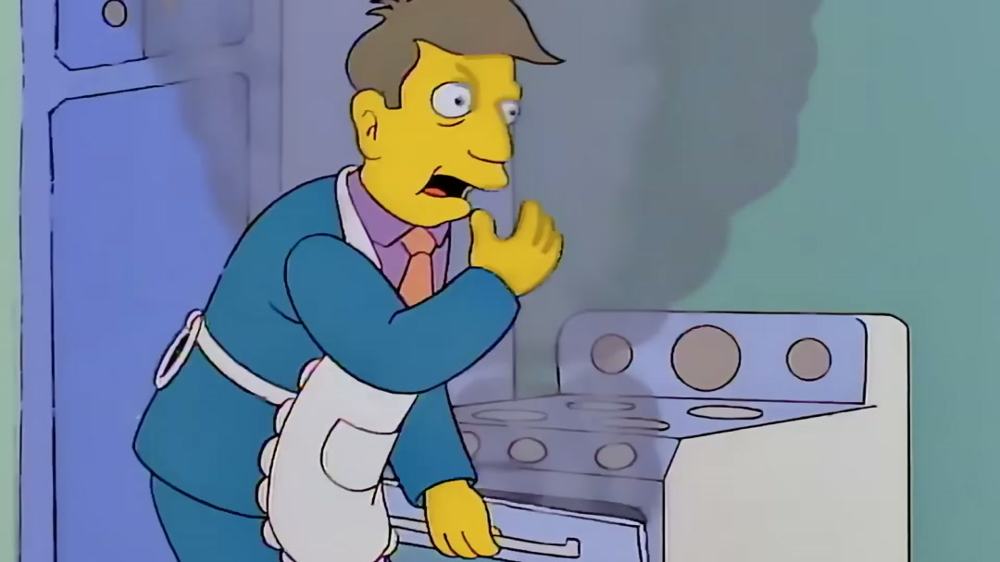 | 0:17.7 | 2.5s | turn: Panic turns into scheming | Kitchen medium shot: Skinner beside the … | static | — | 2D animation 70% | to confirm | AI generation (2D animation) · G7 |
| 11 | 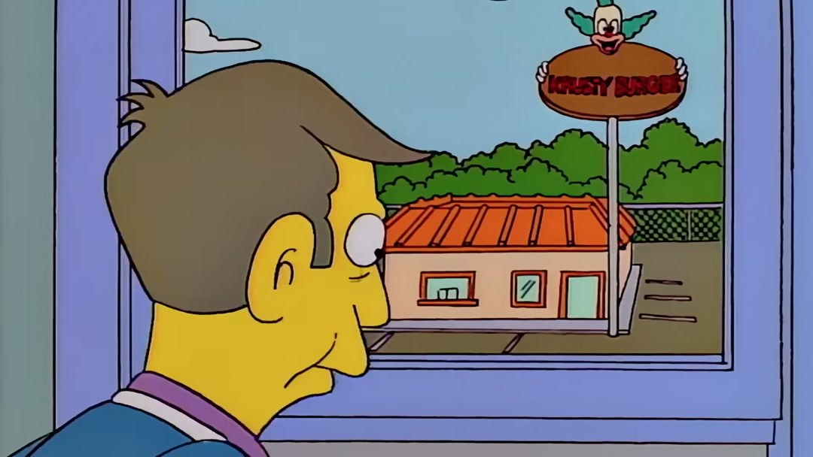 | 0:20.2 | 10.6s | add information: The character states his plan t… | Over-the-shoulder at the kitchen window:… | smooth move | text, title, graphic | 2D animation 70% | to confirm | AI generation (2D animation) · G8 |
| 12 | 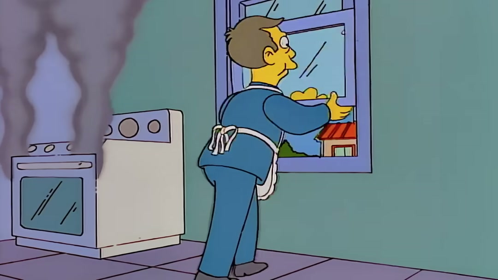 | 0:30.8 | 1.0s | add information: He acts on the plan immediately | Wide kitchen: Skinner whips off the apro… | static (subject moves) | text, graphic | 2D animation 70% | to confirm | AI generation (2D animation) · G9 |
| 13 | 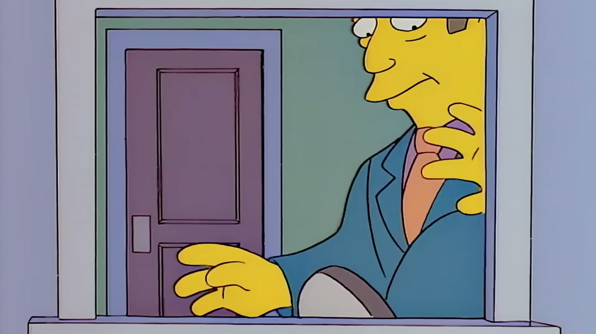 | 0:31.8 | 1.4s | turn: Caught in the act | Seen through the kitchen doorway past Sk… | static (subject moves) | text | 2D animation 70% | to confirm | AI generation (2D animation) · G9 |
| 14 | 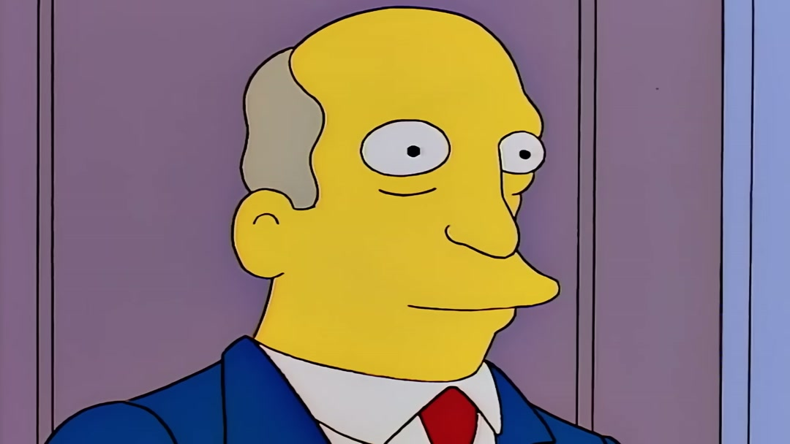 | 0:33.2 | 1.2s | turn: A silent stare builds the tension the next… | Close-up of Chalmers staring; his eyes s… | static | — | 2D animation 70% | to confirm | AI generation (2D animation) · G9 |
| 15 | 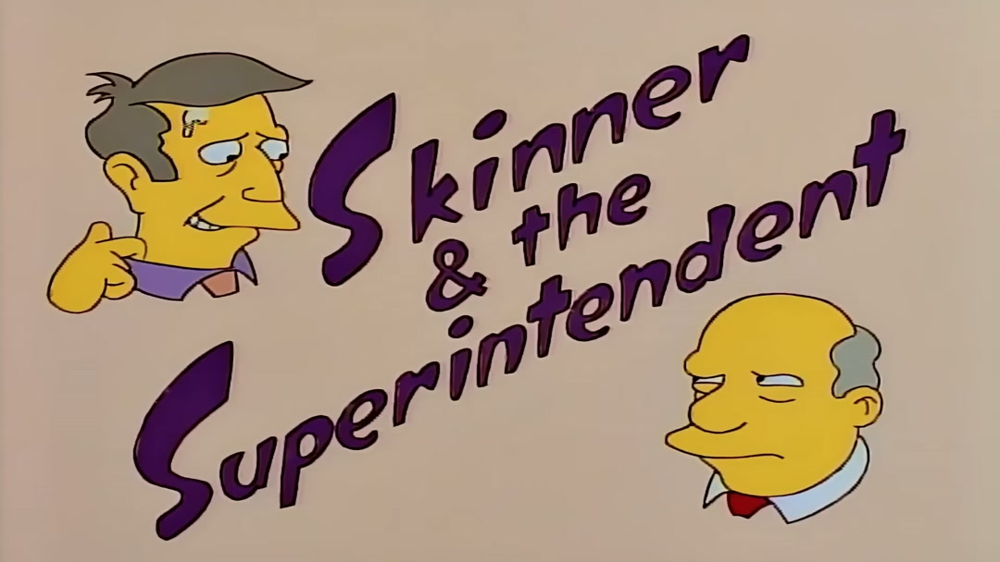 | 0:34.4 | 14.8s | set the mood: Interrupt the scene with a mock TV… | Sitcom-opening parody. A painted title c… | static (subject moves) | subtitle, title | 2D animation 63% | to confirm | AI generation (2D animation) · G10 |
| 16 | 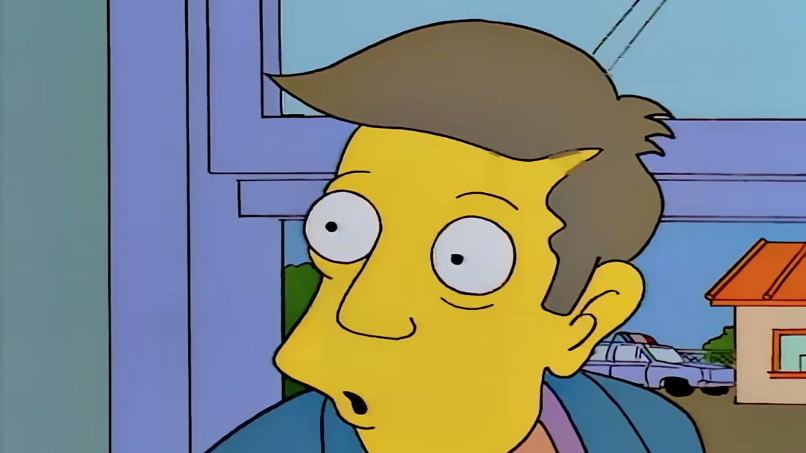 | 0:49.2 | 1.5s | turn: Back to the scene on the caught man's face | Close-up of Skinner at the window, start… | static | graphic | 2D animation 70% | to confirm | AI generation (2D animation) · G11 |
| 17 | 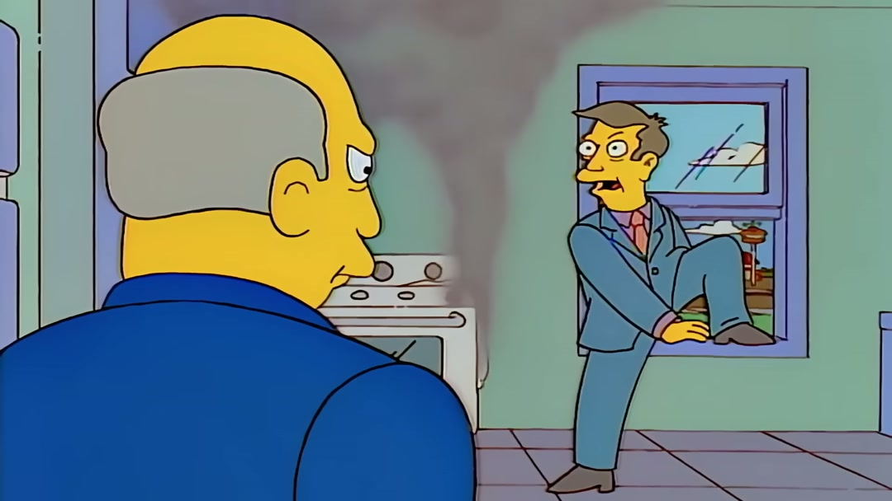 | 0:50.7 | 4.4s | add information: First cover story: an absurd ex… | Over Chalmers' shoulder (dark-suited bac… | static | graphic | 2D animation 70% | to confirm | AI generation (2D animation) · G11 |
| 18 | 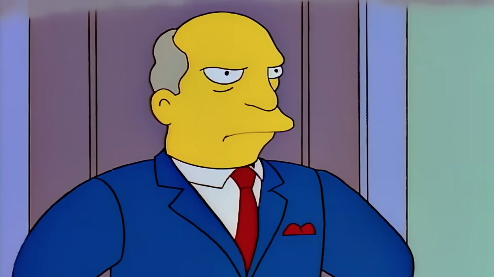 | 0:55.1 | 2.6s | turn: The authority figure asks the direct quest… | Medium close-up of Chalmers at the kitch… | static | graphic | 2D animation 70% | to confirm | AI generation (2D animation) · G11 |
| 19 | 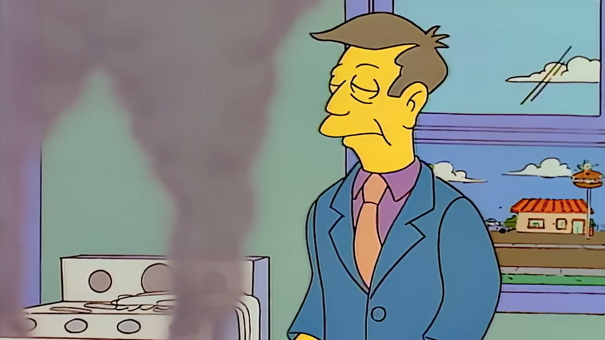 | 0:57.8 | 7.3s | add information: Second lie, and the one that pl… | Skinner beside the smoking stove, window… | smooth move | graphic | 2D animation 70% | to confirm | AI generation (2D animation) · G12 |
| 20 | 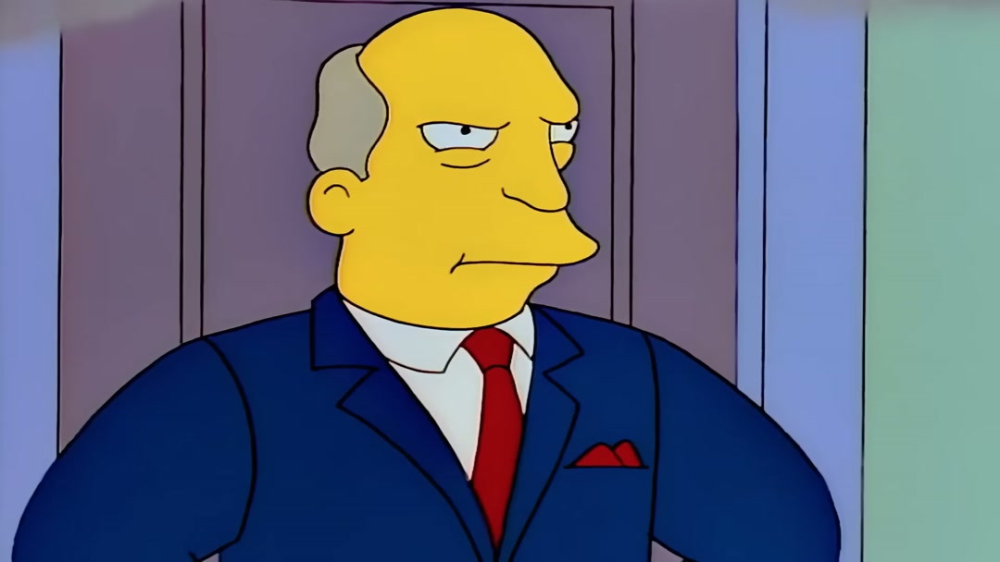 | 1:05.1 | 1.1s | set the mood: A pause that lets the lie hang | Medium close-up of Chalmers staring, unc… | static | graphic | 2D animation 70% | to confirm | AI generation (2D animation) · G13 |
| 21 | 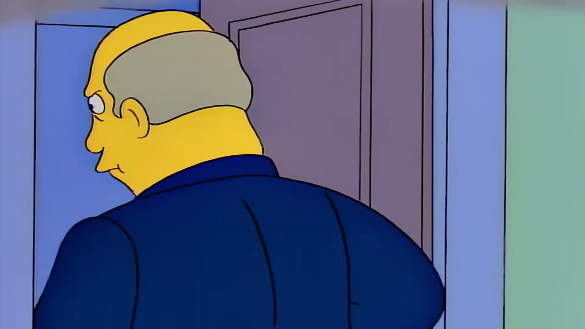 | 1:06.2 | 0.7s | set the mood: Exit beat: the pressure is off for… | Chalmers' back as he walks out; the purp… | static | graphic | 2D animation 70% | to confirm | AI generation (2D animation) · G13 |
| 22 | 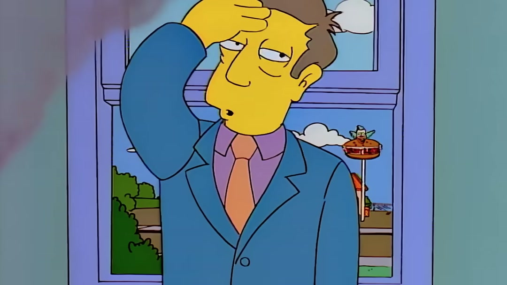 | 1:06.9 | 3.4s | add information: The scheme goes ahead off-scree… | Skinner at the window wipes his brow, th… | static | graphic | 2D animation 70% | to confirm | AI generation (2D animation) · G13 |
| 23 | 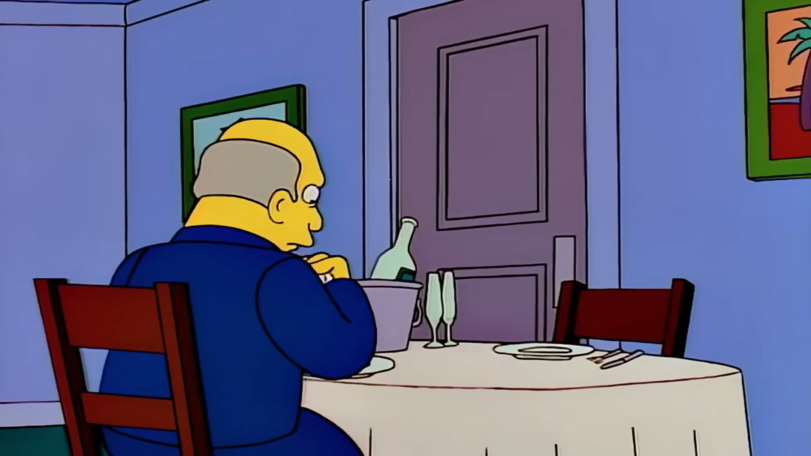 | 1:10.3 | 3.8s | turn: The substitute meal is revealed and contra… | Dining room, wide from behind Chalmers: … | static | graphic | 2D animation 70% | to confirm | AI generation (2D animation) · G14 |
| 24 | 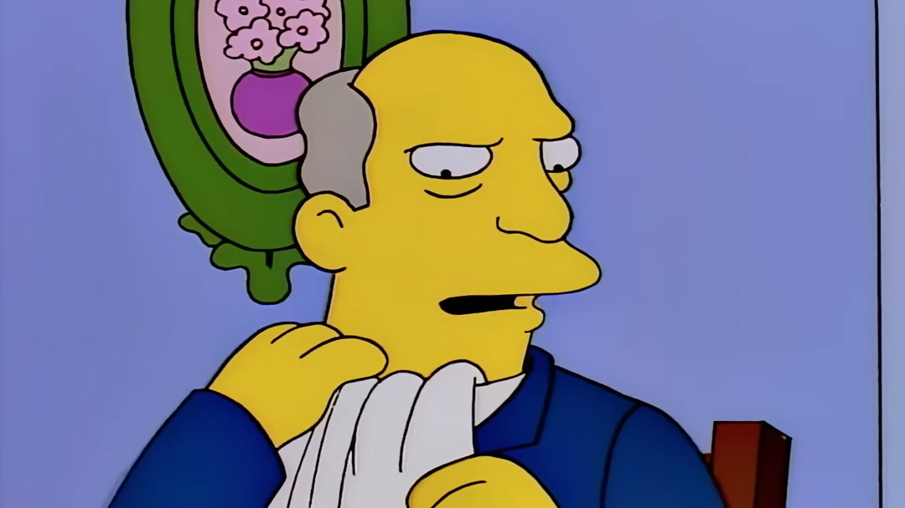 | 1:14.1 | 2.8s | turn: The listener notices the contradiction | Medium close-up of Chalmers tucking a na… | static | graphic | 2D animation 70% | to confirm | AI generation (2D animation) · G14 |
| 25 | 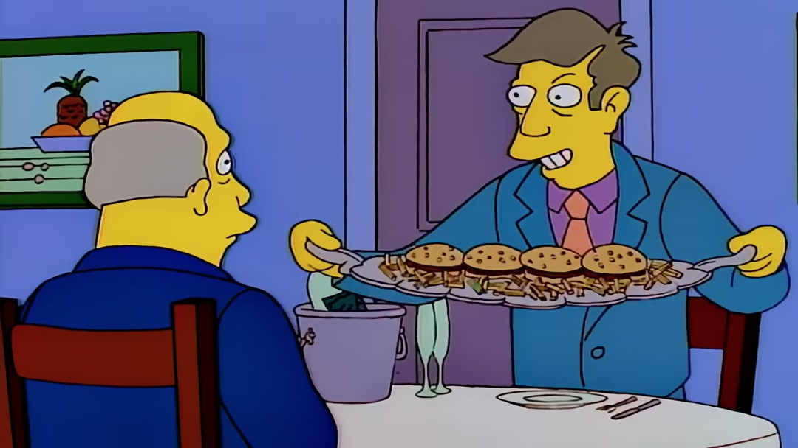 | 1:16.9 | 4.3s | deliver the conclusion: The signature line: a li… | Skinner leans over the table and sets th… | static | graphic | 2D animation 70% | to confirm | AI generation (2D animation) · G15 |
| 26 | 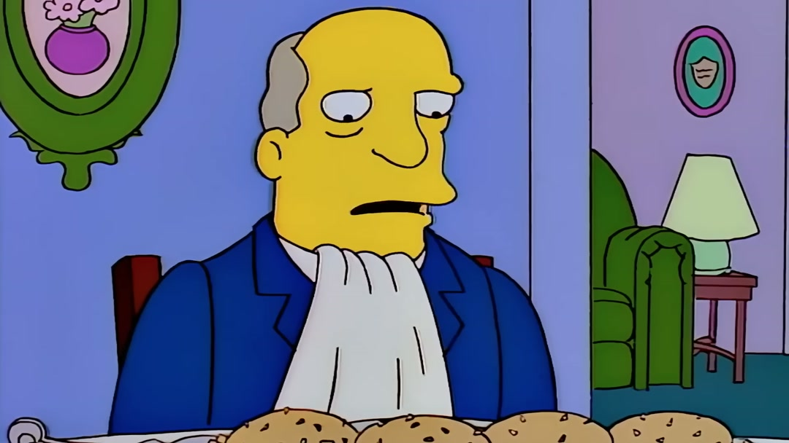 | 1:21.1 | 2.6s | turn: Cross-examination begins | Chalmers, medium close-up with burgers a… | static | — | 2D animation 70% | to confirm | AI generation (2D animation) · G15 |
| 27 | 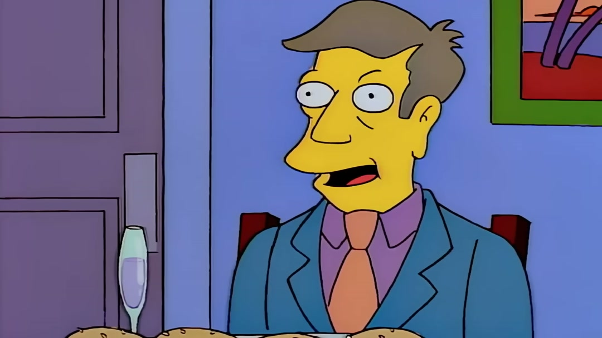 | 1:23.7 | 2.2s | add information: Each answer invents a new fact | Skinner seated, champagne flute in foreg… | static | graphic | 2D animation 70% | to confirm | AI generation (2D animation) · G16 |
| 28 | 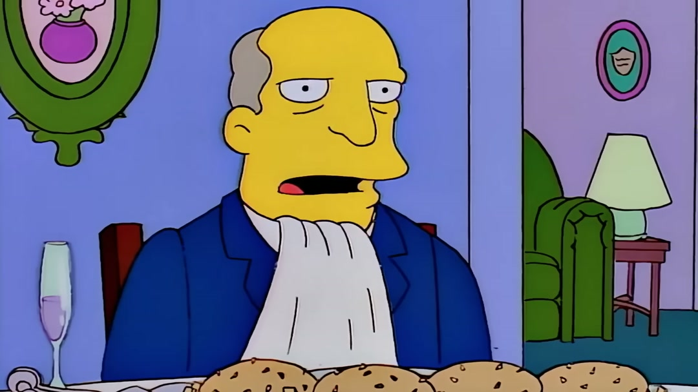 | 1:25.9 | 1.9s | turn: The follow-up question tightens the trap | Chalmers: 'Uh-huh. Eh, what region?' | static | graphic | 2D animation 70% | to confirm | AI generation (2D animation) · G16 |
| 29 | 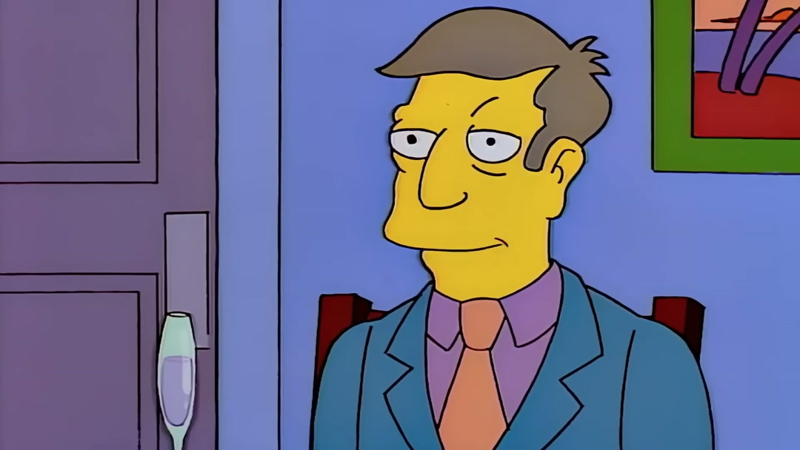 | 1:27.8 | 1.7s | add information: A specific answer that can be c… | Skinner: 'Uh... upstate New York.' | static | — | 2D animation 70% | to confirm | AI generation (2D animation) · G16 |
| 30 | 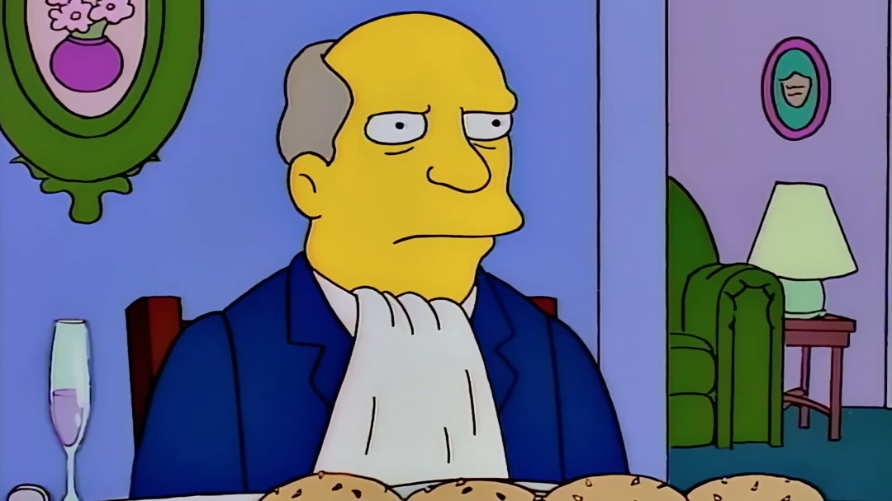 | 1:29.5 | 5.3s | turn: The guest happens to be an expert on the i… | Chalmers: 'Really. Well, I'm from Utica,… | static | graphic | 2D animation 70% | to confirm | AI generation (2D animation) · G17 |
| 31 | 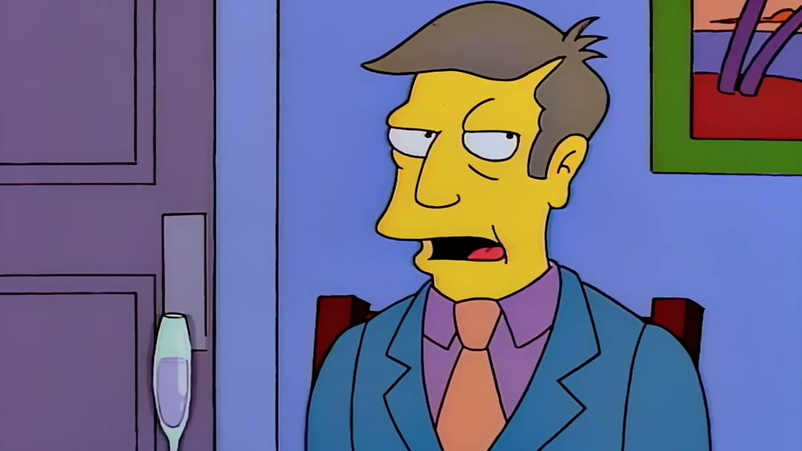 | 1:34.7 | 2.5s | add information: Dodges by narrowing the claim | Skinner: 'Oh, not in Utica, no. It's an … | static | subtitle, graphic | 2D animation 70% | to confirm | AI generation (2D animation) · G17 |
| 32 | 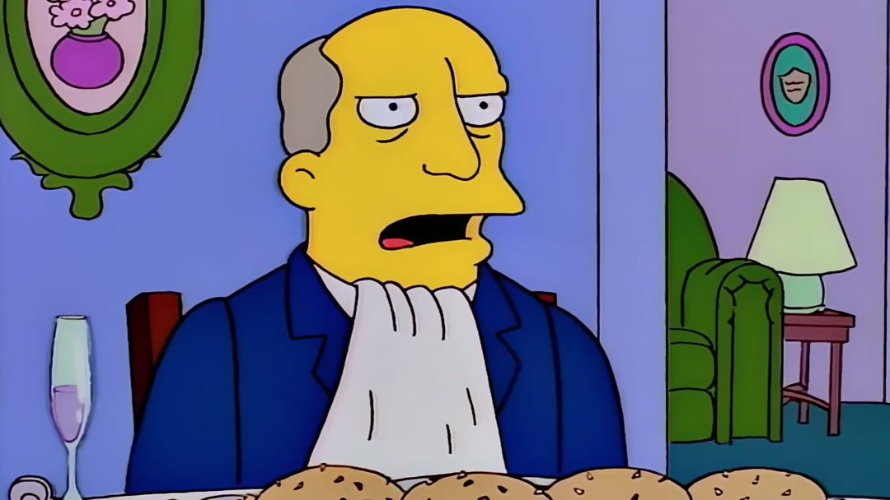 | 1:37.2 | 1.0s | set the mood: Reluctant acceptance: a breather b… | Chalmers: 'I see.' | static | — | 2D animation 70% | to confirm | AI generation (2D animation) · G18 |
| 33 | 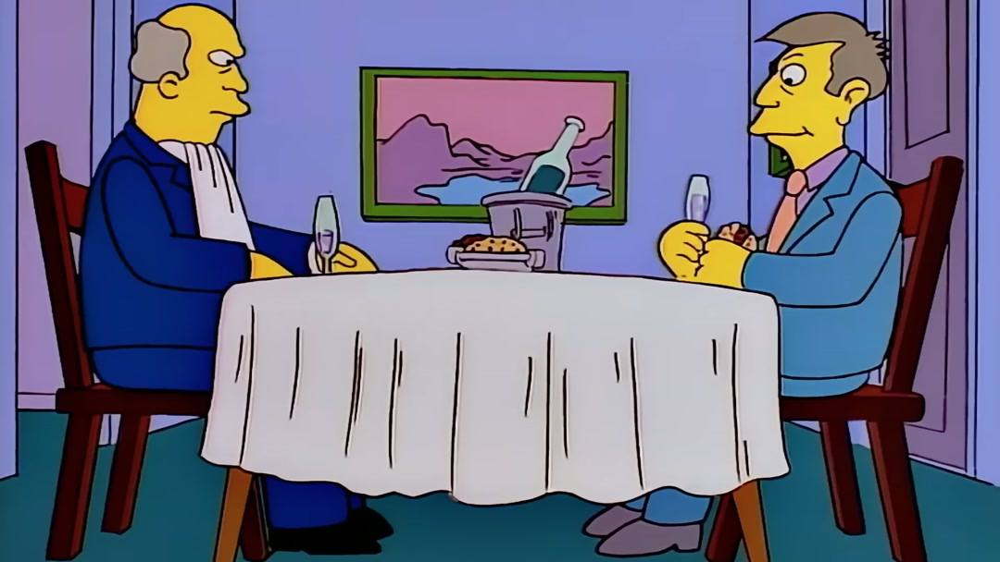 | 1:38.2 | 1.3s | set the mood: Reset the geography and let them e… | Wide profile two-shot across the table: … | static | graphic | 2D animation 70% | to confirm | AI generation (2D animation) · G18 |
| 34 | 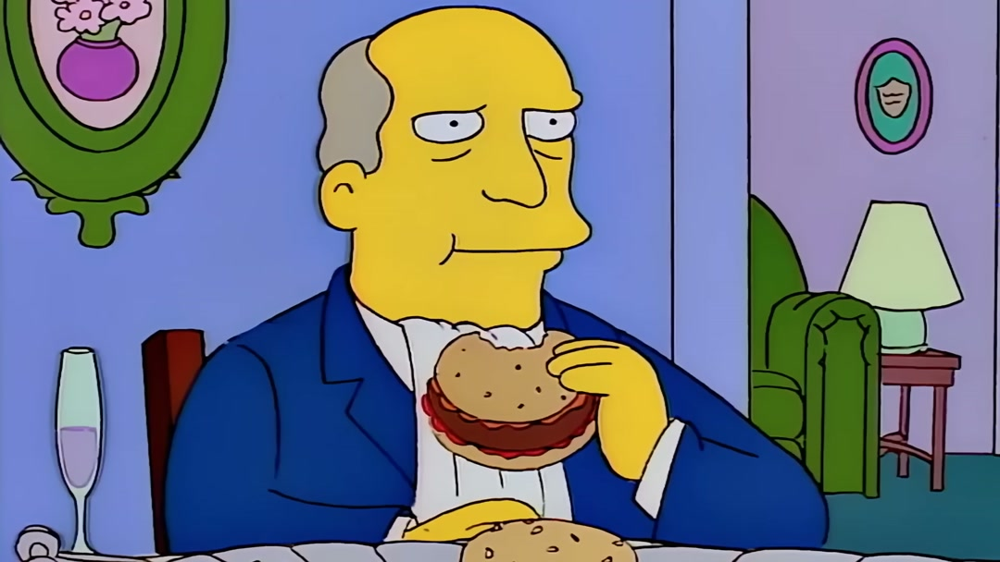 | 1:39.5 | 4.2s | turn: A second line of attack: the food itself i… | Chalmers holds the burger and examines i… | static | graphic | 2D animation 70% | to confirm | AI generation (2D animation) · G18 |
| 35 | 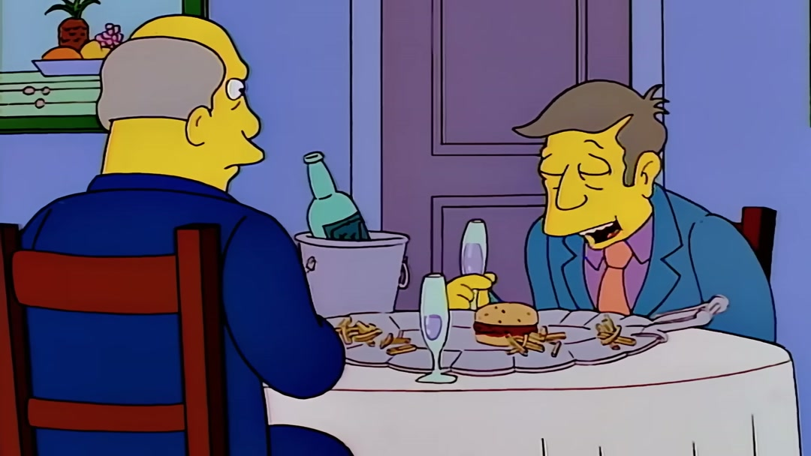 | 1:43.7 | 5.1s | add information: Another instant fabrication | Over Chalmers' shoulder to Skinner acros… | static | text, graphic | 2D animation 70% | to confirm | AI generation (2D animation) · G19 |
| 36 | 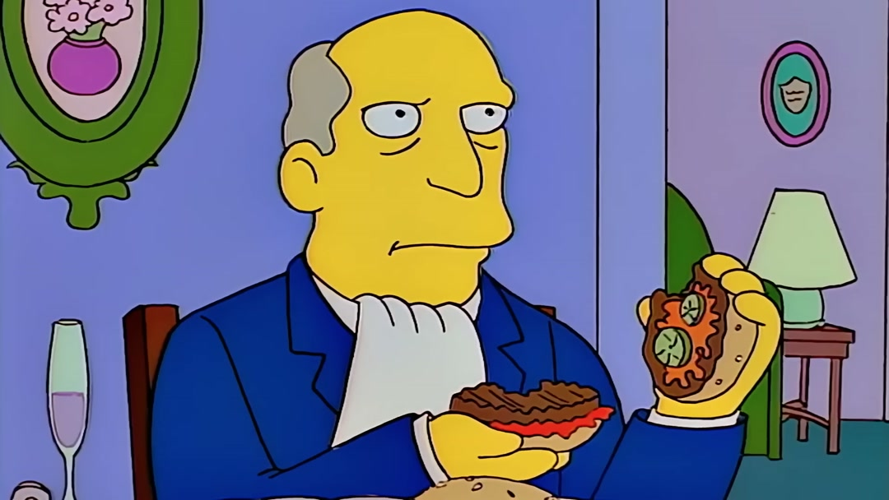 | 1:48.8 | 2.7s | turn: He repeats the made-up word back | Chalmers, burger in hand: 'For steamed h… | static | — | 2D animation 70% | to confirm | AI generation (2D animation) · G19 |
| 37 | 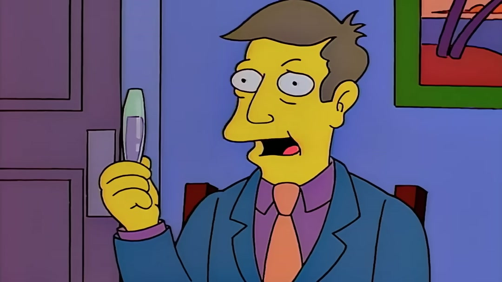 | 1:51.5 | 0.7s | add information: One-word answer played for rhyt… | Skinner: 'Yes.' Very short shot. | static | graphic | 2D animation 70% | to confirm | AI generation (2D animation) · G20 |
| 38 | 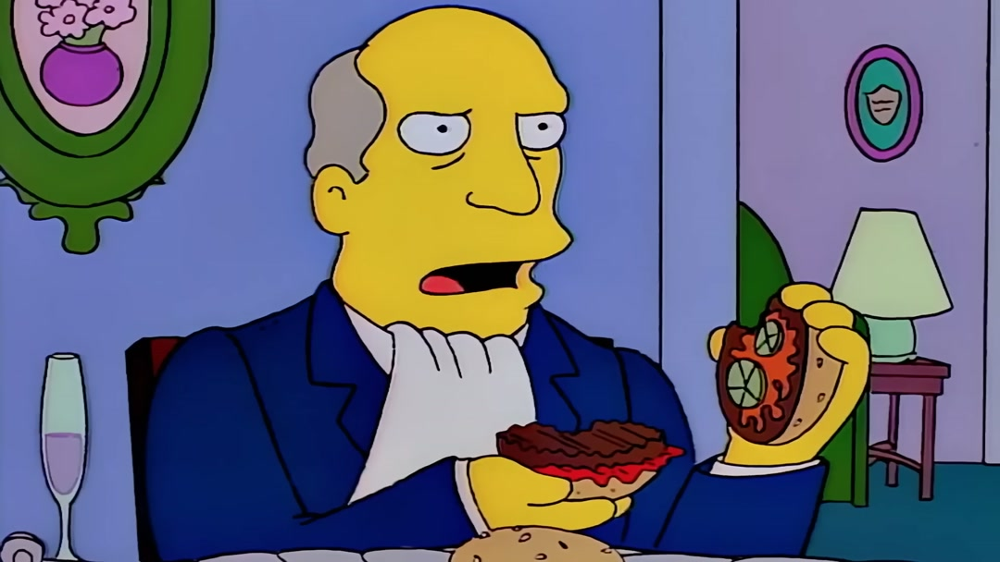 | 1:52.2 | 4.0s | show evidence: Physical proof on screen contradi… | Chalmers lifts the bun to show the patty… | static | graphic | 2D animation 70% | to confirm | AI generation (2D animation) · G20 |
| 39 | 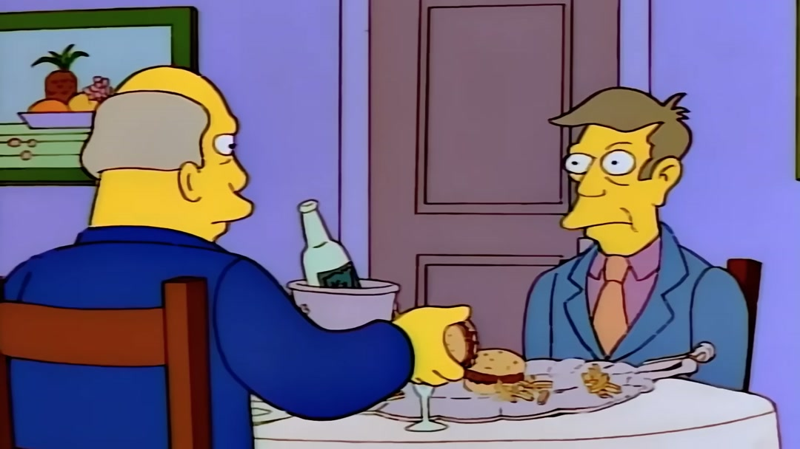 | 1:56.2 | 7.3s | turn: The liar runs out of answers and breaks of… | Over Chalmers' shoulder: Skinner stammer… | static | graphic | 2D animation 70% | to confirm | AI generation (2D animation) · G21 |
| 40 | 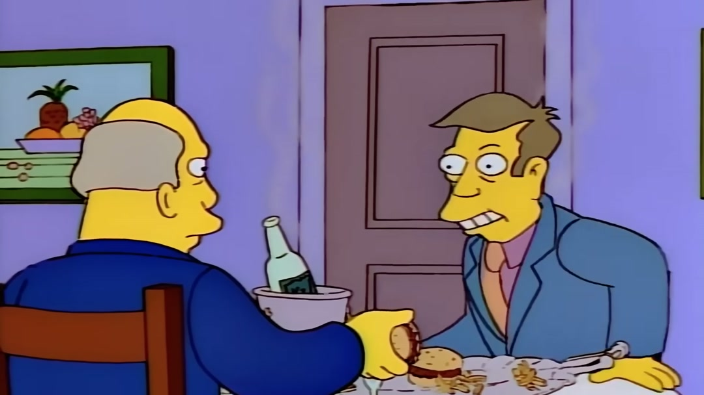 | 2:03.5 | 7.7s | turn: Tries to end the meeting before the proble… | Same side of the table: Skinner steps in… | static | text, graphic | 2D animation 70% | to confirm | AI generation (2D animation) · G22 |
| 41 | 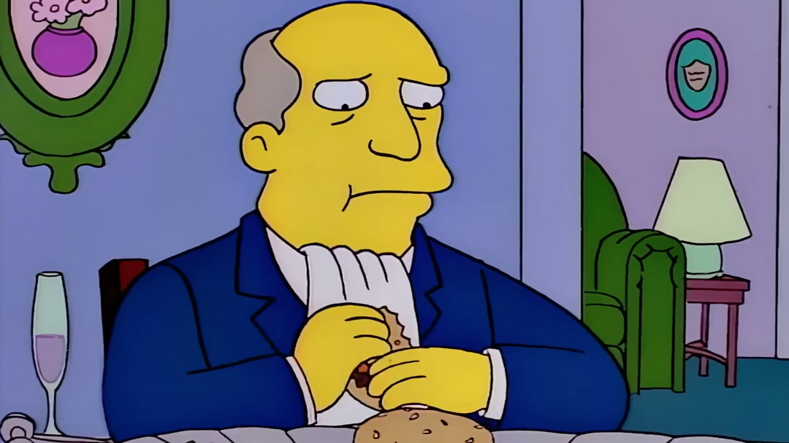 | 2:11.2 | 1.6s | set the mood: The guest starts to leave, which w… | Chalmers pulls off his napkin and stands… | static | graphic | 2D animation 70% | to confirm | AI generation (2D animation) · G23 |
| 42 | 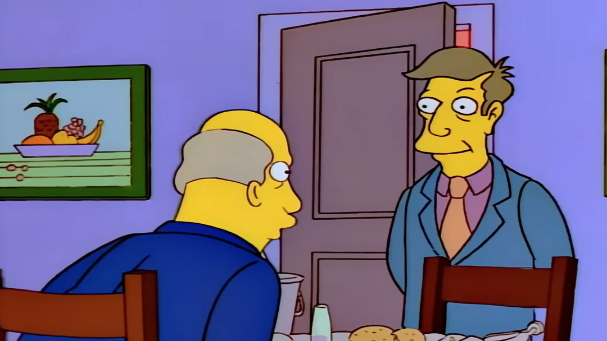 | 2:12.8 | 3.6s | turn: The hidden problem becomes impossible to m… | Two-shot: Chalmers spins and points at t… | static | graphic | 2D animation 70% | to confirm | AI generation (2D animation) · G23 |
| 43 | 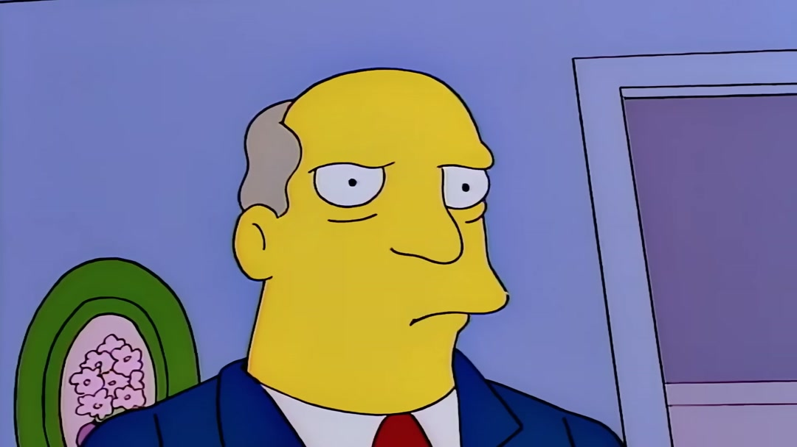 | 2:16.5 | 3.0s | turn: Start of the escalating rebuttal | Close-up of Chalmers: 'Aurora Borealis?!… | static | — | 2D animation 70% | to confirm | AI generation (2D animation) · G24 |
| 44 | 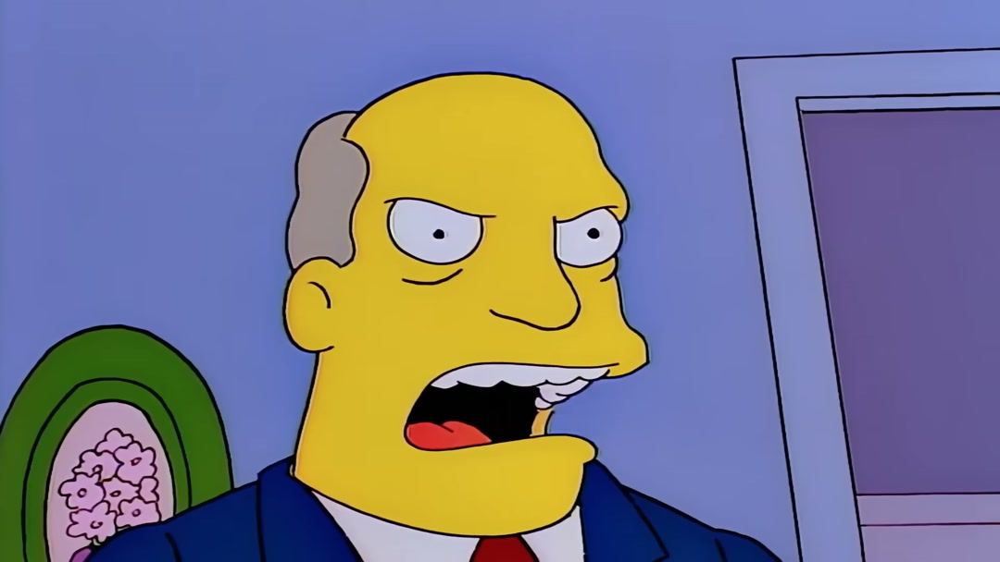 | 2:19.5 | 1.3s | show evidence: List the reasons the lie is impos… | Tighter on Chalmers: 'At this time of ye… | static | — | 2D animation 70% | to confirm | AI generation (2D animation) · G24 |
| 45 | 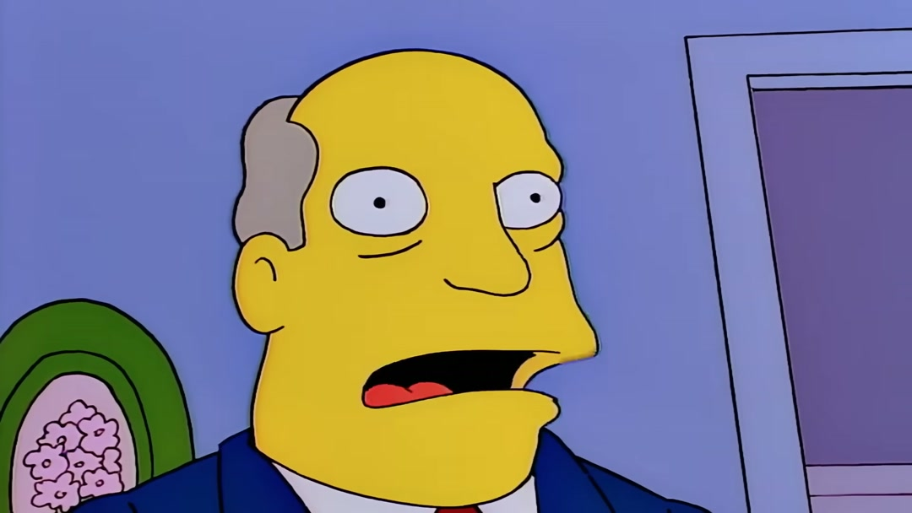 | 2:20.8 | 1.4s | show evidence: Second reason | Chalmers: 'at this time of day,' | static | — | 2D animation 70% | to confirm | AI generation (2D animation) · G24 |
| 46 | 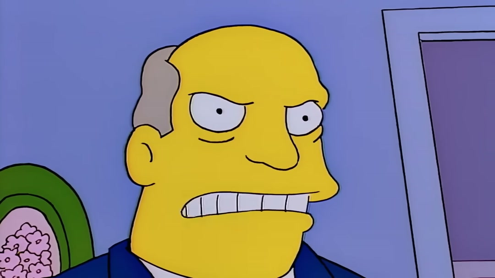 | 2:22.2 | 1.5s | show evidence: Third reason | Chalmers: 'in this part of the country,' | static | text, graphic | 2D animation 70% | to confirm | AI generation (2D animation) · G24 |
| 47 | 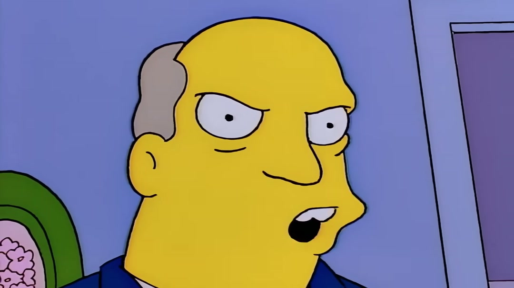 | 2:23.7 | 2.8s | show evidence: Final reason, at peak volume and … | Tightest framing on Chalmers: 'localized… | static | subtitle, graphic | 2D animation 70% | to confirm | AI generation (2D animation) · G25 |
| 48 | 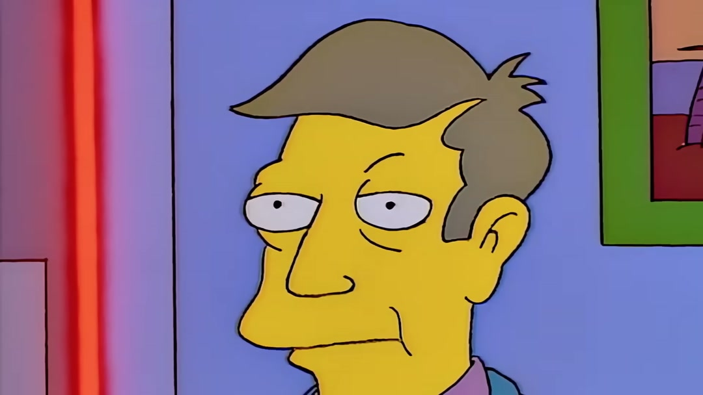 | 2:26.5 | 0.9s | deliver the conclusion: A flat one-word confirma… | Close-up of Skinner with a red glow alon… | static (subject moves) | graphic | 2D animation 70% | to confirm | AI generation (2D animation) · G25 |
| 49 | 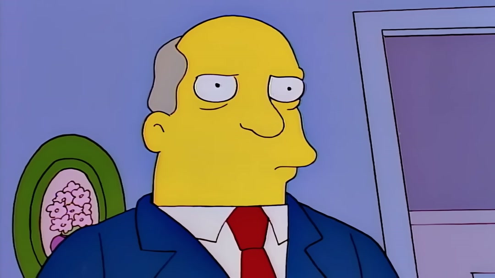 | 2:27.4 | 2.0s | turn: The accuser gives in and asks to share the… | Chalmers, anger gone: 'May I see it?' | static | graphic | 2D animation 70% | to confirm | AI generation (2D animation) · G25 |
| 50 | 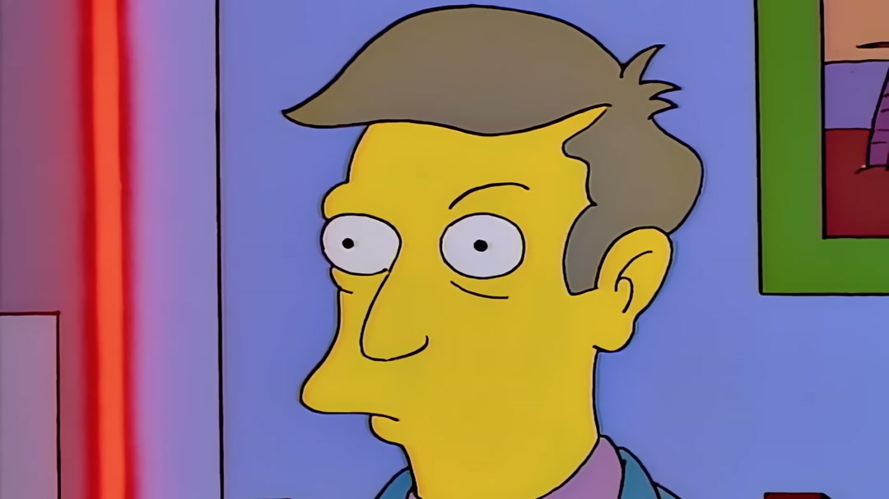 | 2:29.4 | 1.7s | deliver the conclusion: Refusal with no excuse a… | Skinner glances sideways toward the glow… | static | — | 2D animation 70% | to confirm | AI generation (2D animation) · G25 |
| 51 |  | 2:31.1 | 5.5s | turn: A third party states the truth out loud an… | Exterior porch, medium wide: the purple … | static | text, graphic | 2D animation 70% | to confirm | AI generation (2D animation) · G26 |
| 52 |  | 2:36.7 | 5.0s | deliver the conclusion: The authority figure ado… | Outdoor two-shot, houses and sky behind:… | static | text, graphic | 2D animation 70% | to confirm | AI generation (2D animation) · G27 |
| 53 |  | 2:41.7 | 3.6s | deliver the conclusion: Reveal the scale of what… | Porch: Chalmers turns and walks down the… | static | title | 2D animation 70% | to confirm | AI generation (2D animation) · G28 |
| 54 |  | 2:45.2 | 0.6s | set the mood: A last look back | Chalmers from behind, turning his head b… | static (subject moves) | graphic | 2D animation 70% | to confirm | AI generation (2D animation) · G28 |
| 55 |  | 2:45.8 | 0.9s | deliver the conclusion: The closing gesture: kee… | Close-up of Skinner in front of the oran… | static (subject moves) | text, graphic | 2D animation 70% | to confirm | AI generation (2D animation) · G28 |
| 56 |  | 2:46.8 | 2.0s | set the mood: End on the unresolved disaster | Wide from the street: Chalmers walks out… | static | graphic | 2D animation 70% | to confirm | AI generation (2D animation) · G28 |

## Remake it yourself: do it in this order

Copy the method and the rhythm, not the pictures: keep what each part does and fill it with your own content and material.

This is a 3D / animation. Every number in the steps below was measured on the original; follow them and check yours against it.

1. **Write the content**: the original runs in 39 steps (the narrative line under “Content and structure”); write yours in the same order and timing
2. **Collect material**: one reference image per character, the same one in every shot: Skinner (the host, 'Seymour'), Chalmers (the superintendent), The host's mother (voice only)
3. **Generate**: 28 generation units, 28 calls to Seedance 2.0; each unit's prompt, input images and how it joins the last are under “AI generation” below. Paste them into the model's web page by hand, or have the agent run them through capsule-cinema (paid per call; it does a dry run first to show the jobs and cost)
4. **Voice**: the original is TTS voice-over; 53 lines in the script table under “Sound”, with the pace and pauses of each; delivery per “Acting and emotion”
5. **Edit**: follow the order and lengths in the shot list; the original has 56 shots at 3.0s each; 8 transitions are not hard cuts, see “Edit” below
6. **Subtitles and styled text**: timing and style under “Packaging layer”
7. **Sound effects**: 7, with the time and the picture event each one hits under “Sound”; each can be played first
8. **Put it together and compare**: hand the shots you made to the agent; `rea-video remake` places them on the original timeline, keeps the original where yours are missing, and renders a side-by-side comparison with the original

### What to prepare

- `@图片1` character reference images (one frontal face + one half-body per character) so the look stays consistent across shots: Skinner (the host, 'Seymour'), Chalmers (the superintendent), The host's mother (voice only)

### AI generation

**56 2D animation shots → 28 generation units, 28 Seedance 2.0 calls**

<details class="ref"><summary>Before writing prompts: grouping, the model&#x27;s conventions, what it takes as input</summary>

- Grouping: AI shots in the same scene joined by hard cuts are generated in one call; ≤15s per call; consecutive hard cuts inside a unit preferably ≤8s, at most 10s; split at dissolves / fades and scene changes
- Audio: the model can generate action sound effects and ambience along with the picture; voice-over is better done as separate TTS and mixed in, so copy and timing stay editable
- The prompts below are written generically; before generating with Seedance 2.0, rewrite them the way it expects (timing and shots, how references are addressed, dialogue, exclusions): `rea-video models seedance-2.0`

A video model can take these inputs; each generation unit below lists which ones to feed and where they come from:
- **Text prompt**: always; describes the picture, action and camera
- **First frame**: locks the composition and subject of frame one. Without it this is plain text-to-video and framing changes every time
- **Last frame**: also locks the final frame so the model only fills in between. Suits a single shot with a camera move or action
- **Reference images**: how the product and people look, so they stay the same across shots (`@图片1` in the prompt)
- **Reference video**: copy the action, camera move and rhythm, not the picture (`@视频1`); not every model takes one

</details>

One generation per unit. The table lists what to feed the model; open a unit for where each input comes from and the prompt.

| Unit | Shots | Time | Duration | Mode | Feed | Continuity |
|---|---|---|---|---|---|---|
| G1 | #1 | 0.0–1.9s | 1.9s | single shot | first frame + reference image + reference video | — |
| G2 | #2 | 1.9–3.0s | 1.1s | single shot | first frame + reference image + reference video | — |
| G3 | #3 | 3.0–6.7s | 3.7s | single shot | first frame + reference image + reference video | — |
| G4 | #4 | 6.7–12.0s | 5.3s | single shot | first frame + reference image + reference video | — |
| G5 | #5 | 12.0–13.3s | 1.3s | single shot | first frame + reference image + reference video | — |
| G6 | #6–#8 | 13.3–15.6s | 2.3s | multi-shot | first frame + reference image + reference video | — |
| G7 | #9–#10 | 15.6–20.2s | 4.6s | multi-shot | first frame + reference image + reference video | — |
| G8 | #11 | 20.2–30.8s | 10.6s | single shot | first frame + reference image + reference video | — |
| G9 | #12–#14 | 30.8–34.4s | 3.6s | multi-shot | first frame + reference image + reference video | first frame = last frame of G8, continue the action |
| G10 | #15 | 34.4–49.2s | 14.8s | single shot | first frame + reference image + reference video | — |
| G11 | #16–#18 | 49.2–57.8s | 8.6s | multi-shot | first frame + reference image + reference video | — |
| G12 | #19 | 57.8–65.1s | 7.3s | single shot | first frame + reference image + reference video | first frame = last frame of G11, continue the action |
| G13 | #20–#22 | 65.1–70.3s | 5.3s | multi-shot | first frame + reference image + reference video | first frame = last frame of G12, continue the action |
| G14 | #23–#24 | 70.3–76.9s | 6.5s | multi-shot | first frame + reference image + reference video | — |
| G15 | #25–#26 | 76.9–83.7s | 6.8s | multi-shot | first frame + reference image + reference video | first frame = last frame of G14, continue the action |
| G16 | #27–#29 | 83.7–89.5s | 5.8s | multi-shot | first frame + reference image + reference video | first frame = last frame of G15, continue the action |
| G17 | #30–#31 | 89.5–97.2s | 7.7s | multi-shot | first frame + reference image + reference video | first frame = last frame of G16, continue the action |
| G18 | #32–#34 | 97.2–103.7s | 6.5s | multi-shot | first frame + reference image + reference video | first frame = last frame of G17, continue the action |
| G19 | #35–#36 | 103.7–111.5s | 7.8s | multi-shot | first frame + reference image + reference video | first frame = last frame of G18, continue the action |
| G20 | #37–#38 | 111.5–116.2s | 4.6s | multi-shot | first frame + reference image + reference video | first frame = last frame of G19, continue the action |
| G21 | #39 | 116.2–123.5s | 7.3s | single shot | first frame + reference image + reference video | first frame = last frame of G20, continue the action |
| G22 | #40 | 123.5–131.2s | 7.7s | single shot | first frame + reference image + reference video | — |
| G23 | #41–#42 | 131.2–136.5s | 5.3s | multi-shot | first frame + reference image + reference video | first frame = last frame of G22, continue the action |
| G24 | #43–#46 | 136.5–143.7s | 7.3s | multi-shot | first frame + reference image + reference video | first frame = last frame of G23, continue the action |
| G25 | #47–#50 | 143.7–151.1s | 7.4s | multi-shot | first frame + reference image + reference video | first frame = last frame of G24, continue the action |
| G26 | #51 | 151.1–156.7s | 5.5s | single shot | first frame + reference image + reference video | — |
| G27 | #52 | 156.7–161.7s | 5.0s | single shot | first frame + reference image + reference video | first frame = last frame of G26, continue the action |
| G28 | #53–#56 | 161.7–168.8s | 7.1s | multi-shot | first frame + reference image + reference video | first frame = last frame of G27, continue the action |

<details><summary>G1 · shots #1 · 1.9s · multi-reference generation</summary>

| Input | Needed | From | Why |
|---|---|---|---|
| text prompt | yes | see the prompt below | describes picture, action and camera; every other input only constrains it |
| first frame | worth it | source frame `shots/shot_001_first.jpg` (to change product, person or style, redraw it with an image model from the first-frame prompt below); this model takes frame inputs or references, not both: pass it as one more reference image and write “@图片2 as the first frame” in the prompt (Jimeng's omni-reference accepts this; most APIs do not, drop it if refused) | locks composition, shot size and subject position; with text alone every generation frames it differently |
| last frame | no | — | this unit uses references to keep the product and people; the model takes no last frame alongside them |
| reference image | yes | `@图片1` character reference images (one frontal face + one half-body per character) so the look stays consistent across shots | the first frame only fixes frame one; reference images keep the product and people consistent after it |
| reference video | worth it | `@视频1` source clip 0.0–1.9s | follow the action, camera move and cutting rhythm; reference only, the picture is not copied |

- Generate 4s and trim to 1.9s (very short shots are unstable when generated on their own)
- Alternative: a 2D animation project. Split the character into layers and rig it in Live2D / Spine, or animate in After Effects; simple flat-style animation can also be Lottie / Canvas code written by an LLM. More controllable than a video model when lip sync and motion must be frame-accurate (R19)

```text
Horizontal 16:9. Characters follow @图片1. Follow the action, camera movement and cutting rhythm of @视频1.
Wide exterior establishing shot of a two-storey suburban house; a small figure in a blue suit (Chalmers) stands at the front door and rings the bell. Locked-off camera.
```

</details>

<details><summary>G2 · shots #2 · 1.1s · multi-reference generation</summary>

| Input | Needed | From | Why |
|---|---|---|---|
| text prompt | yes | see the prompt below | describes picture, action and camera; every other input only constrains it |
| first frame | worth it | source frame `shots/shot_002_first.jpg` (to change product, person or style, redraw it with an image model from the first-frame prompt below); this model takes frame inputs or references, not both: pass it as one more reference image and write “@图片2 as the first frame” in the prompt (Jimeng's omni-reference accepts this; most APIs do not, drop it if refused) | locks composition, shot size and subject position; with text alone every generation frames it differently |
| last frame | no | — | this unit uses references to keep the product and people; the model takes no last frame alongside them |
| reference image | yes | `@图片1` character reference images (one frontal face + one half-body per character) so the look stays consistent across shots | the first frame only fixes frame one; reference images keep the product and people consistent after it |
| reference video | worth it | `@视频1` source clip 1.9–3.0s | follow the action, camera move and cutting rhythm; reference only, the picture is not copied |

- Generate 4s and trim to 1.1s (very short shots are unstable when generated on their own)
- Alternative: a 2D animation project. Split the character into layers and rig it in Live2D / Spine, or animate in After Effects; simple flat-style animation can also be Lottie / Canvas code written by an LLM. More controllable than a video model when lip sync and motion must be frame-accurate (R19)
- Acting #2: nervous (light) · eyes wide, mouth closed (expression in the first frame, see “Acting and emotion”)

```text
Horizontal 16:9. Characters follow @图片1. Follow the action, camera movement and cutting rhythm of @视频1.
Interior, medium shot: Skinner in a white apron over a blue suit walks left to a purple front door and opens it; the visitor's dark suit appears in the gap. Static camera.Acting (very subtle, barely visible): eyes wide, mouth closed; walks to the door, hand on the knob
```

</details>

<details><summary>G3 · shots #3 · 3.7s · multi-reference generation</summary>

| Input | Needed | From | Why |
|---|---|---|---|
| text prompt | yes | see the prompt below | describes picture, action and camera; every other input only constrains it |
| first frame | worth it | source frame `shots/shot_003_first.jpg` (to change product, person or style, redraw it with an image model from the first-frame prompt below); this model takes frame inputs or references, not both: pass it as one more reference image and write “@图片2 as the first frame” in the prompt (Jimeng's omni-reference accepts this; most APIs do not, drop it if refused) | locks composition, shot size and subject position; with text alone every generation frames it differently |
| last frame | no | — | this unit uses references to keep the product and people; the model takes no last frame alongside them |
| reference image | yes | `@图片1` character reference images (one frontal face + one half-body per character) so the look stays consistent across shots | the first frame only fixes frame one; reference images keep the product and people consistent after it |
| reference video | worth it | `@视频1` source clip 3.0–6.7s | follow the action, camera move and cutting rhythm; reference only, the picture is not copied |

- Alternative: a 2D animation project. Split the character into layers and rig it in Live2D / Spine, or animate in After Effects; simple flat-style animation can also be Lottie / Canvas code written by an LLM. More controllable than a video model when lip sync and motion must be frame-accurate (R19)
- Acting #3: annoyed (light) · half-lidded eyes, brow low, speaks through clenched teeth (voice first, then drive, see “Acting and emotion”)

```text
Horizontal 16:9. Characters follow @图片1. Follow the action, camera movement and cutting rhythm of @视频1.
Close-up of Chalmers in the doorway against the street of houses. Line: 'Well, Seymour, I made it, despite your directions.'. Acting (very subtle, barely visible): half-lidded eyes, brow low, speaks through clenched teeth; head still, body square to the door
```

</details>

<details><summary>G4 · shots #4 · 5.3s · multi-reference generation</summary>

| Input | Needed | From | Why |
|---|---|---|---|
| text prompt | yes | see the prompt below | describes picture, action and camera; every other input only constrains it |
| first frame | worth it | source frame `shots/shot_004_first.jpg` (to change product, person or style, redraw it with an image model from the first-frame prompt below); this model takes frame inputs or references, not both: pass it as one more reference image and write “@图片2 as the first frame” in the prompt (Jimeng's omni-reference accepts this; most APIs do not, drop it if refused) | locks composition, shot size and subject position; with text alone every generation frames it differently |
| last frame | no | — | this unit uses references to keep the product and people; the model takes no last frame alongside them |
| reference image | yes | `@图片1` character reference images (one frontal face + one half-body per character) so the look stays consistent across shots | the first frame only fixes frame one; reference images keep the product and people consistent after it |
| reference video | worth it | `@视频1` source clip 6.7–12.0s | follow the action, camera move and cutting rhythm; reference only, the picture is not copied |

- Alternative: a 2D animation project. Split the character into layers and rig it in Live2D / Spine, or animate in After Effects; simple flat-style animation can also be Lottie / Canvas code written by an LLM. More controllable than a video model when lip sync and motion must be frame-accurate (R19)
- Acting #4: eager (medium) · wide eyes, big open smile, eyebrows up (voice first, then drive, see “Acting and emotion”)

```text
Horizontal 16:9. Characters follow @图片1. Follow the action, camera movement and cutting rhythm of @视频1.
Two-shot on the doorstep: Chalmers holds a bottle tied with a red ribbon; Skinner in apron greets him ('Ah, Superintendent Chalmers, welcome! I hope you're prepared for an unforgettable luncheon'); Chalmers grunts and walks in past him.Acting (moderate, not exaggerated): wide eyes, big open smile, eyebrows up; leans toward the guest, then steps aside
```

</details>

<details><summary>G5 · shots #5 · 1.3s · multi-reference generation</summary>

| Input | Needed | From | Why |
|---|---|---|---|
| text prompt | yes | see the prompt below | describes picture, action and camera; every other input only constrains it |
| first frame | worth it | source frame `shots/shot_005_first.jpg` (to change product, person or style, redraw it with an image model from the first-frame prompt below); this model takes frame inputs or references, not both: pass it as one more reference image and write “@图片2 as the first frame” in the prompt (Jimeng's omni-reference accepts this; most APIs do not, drop it if refused) | locks composition, shot size and subject position; with text alone every generation frames it differently |
| last frame | no | — | this unit uses references to keep the product and people; the model takes no last frame alongside them |
| reference image | yes | `@图片1` character reference images (one frontal face + one half-body per character) so the look stays consistent across shots | the first frame only fixes frame one; reference images keep the product and people consistent after it |
| reference video | worth it | `@视频1` source clip 12.0–13.3s | follow the action, camera move and cutting rhythm; reference only, the picture is not copied |

- Generate 4s and trim to 1.3s (very short shots are unstable when generated on their own)
- Alternative: a 2D animation project. Split the character into layers and rig it in Live2D / Spine, or animate in After Effects; simple flat-style animation can also be Lottie / Canvas code written by an LLM. More controllable than a video model when lip sync and motion must be frame-accurate (R19)
- Acting #5: calm (light) · neutral (expression in the first frame, see “Acting and emotion”)

```text
Horizontal 16:9. Characters follow @图片1. Follow the action, camera movement and cutting rhythm of @视频1.
Dining room, wide: table with white cloth and ice bucket, framed picture on the wall. Chalmers puts the bottle in the bucket and sits; Skinner slips out through the kitchen door in the background.Acting (very subtle, barely visible): neutral; sets bottle in bucket, pulls out chair and sits
```

</details>

<details><summary>G6 · shots #6–#8 · 2.3s · multi-reference generation</summary>

| Input | Needed | From | Why |
|---|---|---|---|
| text prompt | yes | see the prompt below | describes picture, action and camera; every other input only constrains it |
| first frame | worth it | source frame `shots/shot_006_first.jpg` (to change product, person or style, redraw it with an image model from the first-frame prompt below); this model takes frame inputs or references, not both: pass it as one more reference image and write “@图片2 as the first frame” in the prompt (Jimeng's omni-reference accepts this; most APIs do not, drop it if refused) | locks composition, shot size and subject position; with text alone every generation frames it differently |
| last frame | no | — | several shots in one call; a last frame would only constrain the final shot |
| reference image | yes | `@图片1` character reference images (one frontal face + one half-body per character) so the look stays consistent across shots | the first frame only fixes frame one; reference images keep the product and people consistent after it |
| reference video | worth it | `@视频1` source clip 13.3–15.6s | follow the action, camera move and cutting rhythm; reference only, the picture is not copied |

- Generate 4s and trim to 2.3s (very short shots are unstable when generated on their own)
- Alternative: a 2D animation project. Split the character into layers and rig it in Live2D / Spine, or animate in After Effects; simple flat-style animation can also be Lottie / Canvas code written by an LLM. More controllable than a video model when lip sync and motion must be frame-accurate (R19)
- Acting #8 (key): shock (strong) · eyes shut then pop wide, mouth drops open (voice first, then drive, see “Acting and emotion”)

```text
Horizontal 16:9. Characters follow @图片1. Follow the action, camera movement and cutting rhythm of @视频1. Hard cuts between shots.
Shot 1 (0.0–0.4s): Insert: Skinner's arm pushes the kitchen door open and the kitchen comes into view with grey smoke rising from the stove under the window.
Shot 2 (0.4–1.3s): Insert on the white oven, smoke pouring from the top and door seams. No characters.
Shot 3 (1.3–2.3s): Close-up reaction: Skinner's eyes close, then snap wide with an open-mouthed gasp; he darts out of the right edge of frame.Acting (openly expressed, features stay natural): eyes shut then pop wide, mouth drops open; freezes, then bolts out of frame
```

</details>

<details><summary>G7 · shots #9, #10 · 4.6s · multi-reference generation</summary>

| Input | Needed | From | Why |
|---|---|---|---|
| text prompt | yes | see the prompt below | describes picture, action and camera; every other input only constrains it |
| first frame | worth it | source frame `shots/shot_009_first.jpg` (to change product, person or style, redraw it with an image model from the first-frame prompt below); this model takes frame inputs or references, not both: pass it as one more reference image and write “@图片2 as the first frame” in the prompt (Jimeng's omni-reference accepts this; most APIs do not, drop it if refused) | locks composition, shot size and subject position; with text alone every generation frames it differently |
| last frame | no | — | several shots in one call; a last frame would only constrain the final shot |
| reference image | yes | `@图片1` character reference images (one frontal face + one half-body per character) so the look stays consistent across shots | the first frame only fixes frame one; reference images keep the product and people consistent after it |
| reference video | worth it | `@视频1` source clip 15.6–20.2s | follow the action, camera move and cutting rhythm; reference only, the picture is not copied |

- Alternative: a 2D animation project. Split the character into layers and rig it in Live2D / Spine, or animate in After Effects; simple flat-style animation can also be Lottie / Canvas code written by an LLM. More controllable than a video model when lip sync and motion must be frame-accurate (R19)
- Acting #9 (key): dismay (strong) · wide eyes fixed on the roast, mouth open (voice first, then drive, see “Acting and emotion”)
- Acting #10: anxious (medium) · brow knotted, eyes darting (voice first, then drive, see “Acting and emotion”)

```text
Horizontal 16:9. Characters follow @图片1. Follow the action, camera movement and cutting rhythm of @视频1. Hard cuts between shots.
Shot 1 (0.0–2.1s): Point of view from inside the oven: black frame, the door opens, Skinner's face peers in through smoke at the roast, which bursts into flames. Line: 'Oh, egads! My roast is ruined!'. Acting (openly expressed, features stay natural): wide eyes fixed on the roast, mouth open; leaning in to the oven
Shot 2 (2.1–4.6s): Kitchen medium shot: Skinner beside the smoking stove claps a hand to his head, bites his nails, then turns to the window. Line: 'But what if...'. Acting (moderate, not exaggerated): brow knotted, eyes darting; hand on head, then fingers to mouth, turns to window
```

</details>

<details><summary>G8 · shots #11 · 10.6s · multi-reference generation</summary>

| Input | Needed | From | Why |
|---|---|---|---|
| text prompt | yes | see the prompt below | describes picture, action and camera; every other input only constrains it |
| first frame | worth it | source frame `shots/shot_011_first.jpg` (to change product, person or style, redraw it with an image model from the first-frame prompt below); this model takes frame inputs or references, not both: pass it as one more reference image and write “@图片2 as the first frame” in the prompt (Jimeng's omni-reference accepts this; most APIs do not, drop it if refused) | locks composition, shot size and subject position; with text alone every generation frames it differently |
| last frame | no | — | this unit uses references to keep the product and people; the model takes no last frame alongside them |
| reference image | yes | `@图片1` character reference images (one frontal face + one half-body per character) so the look stays consistent across shots | the first frame only fixes frame one; reference images keep the product and people consistent after it |
| reference video | worth it | `@视频1` source clip 20.2–30.8s | follow the action, camera move and cutting rhythm; reference only, the picture is not copied |

- Alternative: a 2D animation project. Split the character into layers and rig it in Live2D / Spine, or animate in After Effects; simple flat-style animation can also be Lottie / Canvas code written by an LLM. More controllable than a video model when lip sync and motion must be frame-accurate (R19)
- Acting #11 (key): smug (medium) · eyes narrow, one brow drops, sly smirk, thumb to chin (voice first, then drive, see “Acting and emotion”)

```text
Horizontal 16:9. Characters follow @图片1. Follow the action, camera movement and cutting rhythm of @视频1.
Over-the-shoulder at the kitchen window: a Krusty Burger restaurant across the road. The camera slowly pushes in and re-frames onto Skinner's face as he plots: '...I were to purchase fast food and disguise it as my own cooking? Ho ho ho, delightfully devilish, Seymour.'. Acting (moderate, not exaggerated): eyes narrow, one brow drops, sly smirk, thumb to chin; turns from window toward camera
```

</details>

<details><summary>G9 · shots #12–#14 · 3.6s · multi-reference generation</summary>

| Input | Needed | From | Why |
|---|---|---|---|
| text prompt | yes | see the prompt below | describes picture, action and camera; every other input only constrains it |
| first frame | worth it | the last frame of G8's result; this model takes frame inputs or references, not both: pass it as one more reference image and write “@图片2 as the first frame” in the prompt (Jimeng's omni-reference accepts this; most APIs do not, drop it if refused) | hard cut from the previous unit in the same scene; matching the first frame keeps it from jumping |
| last frame | no | — | several shots in one call; a last frame would only constrain the final shot |
| reference image | yes | `@图片1` character reference images (one frontal face + one half-body per character) so the look stays consistent across shots | the first frame only fixes frame one; reference images keep the product and people consistent after it |
| reference video | worth it | `@视频1` source clip 30.8–34.4s | follow the action, camera move and cutting rhythm; reference only, the picture is not copied |

- Alternative: a 2D animation project. Split the character into layers and rig it in Live2D / Spine, or animate in After Effects; simple flat-style animation can also be Lottie / Canvas code written by an LLM. More controllable than a video model when lip sync and motion must be frame-accurate (R19)
- Acting #12: hurried (medium) · determined (expression in the first frame, see “Acting and emotion”)
- Acting #13: alarm (medium) · eyes wide, hand to mouth (expression in the first frame, see “Acting and emotion”)
- Acting #14 (key): suspicious (light) · eyes wide then narrowing to slits, mouth flat (expression in the first frame, see “Acting and emotion”)

```text
Horizontal 16:9. Characters follow @图片1. Follow the action, camera movement and cutting rhythm of @视频1. Hard cuts between shots.
Shot 1 (0.0–1.0s): Wide kitchen: Skinner whips off the apron, drops it by the stove and starts climbing through the open window.Acting (moderate, not exaggerated): determined; pulls off apron, swings a leg over the sill
Shot 2 (1.0–2.4s): Seen through the kitchen doorway past Skinner's raised leg: the door opens and Chalmers walks in, catching him half out of the window.Acting (moderate, not exaggerated): eyes wide, hand to mouth; frozen with one leg on the sill
Shot 3 (2.4–3.6s): Close-up of Chalmers staring; his eyes slowly narrow. Held beat with no dialogue.Acting (very subtle, barely visible): eyes wide then narrowing to slits, mouth flat; motionless
```

</details>

<details><summary>G10 · shots #15 · 14.8s · multi-reference generation</summary>

| Input | Needed | From | Why |
|---|---|---|---|
| text prompt | yes | see the prompt below | describes picture, action and camera; every other input only constrains it |
| first frame | worth it | source frame `shots/shot_015_first.jpg` (to change product, person or style, redraw it with an image model from the first-frame prompt below); this model takes frame inputs or references, not both: pass it as one more reference image and write “@图片2 as the first frame” in the prompt (Jimeng's omni-reference accepts this; most APIs do not, drop it if refused) | locks composition, shot size and subject position; with text alone every generation frames it differently |
| last frame | no | — | this unit uses references to keep the product and people; the model takes no last frame alongside them |
| reference image | yes | `@图片1` character reference images (one frontal face + one half-body per character) so the look stays consistent across shots | the first frame only fixes frame one; reference images keep the product and people consistent after it |
| reference video | worth it | `@视频1` source clip 34.4–49.2s | follow the action, camera move and cutting rhythm; reference only, the picture is not copied |

- Alternative: a 2D animation project. Split the character into layers and rig it in Live2D / Spine, or animate in After Effects; simple flat-style animation can also be Lottie / Canvas code written by an LLM. More controllable than a video model when lip sync and motion must be frame-accurate (R19)
- Acting #15 (key): angry (strong) · mouth wide open shouting in the final frame (voice first, then drive, see “Acting and emotion”)

```text
Horizontal 16:9. Characters follow @图片1. Follow the action, camera movement and cutting rhythm of @视频1.
Sitcom-opening parody. A painted title card reads 'Skinner & the Superintendent' with caricatures of both men; the camera pulls back to show it is a framed picture on woven brown wallpaper, then pans across more framed pictures, each a small animated vignette of the two characters (office, school corridor, a man knocked flat, snakes), while a jingle is sung. It ends by pushing into the last frame, which becomes Chalmers shouting 'Seymour!'. One continuous multiplane move, no hard cut. All lettering is painted artwork inside the picture, not an added overlay.Acting (openly expressed, features stay natural): mouth wide open shouting in the final frame; vignette poses
```

</details>

<details><summary>G11 · shots #16–#18 · 8.6s · multi-reference generation</summary>

| Input | Needed | From | Why |
|---|---|---|---|
| text prompt | yes | see the prompt below | describes picture, action and camera; every other input only constrains it |
| first frame | worth it | source frame `shots/shot_016_first.jpg` (to change product, person or style, redraw it with an image model from the first-frame prompt below); this model takes frame inputs or references, not both: pass it as one more reference image and write “@图片2 as the first frame” in the prompt (Jimeng's omni-reference accepts this; most APIs do not, drop it if refused) | locks composition, shot size and subject position; with text alone every generation frames it differently |
| last frame | no | — | several shots in one call; a last frame would only constrain the final shot |
| reference image | yes | `@图片1` character reference images (one frontal face + one half-body per character) so the look stays consistent across shots | the first frame only fixes frame one; reference images keep the product and people consistent after it |
| reference video | worth it | `@视频1` source clip 49.2–57.8s | follow the action, camera move and cutting rhythm; reference only, the picture is not copied |

- Alternative: a 2D animation project. Split the character into layers and rig it in Live2D / Spine, or animate in After Effects; simple flat-style animation can also be Lottie / Canvas code written by an LLM. More controllable than a video model when lip sync and motion must be frame-accurate (R19)
- Acting #16: startled (strong) · eyes round, mouth small 'o' then gritted teeth (voice first, then drive, see “Acting and emotion”)
- Acting #17 (key): bluffing (medium) · forced grin (voice first, then drive, see “Acting and emotion”)
- Acting #18: suspicious (medium) · half-lidded, brow low (voice first, then drive, see “Acting and emotion”)

```text
Horizontal 16:9. Characters follow @图片1. Follow the action, camera movement and cutting rhythm of @视频1. Hard cuts between shots.
Shot 1 (0.0–1.5s): Close-up of Skinner at the window, startled: 'Superintendent!'. Acting (openly expressed, features stay natural): eyes round, mouth small 'o' then gritted teeth; head whips round
Shot 2 (1.5–5.9s): Over Chalmers' shoulder (dark-suited back fills the left foreground): Skinner pumps his leg on the windowsill beside the smoking stove. Line: 'I was just, uh, stretching my calves on the windowsill. Isometric exercise! Care to join me?'. Acting (moderate, not exaggerated): forced grin; bobs up and down on the raised leg, gestures an invitation
Shot 3 (5.9–8.6s): Medium close-up of Chalmers at the kitchen door; he raises an arm and points: 'Why is there smoke coming out of your oven, Seymour?'. Acting (moderate, not exaggerated): half-lidded, brow low; points off-screen with a straight arm
```

</details>

<details><summary>G12 · shots #19 · 7.3s · multi-reference generation</summary>

| Input | Needed | From | Why |
|---|---|---|---|
| text prompt | yes | see the prompt below | describes picture, action and camera; every other input only constrains it |
| first frame | worth it | the last frame of G11's result; this model takes frame inputs or references, not both: pass it as one more reference image and write “@图片2 as the first frame” in the prompt (Jimeng's omni-reference accepts this; most APIs do not, drop it if refused) | hard cut from the previous unit in the same scene; matching the first frame keeps it from jumping |
| last frame | no | — | this unit uses references to keep the product and people; the model takes no last frame alongside them |
| reference image | yes | `@图片1` character reference images (one frontal face + one half-body per character) so the look stays consistent across shots | the first frame only fixes frame one; reference images keep the product and people consistent after it |
| reference video | worth it | `@视频1` source clip 57.8–65.1s | follow the action, camera move and cutting rhythm; reference only, the picture is not copied |

- Alternative: a 2D animation project. Split the character into layers and rig it in Live2D / Spine, or animate in After Effects; simple flat-style animation can also be Lottie / Canvas code written by an LLM. More controllable than a video model when lip sync and motion must be frame-accurate (R19)
- Acting #19 (key): bluffing (medium) · eyes shut then wide, toothy grin (voice first, then drive, see “Acting and emotion”)

```text
Horizontal 16:9. Characters follow @图片1. Follow the action, camera movement and cutting rhythm of @视频1.
Skinner beside the smoking stove, window behind: 'Uh... ooh! That isn't smoke, it's steam! Steam from the steamed clams we're having. Mmm, steamed clams!' He rubs his stomach. Slight camera drift.Acting (moderate, not exaggerated): eyes shut then wide, toothy grin; gestures at the stove, rubs belly
```

</details>

<details><summary>G13 · shots #20–#22 · 5.3s · multi-reference generation</summary>

| Input | Needed | From | Why |
|---|---|---|---|
| text prompt | yes | see the prompt below | describes picture, action and camera; every other input only constrains it |
| first frame | worth it | the last frame of G12's result; this model takes frame inputs or references, not both: pass it as one more reference image and write “@图片2 as the first frame” in the prompt (Jimeng's omni-reference accepts this; most APIs do not, drop it if refused) | hard cut from the previous unit in the same scene; matching the first frame keeps it from jumping |
| last frame | no | — | several shots in one call; a last frame would only constrain the final shot |
| reference image | yes | `@图片1` character reference images (one frontal face + one half-body per character) so the look stays consistent across shots | the first frame only fixes frame one; reference images keep the product and people consistent after it |
| reference video | worth it | `@视频1` source clip 65.1–70.3s | follow the action, camera move and cutting rhythm; reference only, the picture is not copied |

- Alternative: a 2D animation project. Split the character into layers and rig it in Live2D / Spine, or animate in After Effects; simple flat-style animation can also be Lottie / Canvas code written by an LLM. More controllable than a video model when lip sync and motion must be frame-accurate (R19)
- Acting #20: skeptical (light) · narrow eyes, flat mouth (expression in the first frame, see “Acting and emotion”)
- Acting #22: relief (medium) · eyes closed, exhale (voice first, then drive, see “Acting and emotion”)

```text
Horizontal 16:9. Characters follow @图片1. Follow the action, camera movement and cutting rhythm of @视频1. Hard cuts between shots.
Shot 1 (0.0–1.1s): Medium close-up of Chalmers staring, unconvinced, then turning away to leave.Acting (very subtle, barely visible): narrow eyes, flat mouth; slow turn of head and body
Shot 2 (1.1–1.8s): Chalmers' back as he walks out; the purple door swings shut and the frame holds on the closed door.
Shot 3 (1.8–5.3s): Skinner at the window wipes his brow, then dives head-first out of it; the frame holds on the empty window with the Krusty Burger across the road.Acting (moderate, not exaggerated): eyes closed, exhale; wipes forehead, bends and dives through window
```

</details>

<details><summary>G14 · shots #23, #24 · 6.5s · multi-reference generation</summary>

| Input | Needed | From | Why |
|---|---|---|---|
| text prompt | yes | see the prompt below | describes picture, action and camera; every other input only constrains it |
| first frame | worth it | source frame `shots/shot_023_first.jpg` (to change product, person or style, redraw it with an image model from the first-frame prompt below); this model takes frame inputs or references, not both: pass it as one more reference image and write “@图片2 as the first frame” in the prompt (Jimeng's omni-reference accepts this; most APIs do not, drop it if refused) | locks composition, shot size and subject position; with text alone every generation frames it differently |
| last frame | no | — | several shots in one call; a last frame would only constrain the final shot |
| reference image | yes | `@图片1` character reference images (one frontal face + one half-body per character) so the look stays consistent across shots | the first frame only fixes frame one; reference images keep the product and people consistent after it |
| reference video | worth it | `@视频1` source clip 70.3–76.9s | follow the action, camera move and cutting rhythm; reference only, the picture is not copied |

- Alternative: a 2D animation project. Split the character into layers and rig it in Live2D / Spine, or animate in After Effects; simple flat-style animation can also be Lottie / Canvas code written by an LLM. More controllable than a video model when lip sync and motion must be frame-accurate (R19)
- Acting #23: proud (medium) · big grin, slightly out of breath (voice first, then drive, see “Acting and emotion”)
- Acting #24: puzzled (light) · one eye narrowed, brow raised (voice first, then drive, see “Acting and emotion”)

```text
Horizontal 16:9. Characters follow @图片1. Follow the action, camera movement and cutting rhythm of @视频1. Hard cuts between shots.
Shot 1 (0.0–3.8s): Dining room, wide from behind Chalmers: Skinner comes in through the door carrying a silver platter stacked with burgers. Line: 'Superintendent, I hope you're ready for mouthwatering hamburgers!'. Acting (moderate, not exaggerated): big grin, slightly out of breath; carries platter in both hands to the table
Shot 2 (3.8–6.5s): Medium close-up of Chalmers tucking a napkin into his collar, ornate mirror behind: 'I thought we were having steamed clams.'. Acting (very subtle, barely visible): one eye narrowed, brow raised; tucks napkin at the neck
```

</details>

<details><summary>G15 · shots #25, #26 · 6.8s · multi-reference generation</summary>

| Input | Needed | From | Why |
|---|---|---|---|
| text prompt | yes | see the prompt below | describes picture, action and camera; every other input only constrains it |
| first frame | worth it | the last frame of G14's result; this model takes frame inputs or references, not both: pass it as one more reference image and write “@图片2 as the first frame” in the prompt (Jimeng's omni-reference accepts this; most APIs do not, drop it if refused) | hard cut from the previous unit in the same scene; matching the first frame keeps it from jumping |
| last frame | no | — | several shots in one call; a last frame would only constrain the final shot |
| reference image | yes | `@图片1` character reference images (one frontal face + one half-body per character) so the look stays consistent across shots | the first frame only fixes frame one; reference images keep the product and people consistent after it |
| reference video | worth it | `@视频1` source clip 76.9–83.7s | follow the action, camera move and cutting rhythm; reference only, the picture is not copied |

- Alternative: a 2D animation project. Split the character into layers and rig it in Live2D / Spine, or animate in After Effects; simple flat-style animation can also be Lottie / Canvas code written by an LLM. More controllable than a video model when lip sync and motion must be frame-accurate (R19)
- Acting #25 (key): bluffing (medium) · wide smile, eyes flick to the guest (voice first, then drive, see “Acting and emotion”)
- Acting #26: skeptical (light) · half-lidded, brow up (voice first, then drive, see “Acting and emotion”)

```text
Horizontal 16:9. Characters follow @图片1. Follow the action, camera movement and cutting rhythm of @视频1. Hard cuts between shots.
Shot 1 (0.0–4.3s): Skinner leans over the table and sets the platter down: 'Oh, no, I said steamed hams! That's what I call hamburgers.'. Acting (moderate, not exaggerated): wide smile, eyes flick to the guest; lowers platter, spreads a hand over it, sits
Shot 2 (4.3–6.8s): Chalmers, medium close-up with burgers along the bottom of frame: 'You call hamburgers steamed hams?'. Acting (very subtle, barely visible): half-lidded, brow up; still
```

</details>

<details><summary>G16 · shots #27–#29 · 5.8s · multi-reference generation</summary>

| Input | Needed | From | Why |
|---|---|---|---|
| text prompt | yes | see the prompt below | describes picture, action and camera; every other input only constrains it |
| first frame | worth it | the last frame of G15's result; this model takes frame inputs or references, not both: pass it as one more reference image and write “@图片2 as the first frame” in the prompt (Jimeng's omni-reference accepts this; most APIs do not, drop it if refused) | hard cut from the previous unit in the same scene; matching the first frame keeps it from jumping |
| last frame | no | — | several shots in one call; a last frame would only constrain the final shot |
| reference image | yes | `@图片1` character reference images (one frontal face + one half-body per character) so the look stays consistent across shots | the first frame only fixes frame one; reference images keep the product and people consistent after it |
| reference video | worth it | `@视频1` source clip 83.7–89.5s | follow the action, camera move and cutting rhythm; reference only, the picture is not copied |

- Alternative: a 2D animation project. Split the character into layers and rig it in Live2D / Spine, or animate in After Effects; simple flat-style animation can also be Lottie / Canvas code written by an LLM. More controllable than a video model when lip sync and motion must be frame-accurate (R19)
- Acting #27: bluffing (light) · relaxed smile, eyelids low (voice first, then drive, see “Acting and emotion”)
- Acting #28: skeptical (light) · eyes narrow, mouth twists (voice first, then drive, see “Acting and emotion”)
- Acting #29: bluffing (light) · eyes shift, then smile (voice first, then drive, see “Acting and emotion”)

```text
Horizontal 16:9. Characters follow @图片1. Follow the action, camera movement and cutting rhythm of @视频1. Hard cuts between shots.
Shot 1 (0.0–2.2s): Skinner seated, champagne flute in foreground: 'Yes. It's a regional dialect.'. Acting (very subtle, barely visible): relaxed smile, eyelids low; small open-hand gesture
Shot 2 (2.2–4.1s): Chalmers: 'Uh-huh. Eh, what region?'. Acting (very subtle, barely visible): eyes narrow, mouth twists; still
Shot 3 (4.1–5.8s): Skinner: 'Uh... upstate New York.'. Acting (very subtle, barely visible): eyes shift, then smile; still
```

</details>

<details><summary>G17 · shots #30, #31 · 7.7s · multi-reference generation</summary>

| Input | Needed | From | Why |
|---|---|---|---|
| text prompt | yes | see the prompt below | describes picture, action and camera; every other input only constrains it |
| first frame | worth it | the last frame of G16's result; this model takes frame inputs or references, not both: pass it as one more reference image and write “@图片2 as the first frame” in the prompt (Jimeng's omni-reference accepts this; most APIs do not, drop it if refused) | hard cut from the previous unit in the same scene; matching the first frame keeps it from jumping |
| last frame | no | — | several shots in one call; a last frame would only constrain the final shot |
| reference image | yes | `@图片1` character reference images (one frontal face + one half-body per character) so the look stays consistent across shots | the first frame only fixes frame one; reference images keep the product and people consistent after it |
| reference video | worth it | `@视频1` source clip 89.5–97.2s | follow the action, camera move and cutting rhythm; reference only, the picture is not copied |

- Alternative: a 2D animation project. Split the character into layers and rig it in Live2D / Spine, or animate in After Effects; simple flat-style animation can also be Lottie / Canvas code written by an LLM. More controllable than a video model when lip sync and motion must be frame-accurate (R19)
- Acting #30 (key): skeptical (medium) · brow raised, teeth showing on the consonants (voice first, then drive, see “Acting and emotion”)
- Acting #31 (key): bluffing (medium) · eyelids low, quick smile (voice first, then drive, see “Acting and emotion”)

```text
Horizontal 16:9. Characters follow @图片1. Follow the action, camera movement and cutting rhythm of @视频1. Hard cuts between shots.
Shot 1 (0.0–5.3s): Chalmers: 'Really. Well, I'm from Utica, and I've never heard anyone use the phrase steamed hams.' He raises an open hand.Acting (moderate, not exaggerated): brow raised, teeth showing on the consonants; lifts a hand palm-up at the end
Shot 2 (5.3–7.7s): Skinner: 'Oh, not in Utica, no. It's an Albany expression.' He waves a hand dismissively.Acting (moderate, not exaggerated): eyelids low, quick smile; flicks a hand
```

</details>

<details><summary>G18 · shots #32–#34 · 6.5s · multi-reference generation</summary>

| Input | Needed | From | Why |
|---|---|---|---|
| text prompt | yes | see the prompt below | describes picture, action and camera; every other input only constrains it |
| first frame | worth it | the last frame of G17's result; this model takes frame inputs or references, not both: pass it as one more reference image and write “@图片2 as the first frame” in the prompt (Jimeng's omni-reference accepts this; most APIs do not, drop it if refused) | hard cut from the previous unit in the same scene; matching the first frame keeps it from jumping |
| last frame | no | — | several shots in one call; a last frame would only constrain the final shot |
| reference image | yes | `@图片1` character reference images (one frontal face + one half-body per character) so the look stays consistent across shots | the first frame only fixes frame one; reference images keep the product and people consistent after it |
| reference video | worth it | `@视频1` source clip 97.2–103.7s | follow the action, camera move and cutting rhythm; reference only, the picture is not copied |

- Alternative: a 2D animation project. Split the character into layers and rig it in Live2D / Spine, or animate in After Effects; simple flat-style animation can also be Lottie / Canvas code written by an LLM. More controllable than a video model when lip sync and motion must be frame-accurate (R19)
- Acting #32: resigned (light) · flat mouth (voice first, then drive, see “Acting and emotion”)
- Acting #34: suspicious (light) · eyes on the burger, then up (voice first, then drive, see “Acting and emotion”)

```text
Horizontal 16:9. Characters follow @图片1. Follow the action, camera movement and cutting rhythm of @视频1. Hard cuts between shots.
Shot 1 (0.0–1.0s): Chalmers: 'I see.'. Acting (very subtle, barely visible): flat mouth; still
Shot 2 (1.0–2.3s): Wide profile two-shot across the table: Chalmers bites a burger, Skinner tips back his drink. Picture of a boat on the wall between them.
Shot 3 (2.3–6.5s): Chalmers holds the burger and examines it: 'You know, these hamburgers are quite similar to the ones they have at Krusty Burger.'. Acting (very subtle, barely visible): eyes on the burger, then up; turns the burger in his hand
```

</details>

<details><summary>G19 · shots #35, #36 · 7.8s · multi-reference generation</summary>

| Input | Needed | From | Why |
|---|---|---|---|
| text prompt | yes | see the prompt below | describes picture, action and camera; every other input only constrains it |
| first frame | worth it | the last frame of G18's result; this model takes frame inputs or references, not both: pass it as one more reference image and write “@图片2 as the first frame” in the prompt (Jimeng's omni-reference accepts this; most APIs do not, drop it if refused) | hard cut from the previous unit in the same scene; matching the first frame keeps it from jumping |
| last frame | no | — | several shots in one call; a last frame would only constrain the final shot |
| reference image | yes | `@图片1` character reference images (one frontal face + one half-body per character) so the look stays consistent across shots | the first frame only fixes frame one; reference images keep the product and people consistent after it |
| reference video | worth it | `@视频1` source clip 103.7–111.5s | follow the action, camera move and cutting rhythm; reference only, the picture is not copied |

- Alternative: a 2D animation project. Split the character into layers and rig it in Live2D / Spine, or animate in After Effects; simple flat-style animation can also be Lottie / Canvas code written by an LLM. More controllable than a video model when lip sync and motion must be frame-accurate (R19)
- Acting #35: bluffing (medium) · eyes closed in a laugh, then wide (voice first, then drive, see “Acting and emotion”)
- Acting #36: skeptical (light) · narrow eyes (voice first, then drive, see “Acting and emotion”)

```text
Horizontal 16:9. Characters follow @图片1. Follow the action, camera movement and cutting rhythm of @视频1. Hard cuts between shots.
Shot 1 (0.0–5.1s): Over Chalmers' shoulder to Skinner across the table: 'Oh ho ho, no! Patented Skinner Burgers. Old family recipe!'. Acting (moderate, not exaggerated): eyes closed in a laugh, then wide; holds the flute, shakes his head
Shot 2 (5.1–7.8s): Chalmers, burger in hand: 'For steamed hams?'. Acting (very subtle, barely visible): narrow eyes; still
```

</details>

<details><summary>G20 · shots #37, #38 · 4.6s · multi-reference generation</summary>

| Input | Needed | From | Why |
|---|---|---|---|
| text prompt | yes | see the prompt below | describes picture, action and camera; every other input only constrains it |
| first frame | worth it | the last frame of G19's result; this model takes frame inputs or references, not both: pass it as one more reference image and write “@图片2 as the first frame” in the prompt (Jimeng's omni-reference accepts this; most APIs do not, drop it if refused) | hard cut from the previous unit in the same scene; matching the first frame keeps it from jumping |
| last frame | no | — | several shots in one call; a last frame would only constrain the final shot |
| reference image | yes | `@图片1` character reference images (one frontal face + one half-body per character) so the look stays consistent across shots | the first frame only fixes frame one; reference images keep the product and people consistent after it |
| reference video | worth it | `@视频1` source clip 111.5–116.2s | follow the action, camera move and cutting rhythm; reference only, the picture is not copied |

- Alternative: a 2D animation project. Split the character into layers and rig it in Live2D / Spine, or animate in After Effects; simple flat-style animation can also be Lottie / Canvas code written by an LLM. More controllable than a video model when lip sync and motion must be frame-accurate (R19)
- Acting #37: bluffing (light) · fixed grin (voice first, then drive, see “Acting and emotion”)
- Acting #38 (key): skeptical (medium) · brow low, mouth pulled to one side (voice first, then drive, see “Acting and emotion”)

```text
Horizontal 16:9. Characters follow @图片1. Follow the action, camera movement and cutting rhythm of @视频1. Hard cuts between shots.
Shot 1 (0.0–0.7s): Skinner: 'Yes.' Very short shot.Acting (very subtle, barely visible): fixed grin; holds flute up
Shot 2 (0.7–4.6s): Chalmers lifts the bun to show the patty: 'Yes, and you call them steamed hams despite the fact they are obviously grilled.' Grill marks are visible on the patty.Acting (moderate, not exaggerated): brow low, mouth pulled to one side; opens the burger and tilts it to camera
```

</details>

<details><summary>G21 · shots #39 · 7.3s · multi-reference generation</summary>

| Input | Needed | From | Why |
|---|---|---|---|
| text prompt | yes | see the prompt below | describes picture, action and camera; every other input only constrains it |
| first frame | worth it | the last frame of G20's result; this model takes frame inputs or references, not both: pass it as one more reference image and write “@图片2 as the first frame” in the prompt (Jimeng's omni-reference accepts this; most APIs do not, drop it if refused) | hard cut from the previous unit in the same scene; matching the first frame keeps it from jumping |
| last frame | no | — | this unit uses references to keep the product and people; the model takes no last frame alongside them |
| reference image | yes | `@图片1` character reference images (one frontal face + one half-body per character) so the look stays consistent across shots | the first frame only fixes frame one; reference images keep the product and people consistent after it |
| reference video | worth it | `@视频1` source clip 116.2–123.5s | follow the action, camera move and cutting rhythm; reference only, the picture is not copied |

- Alternative: a 2D animation project. Split the character into layers and rig it in Live2D / Spine, or animate in After Effects; simple flat-style animation can also be Lottie / Canvas code written by an LLM. More controllable than a video model when lip sync and motion must be frame-accurate (R19)
- Acting #39 (key): flustered (medium) · eyes dart, mouth starts words and stops (voice first, then drive, see “Acting and emotion”)

```text
Horizontal 16:9. Characters follow @图片1. Follow the action, camera movement and cutting rhythm of @视频1.
Over Chalmers' shoulder: Skinner stammers ('Ye— hey— you know— one thing I should— excuse me for one second'), dabs his face with a napkin; thin smoke begins drifting in at the top of frame.Acting (moderate, not exaggerated): eyes dart, mouth starts words and stops; napkin to face, half-rises
```

</details>

<details><summary>G22 · shots #40 · 7.7s · multi-reference generation</summary>

| Input | Needed | From | Why |
|---|---|---|---|
| text prompt | yes | see the prompt below | describes picture, action and camera; every other input only constrains it |
| first frame | worth it | source frame `shots/shot_040_first.jpg` (to change product, person or style, redraw it with an image model from the first-frame prompt below); this model takes frame inputs or references, not both: pass it as one more reference image and write “@图片2 as the first frame” in the prompt (Jimeng's omni-reference accepts this; most APIs do not, drop it if refused) | locks composition, shot size and subject position; with text alone every generation frames it differently |
| last frame | no | — | this unit uses references to keep the product and people; the model takes no last frame alongside them |
| reference image | yes | `@图片1` character reference images (one frontal face + one half-body per character) so the look stays consistent across shots | the first frame only fixes frame one; reference images keep the product and people consistent after it |
| reference video | worth it | `@视频1` source clip 123.5–131.2s | follow the action, camera move and cutting rhythm; reference only, the picture is not copied |

- Alternative: a 2D animation project. Split the character into layers and rig it in Live2D / Spine, or animate in After Effects; simple flat-style animation can also be Lottie / Canvas code written by an LLM. More controllable than a video model when lip sync and motion must be frame-accurate (R19)
- Acting #40: bluffing (medium) · wide fake smile, then a yawn (voice first, then drive, see “Acting and emotion”)

```text
Horizontal 16:9. Characters follow @图片1. Follow the action, camera movement and cutting rhythm of @视频1.
Same side of the table: Skinner steps into the kitchen and comes straight back, stretching: 'Well, that was wonderful. A good time was had by all. I'm pooped.' A red glow shows at the edge of the kitchen door.Acting (moderate, not exaggerated): wide fake smile, then a yawn; pats hands together, stretches arms
```

</details>

<details><summary>G23 · shots #41, #42 · 5.3s · multi-reference generation</summary>

| Input | Needed | From | Why |
|---|---|---|---|
| text prompt | yes | see the prompt below | describes picture, action and camera; every other input only constrains it |
| first frame | worth it | the last frame of G22's result; this model takes frame inputs or references, not both: pass it as one more reference image and write “@图片2 as the first frame” in the prompt (Jimeng's omni-reference accepts this; most APIs do not, drop it if refused) | hard cut from the previous unit in the same scene; matching the first frame keeps it from jumping |
| last frame | no | — | several shots in one call; a last frame would only constrain the final shot |
| reference image | yes | `@图片1` character reference images (one frontal face + one half-body per character) so the look stays consistent across shots | the first frame only fixes frame one; reference images keep the product and people consistent after it |
| reference video | worth it | `@视频1` source clip 131.2–136.5s | follow the action, camera move and cutting rhythm; reference only, the picture is not copied |

- Alternative: a 2D animation project. Split the character into layers and rig it in Live2D / Spine, or animate in After Effects; simple flat-style animation can also be Lottie / Canvas code written by an LLM. More controllable than a video model when lip sync and motion must be frame-accurate (R19)
- Acting #41: calm (light) · relaxed (voice first, then drive, see “Acting and emotion”)
- Acting #42 (key): alarmed (strong) · eyes wide (voice first, then drive, see “Acting and emotion”)

```text
Horizontal 16:9. Characters follow @图片1. Follow the action, camera movement and cutting rhythm of @视频1. Hard cuts between shots.
Shot 1 (0.0–1.6s): Chalmers pulls off his napkin and stands: 'Yes, I should be—'. Acting (very subtle, barely visible): relaxed; removes napkin, rises out of the chair
Shot 2 (1.6–5.3s): Two-shot: Chalmers spins and points at the kitchen ('Good Lord, what is happening in there?!'); Skinner answers 'Aurora Borealis.'. Acting (openly expressed, features stay natural): eyes wide; whirls and points with a straight arm
```

</details>

<details><summary>G24 · shots #43–#46 · 7.3s · multi-reference generation</summary>

| Input | Needed | From | Why |
|---|---|---|---|
| text prompt | yes | see the prompt below | describes picture, action and camera; every other input only constrains it |
| first frame | worth it | the last frame of G23's result; this model takes frame inputs or references, not both: pass it as one more reference image and write “@图片2 as the first frame” in the prompt (Jimeng's omni-reference accepts this; most APIs do not, drop it if refused) | hard cut from the previous unit in the same scene; matching the first frame keeps it from jumping |
| last frame | no | — | several shots in one call; a last frame would only constrain the final shot |
| reference image | yes | `@图片1` character reference images (one frontal face + one half-body per character) so the look stays consistent across shots | the first frame only fixes frame one; reference images keep the product and people consistent after it |
| reference video | worth it | `@视频1` source clip 136.5–143.7s | follow the action, camera move and cutting rhythm; reference only, the picture is not copied |

- Alternative: a 2D animation project. Split the character into layers and rig it in Live2D / Spine, or animate in After Effects; simple flat-style animation can also be Lottie / Canvas code written by an LLM. More controllable than a video model when lip sync and motion must be frame-accurate (R19)
- Acting #43 (key): outraged (strong) · eyes wide then brows slam down, bared teeth (voice first, then drive, see “Acting and emotion”)
- Acting #44 (key): outraged (strong) · angled brows, wide mouth (voice first, then drive, see “Acting and emotion”)
- Acting #45 (key): outraged (strong) · eyes round, teeth showing (voice first, then drive, see “Acting and emotion”)
- Acting #46 (key): outraged (strong) · brows down hard (voice first, then drive, see “Acting and emotion”)

```text
Horizontal 16:9. Characters follow @图片1. Follow the action, camera movement and cutting rhythm of @视频1. Hard cuts between shots.
Shot 1 (0.0–3.0s): Close-up of Chalmers: 'Aurora Borealis?!' First of five consecutive shots on the same angle that punch in a little tighter on each phrase.Acting (openly expressed, features stay natural): eyes wide then brows slam down, bared teeth; head jerks forward
Shot 2 (3.0–4.3s): Tighter on Chalmers: 'At this time of year,'. Acting (openly expressed, features stay natural): angled brows, wide mouth; head forward
Shot 3 (4.3–5.7s): Chalmers: 'at this time of day,'. Acting (openly expressed, features stay natural): eyes round, teeth showing; head forward
Shot 4 (5.7–7.3s): Chalmers: 'in this part of the country,'. Acting (openly expressed, features stay natural): brows down hard; head forward
```

</details>

<details><summary>G25 · shots #47–#50 · 7.4s · multi-reference generation</summary>

| Input | Needed | From | Why |
|---|---|---|---|
| text prompt | yes | see the prompt below | describes picture, action and camera; every other input only constrains it |
| first frame | worth it | the last frame of G24's result; this model takes frame inputs or references, not both: pass it as one more reference image and write “@图片2 as the first frame” in the prompt (Jimeng's omni-reference accepts this; most APIs do not, drop it if refused) | hard cut from the previous unit in the same scene; matching the first frame keeps it from jumping |
| last frame | no | — | several shots in one call; a last frame would only constrain the final shot |
| reference image | yes | `@图片1` character reference images (one frontal face + one half-body per character) so the look stays consistent across shots | the first frame only fixes frame one; reference images keep the product and people consistent after it |
| reference video | worth it | `@视频1` source clip 143.7–151.1s | follow the action, camera move and cutting rhythm; reference only, the picture is not copied |

- Alternative: a 2D animation project. Split the character into layers and rig it in Live2D / Spine, or animate in After Effects; simple flat-style animation can also be Lottie / Canvas code written by an LLM. More controllable than a video model when lip sync and motion must be frame-accurate (R19)
- Acting #47 (key): outraged (strong) · brows down, mouth wide (voice first, then drive, see “Acting and emotion”)
- Acting #48 (key): calm (light) · eyelids low, then a toothy grin (voice first, then drive, see “Acting and emotion”)
- Acting #49 (key): curious (light) · eyes round, brow relaxed, small mouth (voice first, then drive, see “Acting and emotion”)
- Acting #50 (key): calm (light) · eyes slide to the side, mouth small (voice first, then drive, see “Acting and emotion”)

```text
Horizontal 16:9. Characters follow @图片1. Follow the action, camera movement and cutting rhythm of @视频1. Hard cuts between shots.
Shot 1 (0.0–2.8s): Tightest framing on Chalmers: 'localized entirely within your kitchen?!'. Acting (openly expressed, features stay natural): brows down, mouth wide; head thrust forward
Shot 2 (2.8–3.7s): Close-up of Skinner with a red glow along the left edge of frame: 'Yes.'. Acting (very subtle, barely visible): eyelids low, then a toothy grin; still
Shot 3 (3.7–5.7s): Chalmers, anger gone: 'May I see it?'. Acting (very subtle, barely visible): eyes round, brow relaxed, small mouth; still
Shot 4 (5.7–7.4s): Skinner glances sideways toward the glow: 'No.'. Acting (very subtle, barely visible): eyes slide to the side, mouth small; still
```

</details>

<details><summary>G26 · shots #51 · 5.5s · multi-reference generation</summary>

| Input | Needed | From | Why |
|---|---|---|---|
| text prompt | yes | see the prompt below | describes picture, action and camera; every other input only constrains it |
| first frame | worth it | source frame `shots/shot_051_first.jpg` (to change product, person or style, redraw it with an image model from the first-frame prompt below); this model takes frame inputs or references, not both: pass it as one more reference image and write “@图片2 as the first frame” in the prompt (Jimeng's omni-reference accepts this; most APIs do not, drop it if refused) | locks composition, shot size and subject position; with text alone every generation frames it differently |
| last frame | no | — | this unit uses references to keep the product and people; the model takes no last frame alongside them |
| reference image | yes | `@图片1` character reference images (one frontal face + one half-body per character) so the look stays consistent across shots | the first frame only fixes frame one; reference images keep the product and people consistent after it |
| reference video | worth it | `@视频1` source clip 151.1–156.7s | follow the action, camera move and cutting rhythm; reference only, the picture is not copied |

- Alternative: a 2D animation project. Split the character into layers and rig it in Live2D / Spine, or animate in After Effects; simple flat-style animation can also be Lottie / Canvas code written by an LLM. More controllable than a video model when lip sync and motion must be frame-accurate (R19)
- Acting #51: bluffing (medium) · turns head, eyes wide (voice first, then drive, see “Acting and emotion”)

```text
Horizontal 16:9. Characters follow @图片1. Follow the action, camera movement and cutting rhythm of @视频1.
Exterior porch, medium wide: the purple front door opens and both men step out. Off-screen a woman shouts 'Seymour! The house is on fire!'; Skinner calls back 'No, Mother, it's just the Northern Lights.'. Acting (moderate, not exaggerated): turns head, eyes wide; cups a hand to his mouth to call back
```

</details>

<details><summary>G27 · shots #52 · 5.0s · multi-reference generation</summary>

| Input | Needed | From | Why |
|---|---|---|---|
| text prompt | yes | see the prompt below | describes picture, action and camera; every other input only constrains it |
| first frame | worth it | the last frame of G26's result; this model takes frame inputs or references, not both: pass it as one more reference image and write “@图片2 as the first frame” in the prompt (Jimeng's omni-reference accepts this; most APIs do not, drop it if refused) | hard cut from the previous unit in the same scene; matching the first frame keeps it from jumping |
| last frame | no | — | this unit uses references to keep the product and people; the model takes no last frame alongside them |
| reference image | yes | `@图片1` character reference images (one frontal face + one half-body per character) so the look stays consistent across shots | the first frame only fixes frame one; reference images keep the product and people consistent after it |
| reference video | worth it | `@视频1` source clip 156.7–161.7s | follow the action, camera move and cutting rhythm; reference only, the picture is not copied |

- Alternative: a 2D animation project. Split the character into layers and rig it in Live2D / Spine, or animate in After Effects; simple flat-style animation can also be Lottie / Canvas code written by an LLM. More controllable than a video model when lip sync and motion must be frame-accurate (R19)
- Acting #52 (key): content (light) · half-lidded, slight smile (voice first, then drive, see “Acting and emotion”)

```text
Horizontal 16:9. Characters follow @图片1. Follow the action, camera movement and cutting rhythm of @视频1.
Outdoor two-shot, houses and sky behind: Chalmers, 'Well, Seymour, you are an odd fellow, but I must say... you steam a good ham.'. Acting (very subtle, barely visible): half-lidded, slight smile; hands behind back, leans in
```

</details>

<details><summary>G28 · shots #53–#56 · 7.1s · multi-reference generation</summary>

| Input | Needed | From | Why |
|---|---|---|---|
| text prompt | yes | see the prompt below | describes picture, action and camera; every other input only constrains it |
| first frame | worth it | the last frame of G27's result; this model takes frame inputs or references, not both: pass it as one more reference image and write “@图片2 as the first frame” in the prompt (Jimeng's omni-reference accepts this; most APIs do not, drop it if refused) | hard cut from the previous unit in the same scene; matching the first frame keeps it from jumping |
| last frame | no | — | several shots in one call; a last frame would only constrain the final shot |
| reference image | yes | `@图片1` character reference images (one frontal face + one half-body per character) so the look stays consistent across shots | the first frame only fixes frame one; reference images keep the product and people consistent after it |
| reference video | worth it | `@视频1` source clip 161.7–168.8s | follow the action, camera move and cutting rhythm; reference only, the picture is not copied |

- Alternative: a 2D animation project. Split the character into layers and rig it in Live2D / Spine, or animate in After Effects; simple flat-style animation can also be Lottie / Canvas code written by an LLM. More controllable than a video model when lip sync and motion must be frame-accurate (R19)
- Acting #53: content (light) · neutral (expression in the first frame, see “Acting and emotion”)
- Acting #54: suspicious (light) · one eye visible, narrowed (expression in the first frame, see “Acting and emotion”)
- Acting #55 (key): bluffing (medium) · flat look flips to a broad toothy grin, eyes wide (expression in the first frame, see “Acting and emotion”)

```text
Horizontal 16:9. Characters follow @图片1. Follow the action, camera movement and cutting rhythm of @视频1. Hard cuts between shots.
Shot 1 (0.0–3.6s): Porch: Chalmers turns and walks down the steps and along the path while the camera pulls back and reveals flames filling the ground-floor windows; Skinner stays by the door. Off-screen: 'Help! Help!'. One continuous pull-back.Acting (very subtle, barely visible): neutral; walks away, hands behind back
Shot 2 (3.6–4.2s): Chalmers from behind, turning his head back toward the house.Acting (very subtle, barely visible): one eye visible, narrowed; turns head over shoulder
Shot 3 (4.2–5.1s): Close-up of Skinner in front of the orange-lit doorway: a flat look, then a wide grin and a thumbs-up.Acting (moderate, not exaggerated): flat look flips to a broad toothy grin, eyes wide; raises a thumbs-up
Shot 4 (5.1–7.1s): Wide from the street: Chalmers walks out of the left foreground; the house windows glow with fire and Skinner stands at the door. The frame holds on the burning house.
```

</details>

### Acting and emotion

In a prompt, describe the visible expression and movement rather than words like “happy” or “sad”, and keep it smaller rather than bigger (strong emotion words tend to give mask faces and forced smiles); get the expression right in the first frame; for shots with lines, make the voice with its delivery first and let the picture act to it. For generated shots the Face and Movement below are already in the generation-unit prompts.

<details class="ref"><summary>all 50 shots</summary>

| Shot | Who | Emotion (strength) | Face | Movement / change | Delivery | How to get it |
|---|---|---|---|---|---|---|
| #2 | A Skinner | nervous (light) | eyes wide, mouth closed | walks to the door, hand on the knob | — | expression in the first frame |
| #3 | B Chalmers | annoyed (light) | half-lidded eyes, brow low, speaks through clenched teeth | head still, body square to the door | dry, clipped, slightly raised pitch | voice first, then drive |
| #4 | A Skinner | eager (medium) | wide eyes, big open smile, eyebrows up | leans toward the guest, then steps aside | bright, over-polite | voice first, then drive |
| #5 | B Chalmers | calm (light) | neutral | sets bottle in bucket, pulls out chair and sits | — | expression in the first frame |
| #8 | A Skinner | shock (strong) ★key | eyes shut then pop wide, mouth drops open | freezes, then bolts out of frame | gasp | voice first, then drive |
| #9 | A Skinner | dismay (strong) ★key | wide eyes fixed on the roast, mouth open | leaning in to the oven | loud, theatrical | voice first, then drive |
| #10 | A Skinner | anxious (medium) | brow knotted, eyes darting | hand on head, then fingers to mouth, turns to window | muttering | voice first, then drive |
| #11 | A Skinner | smug (medium) ★key | eyes narrow, one brow drops, sly smirk, thumb to chin | turns from window toward camera | low, conspiratorial chuckle | voice first, then drive |
| #12 | A Skinner | hurried (medium) | determined | pulls off apron, swings a leg over the sill | — | expression in the first frame |
| #13 | A Skinner | alarm (medium) | eyes wide, hand to mouth | frozen with one leg on the sill | — | expression in the first frame |
| #14 | B Chalmers | suspicious (light) ★key | eyes wide then narrowing to slits, mouth flat | motionless | — | expression in the first frame |
| #15 | B Chalmers | angry (strong) ★key | mouth wide open shouting in the final frame | vignette poses | sung jingle, then a shout | voice first, then drive |
| #16 | A Skinner | startled (strong) | eyes round, mouth small 'o' then gritted teeth | head whips round | yelp | voice first, then drive |
| #17 | A Skinner | bluffing (medium) ★key | forced grin | bobs up and down on the raised leg, gestures an invitation | breezy, slightly too fast | voice first, then drive |
| #18 | B Chalmers | suspicious (medium) | half-lidded, brow low | points off-screen with a straight arm | flat, accusing | voice first, then drive |
| #19 | A Skinner | bluffing (medium) ★key | eyes shut then wide, toothy grin | gestures at the stove, rubs belly | hesitant start, then sing-song | voice first, then drive |
| #20 | B Chalmers | skeptical (light) | narrow eyes, flat mouth | slow turn of head and body | — | expression in the first frame |
| #22 | A Skinner | relief (medium) | eyes closed, exhale | wipes forehead, bends and dives through window | 'Phew' | voice first, then drive |
| #23 | A Skinner | proud (medium) | big grin, slightly out of breath | carries platter in both hands to the table | bright, panting | voice first, then drive |
| #24 | B Chalmers | puzzled (light) | one eye narrowed, brow raised | tucks napkin at the neck | level, questioning | voice first, then drive |
| #25 | A Skinner | bluffing (medium) ★key | wide smile, eyes flick to the guest | lowers platter, spreads a hand over it, sits | cheerful, improvised | voice first, then drive |
| #26 | B Chalmers | skeptical (light) | half-lidded, brow up | still | slow, incredulous | voice first, then drive |
| #27 | A Skinner | bluffing (light) | relaxed smile, eyelids low | small open-hand gesture | casual | voice first, then drive |
| #28 | B Chalmers | skeptical (light) | eyes narrow, mouth twists | still | dry | voice first, then drive |
| #29 | A Skinner | bluffing (light) | eyes shift, then smile | still | hesitant | voice first, then drive |
| #30 | B Chalmers | skeptical (medium) ★key | brow raised, teeth showing on the consonants | lifts a hand palm-up at the end | measured, pointed | voice first, then drive |
| #31 | A Skinner | bluffing (medium) ★key | eyelids low, quick smile | flicks a hand | quick, confident | voice first, then drive |
| #32 | B Chalmers | resigned (light) | flat mouth | still | flat | voice first, then drive |
| #34 | B Chalmers | suspicious (light) | eyes on the burger, then up | turns the burger in his hand | thoughtful | voice first, then drive |
| #35 | A Skinner | bluffing (medium) | eyes closed in a laugh, then wide | holds the flute, shakes his head | hearty fake laugh | voice first, then drive |
| #36 | B Chalmers | skeptical (light) | narrow eyes | still | flat | voice first, then drive |
| #37 | A Skinner | bluffing (light) | fixed grin | holds flute up | bright | voice first, then drive |
| #38 | B Chalmers | skeptical (medium) ★key | brow low, mouth pulled to one side | opens the burger and tilts it to camera | slow, emphatic on 'obviously grilled' | voice first, then drive |
| #39 | A Skinner | flustered (medium) ★key | eyes dart, mouth starts words and stops | napkin to face, half-rises | broken, stuttering | voice first, then drive |
| #40 | A Skinner | bluffing (medium) | wide fake smile, then a yawn | pats hands together, stretches arms | fast, forced cheer | voice first, then drive |
| #41 | B Chalmers | calm (light) | relaxed | removes napkin, rises out of the chair | polite | voice first, then drive |
| #42 | B Chalmers | alarmed (strong) ★key | eyes wide | whirls and points with a straight arm | shouted | voice first, then drive |
| #43 | B Chalmers | outraged (strong) ★key | eyes wide then brows slam down, bared teeth | head jerks forward | loud, rising | voice first, then drive |
| #44 | B Chalmers | outraged (strong) ★key | angled brows, wide mouth | head forward | loud | voice first, then drive |
| #45 | B Chalmers | outraged (strong) ★key | eyes round, teeth showing | head forward | loud | voice first, then drive |
| #46 | B Chalmers | outraged (strong) ★key | brows down hard | head forward | loud | voice first, then drive |
| #47 | B Chalmers | outraged (strong) ★key | brows down, mouth wide | head thrust forward | shouted | voice first, then drive |
| #48 | A Skinner | calm (light) ★key | eyelids low, then a toothy grin | still | bright, simple | voice first, then drive |
| #49 | B Chalmers | curious (light) ★key | eyes round, brow relaxed, small mouth | still | quiet | voice first, then drive |
| #50 | A Skinner | calm (light) ★key | eyes slide to the side, mouth small | still | flat | voice first, then drive |
| #51 | A Skinner | bluffing (medium) | turns head, eyes wide | cups a hand to his mouth to call back | raised voice | voice first, then drive |
| #52 | B Chalmers | content (light) ★key | half-lidded, slight smile | hands behind back, leans in | warm, measured | voice first, then drive |
| #53 | B Chalmers | content (light) | neutral | walks away, hands behind back | — | expression in the first frame |
| #54 | B Chalmers | suspicious (light) | one eye visible, narrowed | turns head over shoulder | — | expression in the first frame |
| #55 | A Skinner | bluffing (medium) ★key | flat look flips to a broad toothy grin, eyes wide | raises a thumbs-up | — | expression in the first frame |

</details>

- **expression in the first frame**: Get the expression right in the first frame; the prompt only describes the motion and the change
- **voice first, then drive**: Speaking: make the voice with its delivery first (TTS with tone tags only where the emotion turns, or a real recording), then drive mouth and face from that audio (Kling Avatar, OmniHuman); with a video model that makes sound itself, put the line and its delivery in the prompt together

### Edit

- Cut in the order and lengths of the shot list
- Approach: 56 shots in 169 s (3.0 s average), all hard cuts. Dialogue is cut as shot / reverse shot between two fixed close-ups; the tirade at 136-147 s uses five cuts on the same angle, tighter each time, one per phrase. No beat sync.
- Rhythm: 19.6 cuts per minute, 3.01s average shot; no live-action shots; transitions cut×47, fade×1, jump cut×4, slide×1, zoom transition×2

**Transitions**

| Time | Into shot | Transition |
|---|---|---|
| 6.7–6.7s | #4 | zoom transition |
| 15.3–15.6s | #9 | fade, through black, 0.3s |
| 19.6–20.3s | #11 | zoom transition, 0.7s |
| 123.4–123.7s | #40 | slide, downwards, both pictures move, 0.3s |

## Cast, scenes and props

| Id | Name | Kind | Look | Role | Voice | Shots |
|---|---|---|---|---|---|---|
| A | Skinner (the host, 'Seymour') | cartoon character | Tall thin man, yellow skin, grey-brown side-parted hair with a quiff, long nose; light-blue suit, lilac shirt, salmon tie; white apron in #2-#12. | Protagonist: the host who lies to protect his standing | Male, fussy and formal, speeds up when lying | #2, #4, #5, #8–#13, #15–#17, #19, #22, #23, #25, #27, #29, #31, #33, #35, #37, #39, #40, #42, #48, #50–#53, #55, #56 |
| B | Chalmers (the superintendent) | cartoon character | Heavy-set older man, yellow skin, bald on top with grey hair at the sides, long flat nose; navy suit, white shirt, red tie, red pocket square. | Antagonist: the boss who questions every lie and accepts each answer | Male, dry and clipped, rises to a shout at 136-147 s | #1, #3–#5, #13–#15, #17, #18, #20, #21, #23–#26, #28, #30, #32–#36, #38–#47, #49, #51–#54, #56 |
| C | The host's mother (voice only) | cartoon character | Never on screen. | Off-screen voice that says the truth and is talked over | Elderly woman, shouting | #51, #53, #56 |

**Scenes**

| Scene | Where | When | Set / light | Shots |
|---|---|---|---|---|
| S1 | House exterior, front door and porch | day | Lilac two-storey house, purple door, white porch rail, lawn, street of similar houses | #1, #3, #4, #51–#56 |
| S2 | Dining room | day | Blue-purple walls, round table with white cloth, ice bucket, red chairs, green-framed mirror, lamp and armchair behind the guest | #2, #5, #23–#50 |
| S3 | Kitchen | day | Teal walls, tiled floor, white stove pouring grey smoke, sash window looking onto a fast-food restaurant | #6–#14, #16–#22 |
| S4 | Title-sequence wall | — | Woven brown wallpaper hung with wooden-framed pictures, each an animated vignette | #15 |

**Props / products / logos**

- Burnt roast in the oven (shots #7, #9): Catches fire in #9; source of the smoke and later the house fire
- Platter of fast-food burgers (shots #23, #25, #33, #34, #36, #38): Silver tray, about a dozen burgers; the patty's grill marks are shown in #38
- Bottle with red ribbon and ice bucket (shots #4, #5, #35, #39): Guest's gift, on the table throughout
- Fast-food restaurant across the road (shots #11, #22): Seen through the kitchen window; its sign is painted background art

## Camera and lighting

- Visual style: Mid-1990s hand-drawn TV animation: uniform black outlines, flat fills, yellow skin, large round eyes, overbites; backgrounds in flat purple, blue and teal with minimal shading.
- Lighting: No lighting rig: flat painted colour. Fire is the only light effect, drawn as an orange-pink glow (oven interior #9, door edge #40/#48/#50, windows #53/#56). (image reading; pixel measurements in the fold below)

- Note: lighting ratio, soft / hard, colour temperature and shot size are measured on the subject's pixels (the face when there is one, otherwise the in-focus region, which is an estimate); platform transcodes crush the shadows, so hardness and fill read conservative; camera angle, light source, catchlight and rim light follow the image readers. Where measurement and readers disagree, both are listed.

## Packaging layer (subtitles / styled text / stickers / sound-effect hits)

- SFX hits on: cut ×5
- No overlaid text or stickers detected
- Exports: `packaging/timeline.json` (SRT is the subtitle timeline; ASS carries colour, outline, position and entrance animation, swap in the original font; timeline.json is the full timeline)

Remake: burn subtitles and styled text in with `packaging/overlays.ass` (ffmpeg -vf ass=overlays.ass), or rebuild them from timeline.json in CapCut / Remotion; stickers and GIFs need matching assets (meme / GIF libraries), crops are under packaging/.

## Sound


- loudness -26.3 dBFS, peak -6.3 dBFS; sound runs across cuts, laid in post as one bed (background changes 11.0dB at cuts vs 7.1dB within shots)
- Sources: Video type: voice-over / talking head + music → voice: TTS voice-over; SFX: added in post from an SFX library / editor (leaning, to confirm)

**Voice**

- 36% of the duration; pitch about 158.6Hz (gender unclear)
- Speakers: 3 voices told apart by timbre, plus 3 heard for a few seconds only
  - Speaker 1: 47s (38%), 15 turns, first heard at 3.7s, pitch about 144Hz (male-leaning), `stems/voice_S1.wav`
  - Speaker 2: 51s (41%), 22 turns, first heard at 6.8s, pitch about 126Hz (male-leaning), `stems/voice_S2.wav`
  - Speaker 3: 15s (12%), 5 turns, first heard at 14.7s, pitch about 222Hz (female-leaning), `stems/voice_S3.wav`
  - Speaker 4: 3s (2%), 2 turns, first heard at 54.9s, pitch about 109Hz (male-leaning), `stems/voice_S4.wav`
  - Speaker 5: 3s (2%), 2 turns, first heard at 83.2s, pitch about 124Hz (male-leaning), `stems/voice_S5.wav`
  - Speaker 6: 5s (4%), 4 turns, first heard at 150.8s, pitch about 235Hz (female-leaning), `stems/voice_S6.wav`
  - Two people with similar voices may be merged, and one person changing tone may be split; listen to the tracks when the head count matters
- Source: TTS voice-over (TTS voice-over 64%, human recording 27%, native dialogue from the AI video model 9%)
  - Voice and background sound run across cuts: the voice-over was laid on separately in post (TTS or a human voice-over)
- Remake: TTS voice-over: CapCut text-to-speech or another TTS tool, with a similar voice and pace
- Lines are in the script table under “Content and structure”

**Music**

- No sustained music bed detected

**Sound effects** (7 hits, 3 distinct sounds)

| Sound | Listen | Type | Times used | At | On screen |
|---|---|---|---|---|---|
| F1 | [listen](sfx/sfx_01.wav) | ding | 4 | 19.9s, 32.2s, 66.2s, 123.7s | cut |
| F2 | [listen](sfx/sfx_02.wav) | ding | 1 | 30.8s | cut |
| F3 | [listen](sfx/sfx_03.wav) | pop | 2 | 149.5s, 161.7s | cut |

- Remake: play each sound first (separated out, without voice or music), find one similar effect in the editor's library, and place it at every time listed under “At”

- Separated stems: `stems/original.wav` (original), `stems/vocals.wav` (dry voice), `stems/music.wav` (music + ambience), `stems/effects.wav` (effects track)
<!--stems-->

## Open questions

- Shot #1 (0.0–1.9s): 2D animation rests on a single image reader (the tools cannot measure this class): 2D animation is easily confused with code-driven motion graphics and AI video, take another look
- Shot #2 (1.9–3.0s): 2D animation rests on a single image reader (the tools cannot measure this class): 2D animation is easily confused with code-driven motion graphics and AI video, take another look
- Shot #3 (3.0–6.7s): 2D animation rests on a single image reader (the tools cannot measure this class): 2D animation is easily confused with code-driven motion graphics and AI video, take another look
- Shot #4 (6.7–12.0s): 2D animation rests on a single image reader (the tools cannot measure this class): 2D animation is easily confused with code-driven motion graphics and AI video, take another look
- Shot #5 (12.0–13.3s): 2D animation rests on a single image reader (the tools cannot measure this class): 2D animation is easily confused with code-driven motion graphics and AI video, take another look
- Shot #6 (13.3–13.7s): 2D animation rests on a single image reader (the tools cannot measure this class): 2D animation is easily confused with code-driven motion graphics and AI video, take another look
- Shot #7 (13.7–14.6s): 2D animation rests on a single image reader (the tools cannot measure this class): 2D animation is easily confused with code-driven motion graphics and AI video, take another look
- Shot #8 (14.6–15.6s): 2D animation rests on a single image reader (the tools cannot measure this class): 2D animation is easily confused with code-driven motion graphics and AI video, take another look
- Shot #9 (15.6–17.7s): 2D animation rests on a single image reader (the tools cannot measure this class): 2D animation is easily confused with code-driven motion graphics and AI video, take another look
- Shot #10 (17.7–20.2s): 2D animation rests on a single image reader (the tools cannot measure this class): 2D animation is easily confused with code-driven motion graphics and AI video, take another look
- Shot #11 (20.2–30.8s): 2D animation rests on a single image reader (the tools cannot measure this class): 2D animation is easily confused with code-driven motion graphics and AI video, take another look
- Shot #12 (30.8–31.8s): 2D animation rests on a single image reader (the tools cannot measure this class): 2D animation is easily confused with code-driven motion graphics and AI video, take another look
- Shot #13 (31.8–33.2s): 2D animation rests on a single image reader (the tools cannot measure this class): 2D animation is easily confused with code-driven motion graphics and AI video, take another look
- Shot #14 (33.2–34.4s): 2D animation rests on a single image reader (the tools cannot measure this class): 2D animation is easily confused with code-driven motion graphics and AI video, take another look
- Shot #15 (34.4–49.2s): 2D animation rests on a single image reader (the tools cannot measure this class): 2D animation is easily confused with code-driven motion graphics and AI video, take another look
- Shot #16 (49.2–50.7s): 2D animation rests on a single image reader (the tools cannot measure this class): 2D animation is easily confused with code-driven motion graphics and AI video, take another look
- Shot #17 (50.7–55.1s): 2D animation rests on a single image reader (the tools cannot measure this class): 2D animation is easily confused with code-driven motion graphics and AI video, take another look
- Shot #18 (55.1–57.8s): 2D animation rests on a single image reader (the tools cannot measure this class): 2D animation is easily confused with code-driven motion graphics and AI video, take another look
- Shot #19 (57.8–65.1s): 2D animation rests on a single image reader (the tools cannot measure this class): 2D animation is easily confused with code-driven motion graphics and AI video, take another look
- Shot #20 (65.1–66.2s): 2D animation rests on a single image reader (the tools cannot measure this class): 2D animation is easily confused with code-driven motion graphics and AI video, take another look
- Shot #21 (66.2–66.9s): 2D animation rests on a single image reader (the tools cannot measure this class): 2D animation is easily confused with code-driven motion graphics and AI video, take another look
- Shot #22 (66.9–70.3s): 2D animation rests on a single image reader (the tools cannot measure this class): 2D animation is easily confused with code-driven motion graphics and AI video, take another look
- Shot #23 (70.3–74.1s): 2D animation rests on a single image reader (the tools cannot measure this class): 2D animation is easily confused with code-driven motion graphics and AI video, take another look
- Shot #24 (74.1–76.9s): 2D animation rests on a single image reader (the tools cannot measure this class): 2D animation is easily confused with code-driven motion graphics and AI video, take another look
- Shot #25 (76.9–81.1s): 2D animation rests on a single image reader (the tools cannot measure this class): 2D animation is easily confused with code-driven motion graphics and AI video, take another look
- Shot #26 (81.1–83.7s): 2D animation rests on a single image reader (the tools cannot measure this class): 2D animation is easily confused with code-driven motion graphics and AI video, take another look
- Shot #27 (83.7–85.9s): 2D animation rests on a single image reader (the tools cannot measure this class): 2D animation is easily confused with code-driven motion graphics and AI video, take another look
- Shot #28 (85.9–87.8s): 2D animation rests on a single image reader (the tools cannot measure this class): 2D animation is easily confused with code-driven motion graphics and AI video, take another look
- Shot #29 (87.8–89.5s): 2D animation rests on a single image reader (the tools cannot measure this class): 2D animation is easily confused with code-driven motion graphics and AI video, take another look
- Shot #30 (89.5–94.7s): 2D animation rests on a single image reader (the tools cannot measure this class): 2D animation is easily confused with code-driven motion graphics and AI video, take another look
- Shot #31 (94.7–97.2s): 2D animation rests on a single image reader (the tools cannot measure this class): 2D animation is easily confused with code-driven motion graphics and AI video, take another look
- Shot #32 (97.2–98.2s): 2D animation rests on a single image reader (the tools cannot measure this class): 2D animation is easily confused with code-driven motion graphics and AI video, take another look
- Shot #33 (98.2–99.5s): 2D animation rests on a single image reader (the tools cannot measure this class): 2D animation is easily confused with code-driven motion graphics and AI video, take another look
- Shot #34 (99.5–103.7s): 2D animation rests on a single image reader (the tools cannot measure this class): 2D animation is easily confused with code-driven motion graphics and AI video, take another look
- Shot #35 (103.7–108.8s): 2D animation rests on a single image reader (the tools cannot measure this class): 2D animation is easily confused with code-driven motion graphics and AI video, take another look
- Shot #36 (108.8–111.5s): 2D animation rests on a single image reader (the tools cannot measure this class): 2D animation is easily confused with code-driven motion graphics and AI video, take another look
- Shot #37 (111.5–112.2s): 2D animation rests on a single image reader (the tools cannot measure this class): 2D animation is easily confused with code-driven motion graphics and AI video, take another look
- Shot #38 (112.2–116.2s): 2D animation rests on a single image reader (the tools cannot measure this class): 2D animation is easily confused with code-driven motion graphics and AI video, take another look
- Shot #39 (116.2–123.5s): 2D animation rests on a single image reader (the tools cannot measure this class): 2D animation is easily confused with code-driven motion graphics and AI video, take another look
- Shot #40 (123.5–131.2s): 2D animation rests on a single image reader (the tools cannot measure this class): 2D animation is easily confused with code-driven motion graphics and AI video, take another look
- Shot #41 (131.2–132.8s): 2D animation rests on a single image reader (the tools cannot measure this class): 2D animation is easily confused with code-driven motion graphics and AI video, take another look
- Shot #42 (132.8–136.5s): 2D animation rests on a single image reader (the tools cannot measure this class): 2D animation is easily confused with code-driven motion graphics and AI video, take another look
- Shot #43 (136.5–139.5s): 2D animation rests on a single image reader (the tools cannot measure this class): 2D animation is easily confused with code-driven motion graphics and AI video, take another look
- Shot #44 (139.5–140.8s): 2D animation rests on a single image reader (the tools cannot measure this class): 2D animation is easily confused with code-driven motion graphics and AI video, take another look
- Shot #45 (140.8–142.2s): 2D animation rests on a single image reader (the tools cannot measure this class): 2D animation is easily confused with code-driven motion graphics and AI video, take another look
- Shot #46 (142.2–143.7s): 2D animation rests on a single image reader (the tools cannot measure this class): 2D animation is easily confused with code-driven motion graphics and AI video, take another look
- Shot #47 (143.7–146.5s): 2D animation rests on a single image reader (the tools cannot measure this class): 2D animation is easily confused with code-driven motion graphics and AI video, take another look
- Shot #48 (146.5–147.4s): 2D animation rests on a single image reader (the tools cannot measure this class): 2D animation is easily confused with code-driven motion graphics and AI video, take another look
- Shot #49 (147.4–149.4s): 2D animation rests on a single image reader (the tools cannot measure this class): 2D animation is easily confused with code-driven motion graphics and AI video, take another look
- Shot #50 (149.4–151.1s): 2D animation rests on a single image reader (the tools cannot measure this class): 2D animation is easily confused with code-driven motion graphics and AI video, take another look
- Shot #51 (151.1–156.7s): 2D animation rests on a single image reader (the tools cannot measure this class): 2D animation is easily confused with code-driven motion graphics and AI video, take another look
- Shot #52 (156.7–161.7s): 2D animation rests on a single image reader (the tools cannot measure this class): 2D animation is easily confused with code-driven motion graphics and AI video, take another look
- Shot #53 (161.7–165.2s): 2D animation rests on a single image reader (the tools cannot measure this class): 2D animation is easily confused with code-driven motion graphics and AI video, take another look
- Shot #54 (165.2–165.8s): 2D animation rests on a single image reader (the tools cannot measure this class): 2D animation is easily confused with code-driven motion graphics and AI video, take another look
- Shot #55 (165.8–166.8s): 2D animation rests on a single image reader (the tools cannot measure this class): 2D animation is easily confused with code-driven motion graphics and AI video, take another look
- Shot #56 (166.8–168.8s): 2D animation rests on a single image reader (the tools cannot measure this class): 2D animation is easily confused with code-driven motion graphics and AI video, take another look
- No AI listened to the soundtrack (the review covered the picture only): real voice versus TTS is inferred from the waveform; the effects were found on the separated effects track and their types are estimated from the sound. Play the stems and each effect under “Sound” to check

## Appendix

### Shot by shot

Each shot has two parts: what is visible on screen, and how the tools infer it was made (with the basis); remake prompts last. Folded by default.

<details class="ref"><summary>#1 00:00.000–00:01.919 · 2D animation + code / editor overlays (subtitles)</summary>


**Visible on screen** (check against the frames)
- Picture: Wide exterior establishing shot of a two-storey suburban house; a small figure in a blue suit (Chalmers) stands at the front door and rings the bell. Locked-off camera.
- Text track (subtitle/middle): 0 / 1888 / 1880
- [AI assistant review] Hand-drawn character animation: black ink outlines, flat colour fills, painted backgrounds with a different texture from the characters
- [AI assistant review] Outlines and shapes stay stable frame to frame; no texture drift, no 3D shading, perspective or specular highlights
- [AI assistant review] Recognisable characters and backgrounds from a broadcast TV cartoon (The Simpsons, season 7 episode 21 per the file's own description): this is a clip of existing footage, not material made by the uploader

**How it was made, as inferred by the tools** (inferred, not seen)
- Inference: 2D animation 65%, film / TV footage 11%, 3D render 10% (fused_agent)
- ⚠️ To confirm: 2D animation rests on a single image reader (the tools cannot measure this class): 2D animation is easily confused with code-driven motion graphics and AI video, take another look
- Material: to confirm
- Basis (tool measurements, not necessarily visible to the eye):
  - Platform transcode (YouTube) has compressed the sensor noise away: noise cues no longer apply, live action vs AI rests on frame rate and picture content

- Remake: 2D animation: make a character sheet to lock the style, then first/last-frame generation; for precise lip sync and motion, build an AE / Live2D / Spine project
  - Video prompt: subject in the lower middle of the frame. Wide exterior establishing shot of a two-storey suburban house; a small figure in a blue suit (Chalmers) stands at the front door and rings the bell. Locked-off camera.

</details>

<details class="ref"><summary>#2 00:01.919–00:03.045 · 2D animation + code / editor overlays (static graphics)</summary>


**Visible on screen** (check against the frames)
- Picture: Interior, medium shot: Skinner in a white apron over a blue suit walks left to a purple front door and opens it; the visitor's dark suit appears in the gap. Static camera.
- Acting: nervous (light) · eyes wide, mouth closed
- Text track (text/middle): M
- [AI assistant review] Hand-drawn character animation: black ink outlines, flat colour fills, painted backgrounds with a different texture from the characters
- [AI assistant review] Outlines and shapes stay stable frame to frame; no texture drift, no 3D shading, perspective or specular highlights
- [AI assistant review] Recognisable characters and backgrounds from a broadcast TV cartoon (The Simpsons, season 7 episode 21 per the file's own description): this is a clip of existing footage, not material made by the uploader

**How it was made, as inferred by the tools** (inferred, not seen)
- Inference: 2D animation 67%, 3D render 11%, film / TV footage 8% (fused_agent)
- ⚠️ To confirm: 2D animation rests on a single image reader (the tools cannot measure this class): 2D animation is easily confused with code-driven motion graphics and AI video, take another look
- Material: to confirm
- Basis (tool measurements, not necessarily visible to the eye):
  - Rendered texture: 54% flat colour blocks, 95% of pixels use only 78 colours, 52% axis-aligned edges
  - Platform transcode (YouTube) has compressed the sensor noise away: noise cues no longer apply, live action vs AI rests on frame rate and picture content

- Remake: 2D animation: make a character sheet to lock the style, then first/last-frame generation; for precise lip sync and motion, build an AE / Live2D / Spine project
  - Video prompt: subject in the right of the frame. Interior, medium shot: Skinner in a white apron over a blue suit walks left to a purple front door and opens it; the visitor's dark suit appears in the gap. Static camera.Acting (very subtle, barely visible): eyes wide, mouth closed; walks to the door, hand on the knob

</details>

<details class="ref"><summary>#3 00:03.045–00:06.715 · 2D animation + code / editor overlays (static graphics)</summary>


**Visible on screen** (check against the frames)
- Picture: Close-up of Chalmers in the doorway against the street of houses. Line: 'Well, Seymour, I made it, despite your directions.'
- Acting: annoyed (light) · half-lidded eyes, brow low, speaks through clenched teeth; delivery: dry, clipped, slightly raised pitch
- [AI assistant review] Hand-drawn character animation: black ink outlines, flat colour fills, painted backgrounds with a different texture from the characters
- [AI assistant review] Outlines and shapes stay stable frame to frame; no texture drift, no 3D shading, perspective or specular highlights
- [AI assistant review] Recognisable characters and backgrounds from a broadcast TV cartoon (The Simpsons, season 7 episode 21 per the file's own description): this is a clip of existing footage, not material made by the uploader

**How it was made, as inferred by the tools** (inferred, not seen)
- Inference: 2D animation 66%, 3D render 11%, film / TV footage 10% (fused_agent)
- ⚠️ To confirm: 2D animation rests on a single image reader (the tools cannot measure this class): 2D animation is easily confused with code-driven motion graphics and AI video, take another look
- Material: to confirm
- Basis (tool measurements, not necessarily visible to the eye):
  - Rendered texture: 39% flat colour blocks, 95% of pixels use only 152 colours, 44% axis-aligned edges
  - Platform transcode (YouTube) has compressed the sensor noise away: noise cues no longer apply, live action vs AI rests on frame rate and picture content

- Remake: 2D animation: make a character sheet to lock the style, then first/last-frame generation; for precise lip sync and motion, build an AE / Live2D / Spine project
  - Video prompt: subject in the right of the frame. Close-up of Chalmers in the doorway against the street of houses. Line: 'Well, Seymour, I made it, despite your directions.'. Acting (very subtle, barely visible): half-lidded eyes, brow low, speaks through clenched teeth; head still, body square to the door

</details>

<details class="ref"><summary>#4 00:06.715–00:12.012 · 2D animation + code / editor overlays (text labels)</summary>


**Visible on screen** (check against the frames)
- Picture: Two-shot on the doorstep: Chalmers holds a bottle tied with a red ribbon; Skinner in apron greets him ('Ah, Superintendent Chalmers, welcome! I hope you're prepared for an unforgettable luncheon'); Chalmers grunts and walks in past him.
- Acting: eager (medium) · wide eyes, big open smile, eyebrows up; delivery: bright, over-polite
- Text track (text/middle): 田田
- Text track (text/middle): 田
- [AI assistant review] Hand-drawn character animation: black ink outlines, flat colour fills, painted backgrounds with a different texture from the characters
- [AI assistant review] Outlines and shapes stay stable frame to frame; no texture drift, no 3D shading, perspective or specular highlights
- [AI assistant review] Recognisable characters and backgrounds from a broadcast TV cartoon (The Simpsons, season 7 episode 21 per the file's own description): this is a clip of existing footage, not material made by the uploader

**How it was made, as inferred by the tools** (inferred, not seen)
- Inference: 2D animation 65%, film / TV footage 12%, 3D render 10% (fused_agent)
- ⚠️ To confirm: 2D animation rests on a single image reader (the tools cannot measure this class): 2D animation is easily confused with code-driven motion graphics and AI video, take another look
- Material: to confirm
- Basis (tool measurements, not necessarily visible to the eye):
  - Platform transcode (YouTube) has compressed the sensor noise away: noise cues no longer apply, live action vs AI rests on frame rate and picture content

- Remake: 2D animation: make a character sheet to lock the style, then first/last-frame generation; for precise lip sync and motion, build an AE / Live2D / Spine project
  - Video prompt: subject centred in frame. Two-shot on the doorstep: Chalmers holds a bottle tied with a red ribbon; Skinner in apron greets him ('Ah, Superintendent Chalmers, welcome! I hope you're prepared for an unforgettable luncheon'); Chalmers grunts and walks in past him.Acting (moderate, not exaggerated): wide eyes, big open smile, eyebrows up; leans toward the guest, then steps aside

</details>

<details class="ref"><summary>#5 00:12.012–00:13.305 · 2D animation + code / editor overlays (static graphics)</summary>


**Visible on screen** (check against the frames)
- Picture: Dining room, wide: table with white cloth and ice bucket, framed picture on the wall. Chalmers puts the bottle in the bucket and sits; Skinner slips out through the kitchen door in the background.
- Acting: calm (light) · neutral
- [AI assistant review] Hand-drawn character animation: black ink outlines, flat colour fills, painted backgrounds with a different texture from the characters
- [AI assistant review] Outlines and shapes stay stable frame to frame; no texture drift, no 3D shading, perspective or specular highlights
- [AI assistant review] Recognisable characters and backgrounds from a broadcast TV cartoon (The Simpsons, season 7 episode 21 per the file's own description): this is a clip of existing footage, not material made by the uploader

**How it was made, as inferred by the tools** (inferred, not seen)
- Inference: 2D animation 66%, 3D render 11%, film / TV footage 10% (fused_agent)
- ⚠️ To confirm: 2D animation rests on a single image reader (the tools cannot measure this class): 2D animation is easily confused with code-driven motion graphics and AI video, take another look
- Material: to confirm
- Basis (tool measurements, not necessarily visible to the eye):
  - Rendered texture: 38% flat colour blocks, 95% of pixels use only 160 colours, 44% axis-aligned edges
  - Platform transcode (YouTube) has compressed the sensor noise away: noise cues no longer apply, live action vs AI rests on frame rate and picture content

- Remake: 2D animation: make a character sheet to lock the style, then first/last-frame generation; for precise lip sync and motion, build an AE / Live2D / Spine project
  - Video prompt: subject centred in frame. Dining room, wide: table with white cloth and ice bucket, framed picture on the wall. Chalmers puts the bottle in the bucket and sits; Skinner slips out through the kitchen door in the background.Acting (very subtle, barely visible): neutral; sets bottle in bucket, pulls out chair and sits

</details>

<details class="ref"><summary>#6 00:13.305–00:13.722 · 2D animation + code / editor overlays (static graphics)</summary>


**Visible on screen** (check against the frames)
- Picture: Insert: Skinner's arm pushes the kitchen door open and the kitchen comes into view with grey smoke rising from the stove under the window.
- Text track (text/bottom): E
- [AI assistant review] Hand-drawn character animation: black ink outlines, flat colour fills, painted backgrounds with a different texture from the characters
- [AI assistant review] Outlines and shapes stay stable frame to frame; no texture drift, no 3D shading, perspective or specular highlights
- [AI assistant review] Recognisable characters and backgrounds from a broadcast TV cartoon (The Simpsons, season 7 episode 21 per the file's own description): this is a clip of existing footage, not material made by the uploader

**How it was made, as inferred by the tools** (inferred, not seen)
- Inference: 2D animation 67%, 3D render 11%, film / TV footage 9% (fused_agent)
- ⚠️ To confirm: 2D animation rests on a single image reader (the tools cannot measure this class): 2D animation is easily confused with code-driven motion graphics and AI video, take another look
- Material: to confirm
- Basis (tool measurements, not necessarily visible to the eye):
  - Rendered texture: 39% flat colour blocks, 95% of pixels use only 91 colours, 63% axis-aligned edges
  - Platform transcode (YouTube) has compressed the sensor noise away: noise cues no longer apply, live action vs AI rests on frame rate and picture content

- Remake: 2D animation: make a character sheet to lock the style, then first/last-frame generation; for precise lip sync and motion, build an AE / Live2D / Spine project
  - Video prompt: subject in the lower middle of the frame. Insert: Skinner's arm pushes the kitchen door open and the kitchen comes into view with grey smoke rising from the stove under the window.

</details>

<details class="ref"><summary>#7 00:13.722–00:14.640 · 2D animation</summary>


**Visible on screen** (check against the frames)
- Picture: Insert on the white oven, smoke pouring from the top and door seams. No characters.
- [AI assistant review] Hand-drawn character animation: black ink outlines, flat colour fills, painted backgrounds with a different texture from the characters
- [AI assistant review] Outlines and shapes stay stable frame to frame; no texture drift, no 3D shading, perspective or specular highlights
- [AI assistant review] Recognisable characters and backgrounds from a broadcast TV cartoon (The Simpsons, season 7 episode 21 per the file's own description): this is a clip of existing footage, not material made by the uploader

**How it was made, as inferred by the tools** (inferred, not seen)
- Inference: 2D animation 67%, 3D render 12%, film / TV footage 9% (fused_agent)
- ⚠️ To confirm: 2D animation rests on a single image reader (the tools cannot measure this class): 2D animation is easily confused with code-driven motion graphics and AI video, take another look
- Material: to confirm
- Basis (tool measurements, not necessarily visible to the eye):
  - Rendered texture: 34% flat colour blocks, 95% of pixels use only 76 colours, 63% axis-aligned edges
  - Platform transcode (YouTube) has compressed the sensor noise away: noise cues no longer apply, live action vs AI rests on frame rate and picture content

- Remake: 2D animation: make a character sheet to lock the style, then first/last-frame generation; for precise lip sync and motion, build an AE / Live2D / Spine project
  - Video prompt: subject in the upper middle of the frame. Insert on the white oven, smoke pouring from the top and door seams. No characters.

</details>

<details class="ref"><summary>#8 00:14.640–00:15.557 · 2D animation + code / editor overlays (text labels)</summary>


**Visible on screen** (check against the frames)
- Picture: Close-up reaction: Skinner's eyes close, then snap wide with an open-mouthed gasp; he darts out of the right edge of frame.
- Acting: shock (strong) · eyes shut then pop wide, mouth drops open; delivery: gasp
- Text track (text/middle): m
- [AI assistant review] Hand-drawn character animation: black ink outlines, flat colour fills, painted backgrounds with a different texture from the characters
- [AI assistant review] Outlines and shapes stay stable frame to frame; no texture drift, no 3D shading, perspective or specular highlights
- [AI assistant review] Recognisable characters and backgrounds from a broadcast TV cartoon (The Simpsons, season 7 episode 21 per the file's own description): this is a clip of existing footage, not material made by the uploader

**How it was made, as inferred by the tools** (inferred, not seen)
- Inference: 2D animation 68%, 3D render 11%, film / TV footage 8% (fused_agent)
- ⚠️ To confirm: 2D animation rests on a single image reader (the tools cannot measure this class): 2D animation is easily confused with code-driven motion graphics and AI video, take another look
- Material: to confirm
- Basis (tool measurements, not necessarily visible to the eye):
  - Rendered texture: 57% flat colour blocks, 95% of pixels use only 54 colours, 35% axis-aligned edges
  - Platform transcode (YouTube) has compressed the sensor noise away: noise cues no longer apply, live action vs AI rests on frame rate and picture content

- Remake: 2D animation: make a character sheet to lock the style, then first/last-frame generation; for precise lip sync and motion, build an AE / Live2D / Spine project
  - Video prompt: subject centred in frame. Close-up reaction: Skinner's eyes close, then snap wide with an open-mouthed gasp; he darts out of the right edge of frame.Acting (openly expressed, features stay natural): eyes shut then pop wide, mouth drops open; freezes, then bolts out of frame

</details>

<details class="ref"><summary>#9 00:15.557–00:17.684 · 2D animation</summary>


**Visible on screen** (check against the frames)
- Picture: Point of view from inside the oven: black frame, the door opens, Skinner's face peers in through smoke at the roast, which bursts into flames. Line: 'Oh, egads! My roast is ruined!'
- Acting: dismay (strong) · wide eyes fixed on the roast, mouth open; delivery: loud, theatrical
- [AI assistant review] Hand-drawn character animation: black ink outlines, flat colour fills, painted backgrounds with a different texture from the characters
- [AI assistant review] Outlines and shapes stay stable frame to frame; no texture drift, no 3D shading, perspective or specular highlights
- [AI assistant review] Recognisable characters and backgrounds from a broadcast TV cartoon (The Simpsons, season 7 episode 21 per the file's own description): this is a clip of existing footage, not material made by the uploader

**How it was made, as inferred by the tools** (inferred, not seen)
- Inference: 2D animation 64%, film / TV footage 12%, 3D render 10% (fused_agent)
- ⚠️ To confirm: 2D animation rests on a single image reader (the tools cannot measure this class): 2D animation is easily confused with code-driven motion graphics and AI video, take another look
- Material: to confirm
- Basis (tool measurements, not necessarily visible to the eye):
  - Platform transcode (YouTube) has compressed the sensor noise away: noise cues no longer apply, live action vs AI rests on frame rate and picture content

- Remake: 2D animation: make a character sheet to lock the style, then first/last-frame generation; for precise lip sync and motion, build an AE / Live2D / Spine project
  - Video prompt: subject in the upper middle of the frame. Point of view from inside the oven: black frame, the door opens, Skinner's face peers in through smoke at the roast, which bursts into flames. Line: 'Oh, egads! My roast is ruined!'. Acting (openly expressed, features stay natural): wide eyes fixed on the roast, mouth open; leaning in to the oven

</details>

<details class="ref"><summary>#10 00:17.684–00:20.187 · 2D animation</summary>


**Visible on screen** (check against the frames)
- Picture: Kitchen medium shot: Skinner beside the smoking stove claps a hand to his head, bites his nails, then turns to the window. Line: 'But what if...'
- Acting: anxious (medium) · brow knotted, eyes darting; delivery: muttering
- Text track (text/middle): oo
- [AI assistant review] Hand-drawn character animation: black ink outlines, flat colour fills, painted backgrounds with a different texture from the characters
- [AI assistant review] Outlines and shapes stay stable frame to frame; no texture drift, no 3D shading, perspective or specular highlights
- [AI assistant review] Recognisable characters and backgrounds from a broadcast TV cartoon (The Simpsons, season 7 episode 21 per the file's own description): this is a clip of existing footage, not material made by the uploader

**How it was made, as inferred by the tools** (inferred, not seen)
- Inference: 2D animation 65%, film / TV footage 11%, 3D render 10% (fused_agent)
- ⚠️ To confirm: 2D animation rests on a single image reader (the tools cannot measure this class): 2D animation is easily confused with code-driven motion graphics and AI video, take another look
- Material: to confirm
- Basis (tool measurements, not necessarily visible to the eye):
  - Platform transcode (YouTube) has compressed the sensor noise away: noise cues no longer apply, live action vs AI rests on frame rate and picture content

- Remake: 2D animation: make a character sheet to lock the style, then first/last-frame generation; for precise lip sync and motion, build an AE / Live2D / Spine project
  - Video prompt: subject centred in frame. Kitchen medium shot: Skinner beside the smoking stove claps a hand to his head, bites his nails, then turns to the window. Line: 'But what if...'. Acting (moderate, not exaggerated): brow knotted, eyes darting; hand on head, then fingers to mouth, turns to window

</details>

<details class="ref"><summary>#11 00:20.187–00:30.781 · 2D animation + code / editor overlays (text labels, title, static graphics)</summary>


**Visible on screen** (check against the frames)
- Picture: Over-the-shoulder at the kitchen window: a Krusty Burger restaurant across the road. The camera slowly pushes in and re-frames onto Skinner's face as he plots: '...I were to purchase fast food and disguise it as my own cooking? Ho ho ho, delightfully devilish, Seymour.'
- Acting: smug (medium) · eyes narrow, one brow drops, sly smirk, thumb to chin; delivery: low, conspiratorial chuckle
- Text track (text/middle): 三
- Text track (title/top): IELTYBRCE
- Motion beats within the shot: 20.90s
- [AI assistant review] Hand-drawn character animation: black ink outlines, flat colour fills, painted backgrounds with a different texture from the characters
- [AI assistant review] Outlines and shapes stay stable frame to frame; no texture drift, no 3D shading, perspective or specular highlights
- [AI assistant review] Recognisable characters and backgrounds from a broadcast TV cartoon (The Simpsons, season 7 episode 21 per the file's own description): this is a clip of existing footage, not material made by the uploader

**How it was made, as inferred by the tools** (inferred, not seen)
- Inference: 2D animation 65%, film / TV footage 11%, 3D render 10% (fused_agent)
- ⚠️ To confirm: 2D animation rests on a single image reader (the tools cannot measure this class): 2D animation is easily confused with code-driven motion graphics and AI video, take another look
- Material: to confirm
- Basis (tool measurements, not necessarily visible to the eye):
  - Rendered texture: 47% flat colour blocks, 95% of pixels use only 178 colours, 38% axis-aligned edges
  - Platform transcode (YouTube) has compressed the sensor noise away: noise cues no longer apply, live action vs AI rests on frame rate and picture content

- Remake: 2D animation: make a character sheet to lock the style, then first/last-frame generation; for precise lip sync and motion, build an AE / Live2D / Spine project
  - Video prompt: subject in the right of the frame. Over-the-shoulder at the kitchen window: a Krusty Burger restaurant across the road. The camera slowly pushes in and re-frames onto Skinner's face as he plots: '...I were to purchase fast food and disguise it as my own cooking? Ho ho ho, delightfully devilish, Seymour.'. Acting (moderate, not exaggerated): eyes narrow, one brow drops, sly smirk, thumb to chin; turns from window toward camera

</details>

<details class="ref"><summary>#12 00:30.781–00:31.782 · 2D animation + code / editor overlays (text labels, static graphics)</summary>


**Visible on screen** (check against the frames)
- Picture: Wide kitchen: Skinner whips off the apron, drops it by the stove and starts climbing through the open window.
- Acting: hurried (medium) · determined
- Text track (text/middle): 00
- [AI assistant review] Hand-drawn character animation: black ink outlines, flat colour fills, painted backgrounds with a different texture from the characters
- [AI assistant review] Outlines and shapes stay stable frame to frame; no texture drift, no 3D shading, perspective or specular highlights
- [AI assistant review] Recognisable characters and backgrounds from a broadcast TV cartoon (The Simpsons, season 7 episode 21 per the file's own description): this is a clip of existing footage, not material made by the uploader

**How it was made, as inferred by the tools** (inferred, not seen)
- Inference: 2D animation 65%, film / TV footage 11%, 3D render 10% (fused_agent)
- ⚠️ To confirm: 2D animation rests on a single image reader (the tools cannot measure this class): 2D animation is easily confused with code-driven motion graphics and AI video, take another look
- Material: to confirm
- Basis (tool measurements, not necessarily visible to the eye):
  - Platform transcode (YouTube) has compressed the sensor noise away: noise cues no longer apply, live action vs AI rests on frame rate and picture content

- Remake: 2D animation: make a character sheet to lock the style, then first/last-frame generation; for precise lip sync and motion, build an AE / Live2D / Spine project
  - Video prompt: subject in the upper middle of the frame. Wide kitchen: Skinner whips off the apron, drops it by the stove and starts climbing through the open window.Acting (moderate, not exaggerated): determined; pulls off apron, swings a leg over the sill

</details>

<details class="ref"><summary>#13 00:31.782–00:33.200 · 2D animation + code / editor overlays (text labels)</summary>


**Visible on screen** (check against the frames)
- Picture: Seen through the kitchen doorway past Skinner's raised leg: the door opens and Chalmers walks in, catching him half out of the window.
- Acting: alarm (medium) · eyes wide, hand to mouth
- Text track (text/middle): 塑
- [AI assistant review] Hand-drawn character animation: black ink outlines, flat colour fills, painted backgrounds with a different texture from the characters
- [AI assistant review] Outlines and shapes stay stable frame to frame; no texture drift, no 3D shading, perspective or specular highlights
- [AI assistant review] Recognisable characters and backgrounds from a broadcast TV cartoon (The Simpsons, season 7 episode 21 per the file's own description): this is a clip of existing footage, not material made by the uploader

**How it was made, as inferred by the tools** (inferred, not seen)
- Inference: 2D animation 66%, 3D render 11%, film / TV footage 10% (fused_agent)
- ⚠️ To confirm: 2D animation rests on a single image reader (the tools cannot measure this class): 2D animation is easily confused with code-driven motion graphics and AI video, take another look
- Material: to confirm
- Basis (tool measurements, not necessarily visible to the eye):
  - Rendered texture: 37% flat colour blocks, 95% of pixels use only 162 colours, 53% axis-aligned edges
  - Platform transcode (YouTube) has compressed the sensor noise away: noise cues no longer apply, live action vs AI rests on frame rate and picture content

- Remake: 2D animation: make a character sheet to lock the style, then first/last-frame generation; for precise lip sync and motion, build an AE / Live2D / Spine project
  - Video prompt: subject in the upper middle of the frame. Seen through the kitchen doorway past Skinner's raised leg: the door opens and Chalmers walks in, catching him half out of the window.Acting (moderate, not exaggerated): eyes wide, hand to mouth; frozen with one leg on the sill

</details>

<details class="ref"><summary>#14 00:33.200–00:34.368 · 2D animation</summary>


**Visible on screen** (check against the frames)
- Picture: Close-up of Chalmers staring; his eyes slowly narrow. Held beat with no dialogue.
- Acting: suspicious (light) · eyes wide then narrowing to slits, mouth flat
- [AI assistant review] Hand-drawn character animation: black ink outlines, flat colour fills, painted backgrounds with a different texture from the characters
- [AI assistant review] Outlines and shapes stay stable frame to frame; no texture drift, no 3D shading, perspective or specular highlights
- [AI assistant review] Recognisable characters and backgrounds from a broadcast TV cartoon (The Simpsons, season 7 episode 21 per the file's own description): this is a clip of existing footage, not material made by the uploader

**How it was made, as inferred by the tools** (inferred, not seen)
- Inference: 2D animation 70%, 3D render 13%, film / TV footage 6% (fused_agent)
- ⚠️ To confirm: 2D animation rests on a single image reader (the tools cannot measure this class): 2D animation is easily confused with code-driven motion graphics and AI video, take another look
- Material: to confirm
- Basis (tool measurements, not necessarily visible to the eye):
  - Rendered texture: 52% flat colour blocks, 95% of pixels use only 40 colours, 51% axis-aligned edges
  - Platform transcode (YouTube) has compressed the sensor noise away: noise cues no longer apply, live action vs AI rests on frame rate and picture content

- Remake: 2D animation: make a character sheet to lock the style, then first/last-frame generation; for precise lip sync and motion, build an AE / Live2D / Spine project
  - Video prompt: subject centred in frame. Close-up of Chalmers staring; his eyes slowly narrow. Held beat with no dialogue.Acting (very subtle, barely visible): eyes wide then narrowing to slits, mouth flat; motionless

</details>

<details class="ref"><summary>#15 00:34.368–00:49.216 · 2D animation + code / editor overlays (subtitles, title)</summary>


**Visible on screen** (check against the frames)
- Picture: Sitcom-opening parody. A painted title card reads 'Skinner & the Superintendent' with caricatures of both men; the camera pulls back to show it is a framed picture on woven brown wallpaper, then pans across more framed pictures, each a small animated vignette of the two characters (office, school corridor, a man knocked flat, snakes), while a jingle is sung. It ends by pushing into the last frame, which becomes Chalmers shouting 'Seymour!'. One continuous multiplane move, no hard cut. All lettering is painted artwork inside the picture, not an added overlay.
- Acting: angry (strong) · mouth wide open shouting in the final frame; delivery: sung jingle, then a shout
- Text track (subtitle/middle): kinner / aRIYNEB
- Text track (text/middle): & the
- Text track (text/middle): Superintendent
- Text track (text/middle):  he
- [AI assistant review] Hand-drawn character animation: black ink outlines, flat colour fills, painted backgrounds with a different texture from the characters
- [AI assistant review] Outlines and shapes stay stable frame to frame; no texture drift, no 3D shading, perspective or specular highlights
- [AI assistant review] Recognisable characters and backgrounds from a broadcast TV cartoon (The Simpsons, season 7 episode 21 per the file's own description): this is a clip of existing footage, not material made by the uploader

**How it was made, as inferred by the tools** (inferred, not seen)
- Inference: 2D animation 57%, film / TV footage 19%, AI-generated video 7% (fused_agent)
- ⚠️ To confirm: 2D animation rests on a single image reader (the tools cannot measure this class): 2D animation is easily confused with code-driven motion graphics and AI video, take another look
- Material: to confirm
- Basis (tool measurements, not necessarily visible to the eye):
  - Photographic texture: noise σ=0.77, 204 colours, 11% flat blocks
  - Platform transcode (YouTube) has compressed the sensor noise away: noise cues no longer apply, live action vs AI rests on frame rate and picture content

- Remake: 2D animation: make a character sheet to lock the style, then first/last-frame generation; for precise lip sync and motion, build an AE / Live2D / Spine project
  - Video prompt: subject in the upper middle of the frame. Sitcom-opening parody. A painted title card reads 'Skinner & the Superintendent' with caricatures of both men; the camera pulls back to show it is a framed picture on woven brown wallpaper, then pans across more framed pictures, each a small animated vignette of the two characters (office, school corridor, a man knocked flat, snakes), while a jingle is sung. It ends by pushing into the last frame, which becomes Chalmers shouting 'Seymour!'. One continuous multiplane move, no hard cut. All lettering is painted artwork inside the picture, not an added overlay.Acting (openly expressed, features stay natural): mouth wide open shouting in the final frame; vignette poses

</details>

<details class="ref"><summary>#16 00:49.216–00:50.717 · 2D animation + code / editor overlays (static graphics)</summary>


**Visible on screen** (check against the frames)
- Picture: Close-up of Skinner at the window, startled: 'Superintendent!'
- Acting: startled (strong) · eyes round, mouth small 'o' then gritted teeth; delivery: yelp
- [AI assistant review] Hand-drawn character animation: black ink outlines, flat colour fills, painted backgrounds with a different texture from the characters
- [AI assistant review] Outlines and shapes stay stable frame to frame; no texture drift, no 3D shading, perspective or specular highlights
- [AI assistant review] Recognisable characters and backgrounds from a broadcast TV cartoon (The Simpsons, season 7 episode 21 per the file's own description): this is a clip of existing footage, not material made by the uploader

**How it was made, as inferred by the tools** (inferred, not seen)
- Inference: 2D animation 65%, film / TV footage 11%, 3D render 11% (fused_agent)
- ⚠️ To confirm: 2D animation rests on a single image reader (the tools cannot measure this class): 2D animation is easily confused with code-driven motion graphics and AI video, take another look
- Material: to confirm
- Basis (tool measurements, not necessarily visible to the eye):
  - Rendered texture: 44% flat colour blocks, 95% of pixels use only 142 colours, 38% axis-aligned edges
  - Platform transcode (YouTube) has compressed the sensor noise away: noise cues no longer apply, live action vs AI rests on frame rate and picture content

- Remake: 2D animation: make a character sheet to lock the style, then first/last-frame generation; for precise lip sync and motion, build an AE / Live2D / Spine project
  - Video prompt: subject in the lower right of the frame. Close-up of Skinner at the window, startled: 'Superintendent!'. Acting (openly expressed, features stay natural): eyes round, mouth small 'o' then gritted teeth; head whips round

</details>

<details class="ref"><summary>#17 00:50.717–00:55.138 · 2D animation + code / editor overlays (static graphics)</summary>


**Visible on screen** (check against the frames)
- Picture: Over Chalmers' shoulder (dark-suited back fills the left foreground): Skinner pumps his leg on the windowsill beside the smoking stove. Line: 'I was just, uh, stretching my calves on the windowsill. Isometric exercise! Care to join me?'
- Acting: bluffing (medium) · forced grin; delivery: breezy, slightly too fast
- [AI assistant review] Hand-drawn character animation: black ink outlines, flat colour fills, painted backgrounds with a different texture from the characters
- [AI assistant review] Outlines and shapes stay stable frame to frame; no texture drift, no 3D shading, perspective or specular highlights
- [AI assistant review] Recognisable characters and backgrounds from a broadcast TV cartoon (The Simpsons, season 7 episode 21 per the file's own description): this is a clip of existing footage, not material made by the uploader

**How it was made, as inferred by the tools** (inferred, not seen)
- Inference: 2D animation 65%, 3D render 11%, film / TV footage 10% (fused_agent)
- ⚠️ To confirm: 2D animation rests on a single image reader (the tools cannot measure this class): 2D animation is easily confused with code-driven motion graphics and AI video, take another look
- Material: to confirm
- Basis (tool measurements, not necessarily visible to the eye):
  - Rendered texture: 33% flat colour blocks, 95% of pixels use only 161 colours, 43% axis-aligned edges
  - Platform transcode (YouTube) has compressed the sensor noise away: noise cues no longer apply, live action vs AI rests on frame rate and picture content

- Remake: 2D animation: make a character sheet to lock the style, then first/last-frame generation; for precise lip sync and motion, build an AE / Live2D / Spine project
  - Video prompt: subject in the right of the frame. Over Chalmers' shoulder (dark-suited back fills the left foreground): Skinner pumps his leg on the windowsill beside the smoking stove. Line: 'I was just, uh, stretching my calves on the windowsill. Isometric exercise! Care to join me?'. Acting (moderate, not exaggerated): forced grin; bobs up and down on the raised leg, gestures an invitation

</details>

<details class="ref"><summary>#18 00:55.138–00:57.766 · 2D animation + code / editor overlays (static graphics)</summary>


**Visible on screen** (check against the frames)
- Picture: Medium close-up of Chalmers at the kitchen door; he raises an arm and points: 'Why is there smoke coming out of your oven, Seymour?'
- Acting: suspicious (medium) · half-lidded, brow low; delivery: flat, accusing
- [AI assistant review] Hand-drawn character animation: black ink outlines, flat colour fills, painted backgrounds with a different texture from the characters
- [AI assistant review] Outlines and shapes stay stable frame to frame; no texture drift, no 3D shading, perspective or specular highlights
- [AI assistant review] Recognisable characters and backgrounds from a broadcast TV cartoon (The Simpsons, season 7 episode 21 per the file's own description): this is a clip of existing footage, not material made by the uploader

**How it was made, as inferred by the tools** (inferred, not seen)
- Inference: 2D animation 70%, 3D render 13%, film / TV footage 5% (fused_agent)
- ⚠️ To confirm: 2D animation rests on a single image reader (the tools cannot measure this class): 2D animation is easily confused with code-driven motion graphics and AI video, take another look
- Material: to confirm
- Basis (tool measurements, not necessarily visible to the eye):
  - Rendered texture: 47% flat colour blocks, 95% of pixels use only 71 colours, 41% axis-aligned edges
  - Duplicate frames follow a 25→30? pattern (5%, period 6): a 24/25fps source transcoded up, typical of AI-generated video, 3D / animation renders or cinema footage

- Remake: 2D animation: make a character sheet to lock the style, then first/last-frame generation; for precise lip sync and motion, build an AE / Live2D / Spine project
  - Video prompt: subject centred in frame. Medium close-up of Chalmers at the kitchen door; he raises an arm and points: 'Why is there smoke coming out of your oven, Seymour?'. Acting (moderate, not exaggerated): half-lidded, brow low; points off-screen with a straight arm

</details>

<details class="ref"><summary>#19 00:57.766–01:05.065 · 2D animation + code / editor overlays (static graphics)</summary>


**Visible on screen** (check against the frames)
- Picture: Skinner beside the smoking stove, window behind: 'Uh... ooh! That isn't smoke, it's steam! Steam from the steamed clams we're having. Mmm, steamed clams!' He rubs his stomach. Slight camera drift.
- Acting: bluffing (medium) · eyes shut then wide, toothy grin; delivery: hesitant start, then sing-song
- [AI assistant review] Hand-drawn character animation: black ink outlines, flat colour fills, painted backgrounds with a different texture from the characters
- [AI assistant review] Outlines and shapes stay stable frame to frame; no texture drift, no 3D shading, perspective or specular highlights
- [AI assistant review] Recognisable characters and backgrounds from a broadcast TV cartoon (The Simpsons, season 7 episode 21 per the file's own description): this is a clip of existing footage, not material made by the uploader

**How it was made, as inferred by the tools** (inferred, not seen)
- Inference: 2D animation 65%, film / TV footage 12%, 3D render 10% (fused_agent)
- ⚠️ To confirm: 2D animation rests on a single image reader (the tools cannot measure this class): 2D animation is easily confused with code-driven motion graphics and AI video, take another look
- Material: to confirm
- Basis (tool measurements, not necessarily visible to the eye):
  - Platform transcode (YouTube) has compressed the sensor noise away: noise cues no longer apply, live action vs AI rests on frame rate and picture content

- Remake: 2D animation: make a character sheet to lock the style, then first/last-frame generation; for precise lip sync and motion, build an AE / Live2D / Spine project
  - Video prompt: subject in the upper right of the frame. Skinner beside the smoking stove, window behind: 'Uh... ooh! That isn't smoke, it's steam! Steam from the steamed clams we're having. Mmm, steamed clams!' He rubs his stomach. Slight camera drift.Acting (moderate, not exaggerated): eyes shut then wide, toothy grin; gestures at the stove, rubs belly

</details>

<details class="ref"><summary>#20 01:05.065–01:06.191 · 2D animation + code / editor overlays (static graphics)</summary>


**Visible on screen** (check against the frames)
- Picture: Medium close-up of Chalmers staring, unconvinced, then turning away to leave.
- Acting: skeptical (light) · narrow eyes, flat mouth
- [AI assistant review] Hand-drawn character animation: black ink outlines, flat colour fills, painted backgrounds with a different texture from the characters
- [AI assistant review] Outlines and shapes stay stable frame to frame; no texture drift, no 3D shading, perspective or specular highlights
- [AI assistant review] Recognisable characters and backgrounds from a broadcast TV cartoon (The Simpsons, season 7 episode 21 per the file's own description): this is a clip of existing footage, not material made by the uploader

**How it was made, as inferred by the tools** (inferred, not seen)
- Inference: 2D animation 69%, 3D render 12%, film / TV footage 7% (fused_agent)
- ⚠️ To confirm: 2D animation rests on a single image reader (the tools cannot measure this class): 2D animation is easily confused with code-driven motion graphics and AI video, take another look
- Material: to confirm
- Basis (tool measurements, not necessarily visible to the eye):
  - Rendered texture: 44% flat colour blocks, 95% of pixels use only 58 colours, 50% axis-aligned edges
  - Platform transcode (YouTube) has compressed the sensor noise away: noise cues no longer apply, live action vs AI rests on frame rate and picture content

- Remake: 2D animation: make a character sheet to lock the style, then first/last-frame generation; for precise lip sync and motion, build an AE / Live2D / Spine project
  - Video prompt: subject centred in frame. Medium close-up of Chalmers staring, unconvinced, then turning away to leave.Acting (very subtle, barely visible): narrow eyes, flat mouth; slow turn of head and body

</details>

<details class="ref"><summary>#21 01:06.191–01:06.900 · 2D animation + code / editor overlays (static graphics)</summary>


**Visible on screen** (check against the frames)
- Picture: Chalmers' back as he walks out; the purple door swings shut and the frame holds on the closed door.
- [AI assistant review] Hand-drawn character animation: black ink outlines, flat colour fills, painted backgrounds with a different texture from the characters
- [AI assistant review] Outlines and shapes stay stable frame to frame; no texture drift, no 3D shading, perspective or specular highlights
- [AI assistant review] Recognisable characters and backgrounds from a broadcast TV cartoon (The Simpsons, season 7 episode 21 per the file's own description): this is a clip of existing footage, not material made by the uploader

**How it was made, as inferred by the tools** (inferred, not seen)
- Inference: 2D animation 71%, 3D render 13%, film / TV footage 5% (fused_agent)
- ⚠️ To confirm: 2D animation rests on a single image reader (the tools cannot measure this class): 2D animation is easily confused with code-driven motion graphics and AI video, take another look
- Material: to confirm
- Basis (tool measurements, not necessarily visible to the eye):
  - Rendered texture: 64% flat colour blocks, 95% of pixels use only 27 colours, 91% axis-aligned edges
  - Platform transcode (YouTube) has compressed the sensor noise away: noise cues no longer apply, live action vs AI rests on frame rate and picture content

- Remake: 2D animation: make a character sheet to lock the style, then first/last-frame generation; for precise lip sync and motion, build an AE / Live2D / Spine project
  - Video prompt: subject centred in frame. Chalmers' back as he walks out; the purple door swings shut and the frame holds on the closed door.

</details>

<details class="ref"><summary>#22 01:06.900–01:10.320 · 2D animation + code / editor overlays (static graphics)</summary>


**Visible on screen** (check against the frames)
- Picture: Skinner at the window wipes his brow, then dives head-first out of it; the frame holds on the empty window with the Krusty Burger across the road.
- Acting: relief (medium) · eyes closed, exhale; delivery: 'Phew'
- [AI assistant review] Hand-drawn character animation: black ink outlines, flat colour fills, painted backgrounds with a different texture from the characters
- [AI assistant review] Outlines and shapes stay stable frame to frame; no texture drift, no 3D shading, perspective or specular highlights
- [AI assistant review] Recognisable characters and backgrounds from a broadcast TV cartoon (The Simpsons, season 7 episode 21 per the file's own description): this is a clip of existing footage, not material made by the uploader

**How it was made, as inferred by the tools** (inferred, not seen)
- Inference: 2D animation 66%, 3D render 11%, film / TV footage 10% (fused_agent)
- ⚠️ To confirm: 2D animation rests on a single image reader (the tools cannot measure this class): 2D animation is easily confused with code-driven motion graphics and AI video, take another look
- Material: to confirm
- Basis (tool measurements, not necessarily visible to the eye):
  - Rendered texture: 43% flat colour blocks, 95% of pixels use only 173 colours, 65% axis-aligned edges
  - Platform transcode (YouTube) has compressed the sensor noise away: noise cues no longer apply, live action vs AI rests on frame rate and picture content

- Remake: 2D animation: make a character sheet to lock the style, then first/last-frame generation; for precise lip sync and motion, build an AE / Live2D / Spine project
  - Video prompt: subject centred in frame. Skinner at the window wipes his brow, then dives head-first out of it; the frame holds on the empty window with the Krusty Burger across the road.Acting (moderate, not exaggerated): eyes closed, exhale; wipes forehead, bends and dives through window

</details>

<details class="ref"><summary>#23 01:10.320–01:14.116 · 2D animation + code / editor overlays (static graphics)</summary>


**Visible on screen** (check against the frames)
- Picture: Dining room, wide from behind Chalmers: Skinner comes in through the door carrying a silver platter stacked with burgers. Line: 'Superintendent, I hope you're ready for mouthwatering hamburgers!'
- Acting: proud (medium) · big grin, slightly out of breath; delivery: bright, panting
- [AI assistant review] Hand-drawn character animation: black ink outlines, flat colour fills, painted backgrounds with a different texture from the characters
- [AI assistant review] Outlines and shapes stay stable frame to frame; no texture drift, no 3D shading, perspective or specular highlights
- [AI assistant review] Recognisable characters and backgrounds from a broadcast TV cartoon (The Simpsons, season 7 episode 21 per the file's own description): this is a clip of existing footage, not material made by the uploader

**How it was made, as inferred by the tools** (inferred, not seen)
- Inference: 2D animation 65%, 3D render 11%, film / TV footage 10% (fused_agent)
- ⚠️ To confirm: 2D animation rests on a single image reader (the tools cannot measure this class): 2D animation is easily confused with code-driven motion graphics and AI video, take another look
- Material: to confirm
- Basis (tool measurements, not necessarily visible to the eye):
  - Rendered texture: 37% flat colour blocks, 95% of pixels use only 194 colours, 39% axis-aligned edges
  - Platform transcode (YouTube) has compressed the sensor noise away: noise cues no longer apply, live action vs AI rests on frame rate and picture content

- Remake: 2D animation: make a character sheet to lock the style, then first/last-frame generation; for precise lip sync and motion, build an AE / Live2D / Spine project
  - Video prompt: subject centred in frame. Dining room, wide from behind Chalmers: Skinner comes in through the door carrying a silver platter stacked with burgers. Line: 'Superintendent, I hope you're ready for mouthwatering hamburgers!'. Acting (moderate, not exaggerated): big grin, slightly out of breath; carries platter in both hands to the table

</details>

<details class="ref"><summary>#24 01:14.116–01:16.868 · 2D animation + code / editor overlays (static graphics)</summary>


**Visible on screen** (check against the frames)
- Picture: Medium close-up of Chalmers tucking a napkin into his collar, ornate mirror behind: 'I thought we were having steamed clams.'
- Acting: puzzled (light) · one eye narrowed, brow raised; delivery: level, questioning
- [AI assistant review] Hand-drawn character animation: black ink outlines, flat colour fills, painted backgrounds with a different texture from the characters
- [AI assistant review] Outlines and shapes stay stable frame to frame; no texture drift, no 3D shading, perspective or specular highlights
- [AI assistant review] Recognisable characters and backgrounds from a broadcast TV cartoon (The Simpsons, season 7 episode 21 per the file's own description): this is a clip of existing footage, not material made by the uploader

**How it was made, as inferred by the tools** (inferred, not seen)
- Inference: 2D animation 65%, film / TV footage 11%, 3D render 10% (fused_agent)
- ⚠️ To confirm: 2D animation rests on a single image reader (the tools cannot measure this class): 2D animation is easily confused with code-driven motion graphics and AI video, take another look
- Material: to confirm
- Basis (tool measurements, not necessarily visible to the eye):
  - Platform transcode (YouTube) has compressed the sensor noise away: noise cues no longer apply, live action vs AI rests on frame rate and picture content

- Remake: 2D animation: make a character sheet to lock the style, then first/last-frame generation; for precise lip sync and motion, build an AE / Live2D / Spine project
  - Video prompt: subject centred in frame. Medium close-up of Chalmers tucking a napkin into his collar, ornate mirror behind: 'I thought we were having steamed clams.'. Acting (very subtle, barely visible): one eye narrowed, brow raised; tucks napkin at the neck

</details>

<details class="ref"><summary>#25 01:16.868–01:21.123 · 2D animation + code / editor overlays (static graphics)</summary>


**Visible on screen** (check against the frames)
- Picture: Skinner leans over the table and sets the platter down: 'Oh, no, I said steamed hams! That's what I call hamburgers.'
- Acting: bluffing (medium) · wide smile, eyes flick to the guest; delivery: cheerful, improvised
- [AI assistant review] Hand-drawn character animation: black ink outlines, flat colour fills, painted backgrounds with a different texture from the characters
- [AI assistant review] Outlines and shapes stay stable frame to frame; no texture drift, no 3D shading, perspective or specular highlights
- [AI assistant review] Recognisable characters and backgrounds from a broadcast TV cartoon (The Simpsons, season 7 episode 21 per the file's own description): this is a clip of existing footage, not material made by the uploader

**How it was made, as inferred by the tools** (inferred, not seen)
- Inference: 2D animation 64%, film / TV footage 12%, 3D render 10% (fused_agent)
- ⚠️ To confirm: 2D animation rests on a single image reader (the tools cannot measure this class): 2D animation is easily confused with code-driven motion graphics and AI video, take another look
- Material: to confirm
- Basis (tool measurements, not necessarily visible to the eye):
  - Platform transcode (YouTube) has compressed the sensor noise away: noise cues no longer apply, live action vs AI rests on frame rate and picture content

- Remake: 2D animation: make a character sheet to lock the style, then first/last-frame generation; for precise lip sync and motion, build an AE / Live2D / Spine project
  - Video prompt: subject in the lower right of the frame. Skinner leans over the table and sets the platter down: 'Oh, no, I said steamed hams! That's what I call hamburgers.'. Acting (moderate, not exaggerated): wide smile, eyes flick to the guest; lowers platter, spreads a hand over it, sits

</details>

<details class="ref"><summary>#26 01:21.123–01:23.709 · 2D animation</summary>


**Visible on screen** (check against the frames)
- Picture: Chalmers, medium close-up with burgers along the bottom of frame: 'You call hamburgers steamed hams?'
- Acting: skeptical (light) · half-lidded, brow up; delivery: slow, incredulous
- [AI assistant review] Hand-drawn character animation: black ink outlines, flat colour fills, painted backgrounds with a different texture from the characters
- [AI assistant review] Outlines and shapes stay stable frame to frame; no texture drift, no 3D shading, perspective or specular highlights
- [AI assistant review] Recognisable characters and backgrounds from a broadcast TV cartoon (The Simpsons, season 7 episode 21 per the file's own description): this is a clip of existing footage, not material made by the uploader

**How it was made, as inferred by the tools** (inferred, not seen)
- Inference: 2D animation 64%, film / TV footage 12%, 3D render 10% (fused_agent)
- ⚠️ To confirm: 2D animation rests on a single image reader (the tools cannot measure this class): 2D animation is easily confused with code-driven motion graphics and AI video, take another look
- Material: to confirm
- Basis (tool measurements, not necessarily visible to the eye):
  - Platform transcode (YouTube) has compressed the sensor noise away: noise cues no longer apply, live action vs AI rests on frame rate and picture content

- Remake: 2D animation: make a character sheet to lock the style, then first/last-frame generation; for precise lip sync and motion, build an AE / Live2D / Spine project
  - Video prompt: subject in the lower left of the frame. Chalmers, medium close-up with burgers along the bottom of frame: 'You call hamburgers steamed hams?'. Acting (very subtle, barely visible): half-lidded, brow up; still

</details>

<details class="ref"><summary>#27 01:23.709–01:25.877 · 2D animation + code / editor overlays (static graphics)</summary>


**Visible on screen** (check against the frames)
- Picture: Skinner seated, champagne flute in foreground: 'Yes. It's a regional dialect.'
- Acting: bluffing (light) · relaxed smile, eyelids low; delivery: casual
- Text track (title/top): 17
- [AI assistant review] Hand-drawn character animation: black ink outlines, flat colour fills, painted backgrounds with a different texture from the characters
- [AI assistant review] Outlines and shapes stay stable frame to frame; no texture drift, no 3D shading, perspective or specular highlights
- [AI assistant review] Recognisable characters and backgrounds from a broadcast TV cartoon (The Simpsons, season 7 episode 21 per the file's own description): this is a clip of existing footage, not material made by the uploader

**How it was made, as inferred by the tools** (inferred, not seen)
- Inference: 2D animation 65%, 3D render 11%, film / TV footage 10% (fused_agent)
- ⚠️ To confirm: 2D animation rests on a single image reader (the tools cannot measure this class): 2D animation is easily confused with code-driven motion graphics and AI video, take another look
- Material: to confirm
- Basis (tool measurements, not necessarily visible to the eye):
  - Rendered texture: 38% flat colour blocks, 95% of pixels use only 153 colours, 39% axis-aligned edges
  - Platform transcode (YouTube) has compressed the sensor noise away: noise cues no longer apply, live action vs AI rests on frame rate and picture content

- Remake: 2D animation: make a character sheet to lock the style, then first/last-frame generation; for precise lip sync and motion, build an AE / Live2D / Spine project
  - Video prompt: subject centred in frame. Skinner seated, champagne flute in foreground: 'Yes. It's a regional dialect.'. Acting (very subtle, barely visible): relaxed smile, eyelids low; small open-hand gesture

</details>

<details class="ref"><summary>#28 01:25.877–01:27.796 · 2D animation + code / editor overlays (static graphics)</summary>


**Visible on screen** (check against the frames)
- Picture: Chalmers: 'Uh-huh. Eh, what region?'
- Acting: skeptical (light) · eyes narrow, mouth twists; delivery: dry
- [AI assistant review] Hand-drawn character animation: black ink outlines, flat colour fills, painted backgrounds with a different texture from the characters
- [AI assistant review] Outlines and shapes stay stable frame to frame; no texture drift, no 3D shading, perspective or specular highlights
- [AI assistant review] Recognisable characters and backgrounds from a broadcast TV cartoon (The Simpsons, season 7 episode 21 per the file's own description): this is a clip of existing footage, not material made by the uploader

**How it was made, as inferred by the tools** (inferred, not seen)
- Inference: 2D animation 64%, film / TV footage 12%, 3D render 10% (fused_agent)
- ⚠️ To confirm: 2D animation rests on a single image reader (the tools cannot measure this class): 2D animation is easily confused with code-driven motion graphics and AI video, take another look
- Material: to confirm
- Basis (tool measurements, not necessarily visible to the eye):
  - Platform transcode (YouTube) has compressed the sensor noise away: noise cues no longer apply, live action vs AI rests on frame rate and picture content

- Remake: 2D animation: make a character sheet to lock the style, then first/last-frame generation; for precise lip sync and motion, build an AE / Live2D / Spine project
  - Video prompt: subject in the lower left of the frame. Chalmers: 'Uh-huh. Eh, what region?'. Acting (very subtle, barely visible): eyes narrow, mouth twists; still

</details>

<details class="ref"><summary>#29 01:27.796–01:29.464 · 2D animation</summary>


**Visible on screen** (check against the frames)
- Picture: Skinner: 'Uh... upstate New York.'
- Acting: bluffing (light) · eyes shift, then smile; delivery: hesitant
- Text track (title/top): 17 / A
- [AI assistant review] Hand-drawn character animation: black ink outlines, flat colour fills, painted backgrounds with a different texture from the characters
- [AI assistant review] Outlines and shapes stay stable frame to frame; no texture drift, no 3D shading, perspective or specular highlights
- [AI assistant review] Recognisable characters and backgrounds from a broadcast TV cartoon (The Simpsons, season 7 episode 21 per the file's own description): this is a clip of existing footage, not material made by the uploader

**How it was made, as inferred by the tools** (inferred, not seen)
- Inference: 2D animation 66%, 3D render 11%, film / TV footage 10% (fused_agent)
- ⚠️ To confirm: 2D animation rests on a single image reader (the tools cannot measure this class): 2D animation is easily confused with code-driven motion graphics and AI video, take another look
- Material: to confirm
- Basis (tool measurements, not necessarily visible to the eye):
  - Rendered texture: 40% flat colour blocks, 95% of pixels use only 125 colours, 43% axis-aligned edges
  - Platform transcode (YouTube) has compressed the sensor noise away: noise cues no longer apply, live action vs AI rests on frame rate and picture content

- Remake: 2D animation: make a character sheet to lock the style, then first/last-frame generation; for precise lip sync and motion, build an AE / Live2D / Spine project
  - Video prompt: subject centred in frame. Skinner: 'Uh... upstate New York.'. Acting (very subtle, barely visible): eyes shift, then smile; still

</details>

<details class="ref"><summary>#30 01:29.464–01:34.720 · 2D animation + code / editor overlays (static graphics)</summary>


**Visible on screen** (check against the frames)
- Picture: Chalmers: 'Really. Well, I'm from Utica, and I've never heard anyone use the phrase steamed hams.' He raises an open hand.
- Acting: skeptical (medium) · brow raised, teeth showing on the consonants; delivery: measured, pointed
- [AI assistant review] Hand-drawn character animation: black ink outlines, flat colour fills, painted backgrounds with a different texture from the characters
- [AI assistant review] Outlines and shapes stay stable frame to frame; no texture drift, no 3D shading, perspective or specular highlights
- [AI assistant review] Recognisable characters and backgrounds from a broadcast TV cartoon (The Simpsons, season 7 episode 21 per the file's own description): this is a clip of existing footage, not material made by the uploader

**How it was made, as inferred by the tools** (inferred, not seen)
- Inference: 2D animation 64%, film / TV footage 12%, 3D render 10% (fused_agent)
- ⚠️ To confirm: 2D animation rests on a single image reader (the tools cannot measure this class): 2D animation is easily confused with code-driven motion graphics and AI video, take another look
- Material: to confirm
- Basis (tool measurements, not necessarily visible to the eye):
  - Platform transcode (YouTube) has compressed the sensor noise away: noise cues no longer apply, live action vs AI rests on frame rate and picture content

- Remake: 2D animation: make a character sheet to lock the style, then first/last-frame generation; for precise lip sync and motion, build an AE / Live2D / Spine project
  - Video prompt: subject centred in frame. Chalmers: 'Really. Well, I'm from Utica, and I've never heard anyone use the phrase steamed hams.' He raises an open hand.Acting (moderate, not exaggerated): brow raised, teeth showing on the consonants; lifts a hand palm-up at the end

</details>

<details class="ref"><summary>#31 01:34.720–01:37.180 · 2D animation + code / editor overlays (subtitles, static graphics)</summary>


**Visible on screen** (check against the frames)
- Picture: Skinner: 'Oh, not in Utica, no. It's an Albany expression.' He waves a hand dismissively.
- Acting: bluffing (medium) · eyelids low, quick smile; delivery: quick, confident
- Text track (subtitle/middle): 食 / L
- [AI assistant review] Hand-drawn character animation: black ink outlines, flat colour fills, painted backgrounds with a different texture from the characters
- [AI assistant review] Outlines and shapes stay stable frame to frame; no texture drift, no 3D shading, perspective or specular highlights
- [AI assistant review] Recognisable characters and backgrounds from a broadcast TV cartoon (The Simpsons, season 7 episode 21 per the file's own description): this is a clip of existing footage, not material made by the uploader

**How it was made, as inferred by the tools** (inferred, not seen)
- Inference: 2D animation 69%, 3D render 12%, AI-generated video 5% (fused_agent)
- ⚠️ To confirm: 2D animation rests on a single image reader (the tools cannot measure this class): 2D animation is easily confused with code-driven motion graphics and AI video, take another look
- Material: to confirm
- Basis (tool measurements, not necessarily visible to the eye):
  - Rendered texture: 40% flat colour blocks, 95% of pixels use only 139 colours, 42% axis-aligned edges
  - Duplicate frames follow a 25→30? pattern (6%, period 6): a 24/25fps source transcoded up, typical of AI-generated video, 3D / animation renders or cinema footage

- Remake: 2D animation: make a character sheet to lock the style, then first/last-frame generation; for precise lip sync and motion, build an AE / Live2D / Spine project
  - Video prompt: subject centred in frame. Skinner: 'Oh, not in Utica, no. It's an Albany expression.' He waves a hand dismissively.Acting (moderate, not exaggerated): eyelids low, quick smile; flicks a hand

</details>

<details class="ref"><summary>#32 01:37.180–01:38.181 · 2D animation</summary>


**Visible on screen** (check against the frames)
- Picture: Chalmers: 'I see.'
- Acting: resigned (light) · flat mouth; delivery: flat
- [AI assistant review] Hand-drawn character animation: black ink outlines, flat colour fills, painted backgrounds with a different texture from the characters
- [AI assistant review] Outlines and shapes stay stable frame to frame; no texture drift, no 3D shading, perspective or specular highlights
- [AI assistant review] Recognisable characters and backgrounds from a broadcast TV cartoon (The Simpsons, season 7 episode 21 per the file's own description): this is a clip of existing footage, not material made by the uploader

**How it was made, as inferred by the tools** (inferred, not seen)
- Inference: 2D animation 64%, film / TV footage 12%, 3D render 10% (fused_agent)
- ⚠️ To confirm: 2D animation rests on a single image reader (the tools cannot measure this class): 2D animation is easily confused with code-driven motion graphics and AI video, take another look
- Material: to confirm
- Basis (tool measurements, not necessarily visible to the eye):
  - Platform transcode (YouTube) has compressed the sensor noise away: noise cues no longer apply, live action vs AI rests on frame rate and picture content

- Remake: 2D animation: make a character sheet to lock the style, then first/last-frame generation; for precise lip sync and motion, build an AE / Live2D / Spine project
  - Video prompt: subject centred in frame. Chalmers: 'I see.'. Acting (very subtle, barely visible): flat mouth; still

</details>

<details class="ref"><summary>#33 01:38.181–01:39.516 · 2D animation + code / editor overlays (static graphics)</summary>


**Visible on screen** (check against the frames)
- Picture: Wide profile two-shot across the table: Chalmers bites a burger, Skinner tips back his drink. Picture of a boat on the wall between them.
- [AI assistant review] Hand-drawn character animation: black ink outlines, flat colour fills, painted backgrounds with a different texture from the characters
- [AI assistant review] Outlines and shapes stay stable frame to frame; no texture drift, no 3D shading, perspective or specular highlights
- [AI assistant review] Recognisable characters and backgrounds from a broadcast TV cartoon (The Simpsons, season 7 episode 21 per the file's own description): this is a clip of existing footage, not material made by the uploader

**How it was made, as inferred by the tools** (inferred, not seen)
- Inference: 2D animation 64%, film / TV footage 12%, 3D render 9% (fused_agent)
- ⚠️ To confirm: 2D animation rests on a single image reader (the tools cannot measure this class): 2D animation is easily confused with code-driven motion graphics and AI video, take another look
- Material: to confirm
- Basis (tool measurements, not necessarily visible to the eye):
  - Platform transcode (YouTube) has compressed the sensor noise away: noise cues no longer apply, live action vs AI rests on frame rate and picture content

- Remake: 2D animation: make a character sheet to lock the style, then first/last-frame generation; for precise lip sync and motion, build an AE / Live2D / Spine project
  - Video prompt: subject in the upper right of the frame. Wide profile two-shot across the table: Chalmers bites a burger, Skinner tips back his drink. Picture of a boat on the wall between them.

</details>

<details class="ref"><summary>#34 01:39.516–01:43.687 · 2D animation + code / editor overlays (static graphics)</summary>


**Visible on screen** (check against the frames)
- Picture: Chalmers holds the burger and examines it: 'You know, these hamburgers are quite similar to the ones they have at Krusty Burger.'
- Acting: suspicious (light) · eyes on the burger, then up; delivery: thoughtful
- [AI assistant review] Hand-drawn character animation: black ink outlines, flat colour fills, painted backgrounds with a different texture from the characters
- [AI assistant review] Outlines and shapes stay stable frame to frame; no texture drift, no 3D shading, perspective or specular highlights
- [AI assistant review] Recognisable characters and backgrounds from a broadcast TV cartoon (The Simpsons, season 7 episode 21 per the file's own description): this is a clip of existing footage, not material made by the uploader

**How it was made, as inferred by the tools** (inferred, not seen)
- Inference: 2D animation 63%, film / TV footage 13%, 3D render 9% (fused_agent)
- ⚠️ To confirm: 2D animation rests on a single image reader (the tools cannot measure this class): 2D animation is easily confused with code-driven motion graphics and AI video, take another look
- Material: to confirm
- Basis (tool measurements, not necessarily visible to the eye):
  - Platform transcode (YouTube) has compressed the sensor noise away: noise cues no longer apply, live action vs AI rests on frame rate and picture content

- Remake: 2D animation: make a character sheet to lock the style, then first/last-frame generation; for precise lip sync and motion, build an AE / Live2D / Spine project
  - Video prompt: subject in the lower middle of the frame. Chalmers holds the burger and examines it: 'You know, these hamburgers are quite similar to the ones they have at Krusty Burger.'. Acting (very subtle, barely visible): eyes on the burger, then up; turns the burger in his hand

</details>

<details class="ref"><summary>#35 01:43.687–01:48.817 · 2D animation + code / editor overlays (text labels, static graphics)</summary>


**Visible on screen** (check against the frames)
- Picture: Over Chalmers' shoulder to Skinner across the table: 'Oh ho ho, no! Patented Skinner Burgers. Old family recipe!'
- Acting: bluffing (medium) · eyes closed in a laugh, then wide; delivery: hearty fake laugh
- Text track (text/middle): 食
- Text track (text/middle): 河
- [AI assistant review] Hand-drawn character animation: black ink outlines, flat colour fills, painted backgrounds with a different texture from the characters
- [AI assistant review] Outlines and shapes stay stable frame to frame; no texture drift, no 3D shading, perspective or specular highlights
- [AI assistant review] Recognisable characters and backgrounds from a broadcast TV cartoon (The Simpsons, season 7 episode 21 per the file's own description): this is a clip of existing footage, not material made by the uploader

**How it was made, as inferred by the tools** (inferred, not seen)
- Inference: 2D animation 65%, film / TV footage 11%, 3D render 10% (fused_agent)
- ⚠️ To confirm: 2D animation rests on a single image reader (the tools cannot measure this class): 2D animation is easily confused with code-driven motion graphics and AI video, take another look
- Material: to confirm
- Basis (tool measurements, not necessarily visible to the eye):
  - Platform transcode (YouTube) has compressed the sensor noise away: noise cues no longer apply, live action vs AI rests on frame rate and picture content

- Remake: 2D animation: make a character sheet to lock the style, then first/last-frame generation; for precise lip sync and motion, build an AE / Live2D / Spine project
  - Video prompt: subject in the right of the frame. Over Chalmers' shoulder to Skinner across the table: 'Oh ho ho, no! Patented Skinner Burgers. Old family recipe!'. Acting (moderate, not exaggerated): eyes closed in a laugh, then wide; holds the flute, shakes his head

</details>

<details class="ref"><summary>#36 01:48.817–01:51.528 · 2D animation</summary>


**Visible on screen** (check against the frames)
- Picture: Chalmers, burger in hand: 'For steamed hams?'
- Acting: skeptical (light) · narrow eyes; delivery: flat
- [AI assistant review] Hand-drawn character animation: black ink outlines, flat colour fills, painted backgrounds with a different texture from the characters
- [AI assistant review] Outlines and shapes stay stable frame to frame; no texture drift, no 3D shading, perspective or specular highlights
- [AI assistant review] Recognisable characters and backgrounds from a broadcast TV cartoon (The Simpsons, season 7 episode 21 per the file's own description): this is a clip of existing footage, not material made by the uploader

**How it was made, as inferred by the tools** (inferred, not seen)
- Inference: 2D animation 63%, film / TV footage 13%, 3D render 9% (fused_agent)
- ⚠️ To confirm: 2D animation rests on a single image reader (the tools cannot measure this class): 2D animation is easily confused with code-driven motion graphics and AI video, take another look
- Material: to confirm
- Basis (tool measurements, not necessarily visible to the eye):
  - Platform transcode (YouTube) has compressed the sensor noise away: noise cues no longer apply, live action vs AI rests on frame rate and picture content

- Remake: 2D animation: make a character sheet to lock the style, then first/last-frame generation; for precise lip sync and motion, build an AE / Live2D / Spine project
  - Video prompt: subject in the lower right of the frame. Chalmers, burger in hand: 'For steamed hams?'. Acting (very subtle, barely visible): narrow eyes; still

</details>

<details class="ref"><summary>#37 01:51.528–01:52.195 · 2D animation + code / editor overlays (static graphics)</summary>


**Visible on screen** (check against the frames)
- Picture: Skinner: 'Yes.' Very short shot.
- Acting: bluffing (light) · fixed grin; delivery: bright
- [AI assistant review] Hand-drawn character animation: black ink outlines, flat colour fills, painted backgrounds with a different texture from the characters
- [AI assistant review] Outlines and shapes stay stable frame to frame; no texture drift, no 3D shading, perspective or specular highlights
- [AI assistant review] Recognisable characters and backgrounds from a broadcast TV cartoon (The Simpsons, season 7 episode 21 per the file's own description): this is a clip of existing footage, not material made by the uploader

**How it was made, as inferred by the tools** (inferred, not seen)
- Inference: 2D animation 65%, 3D render 11%, film / TV footage 10% (fused_agent)
- ⚠️ To confirm: 2D animation rests on a single image reader (the tools cannot measure this class): 2D animation is easily confused with code-driven motion graphics and AI video, take another look
- Material: to confirm
- Basis (tool measurements, not necessarily visible to the eye):
  - Rendered texture: 38% flat colour blocks, 95% of pixels use only 128 colours, 38% axis-aligned edges
  - Platform transcode (YouTube) has compressed the sensor noise away: noise cues no longer apply, live action vs AI rests on frame rate and picture content

- Remake: 2D animation: make a character sheet to lock the style, then first/last-frame generation; for precise lip sync and motion, build an AE / Live2D / Spine project
  - Video prompt: subject centred in frame. Skinner: 'Yes.' Very short shot.Acting (very subtle, barely visible): fixed grin; holds flute up

</details>

<details class="ref"><summary>#38 01:52.195–01:56.158 · 2D animation + code / editor overlays (static graphics)</summary>


**Visible on screen** (check against the frames)
- Picture: Chalmers lifts the bun to show the patty: 'Yes, and you call them steamed hams despite the fact they are obviously grilled.' Grill marks are visible on the patty.
- Acting: skeptical (medium) · brow low, mouth pulled to one side; delivery: slow, emphatic on 'obviously grilled'
- [AI assistant review] Hand-drawn character animation: black ink outlines, flat colour fills, painted backgrounds with a different texture from the characters
- [AI assistant review] Outlines and shapes stay stable frame to frame; no texture drift, no 3D shading, perspective or specular highlights
- [AI assistant review] Recognisable characters and backgrounds from a broadcast TV cartoon (The Simpsons, season 7 episode 21 per the file's own description): this is a clip of existing footage, not material made by the uploader

**How it was made, as inferred by the tools** (inferred, not seen)
- Inference: 2D animation 63%, film / TV footage 13%, 3D render 9% (fused_agent)
- ⚠️ To confirm: 2D animation rests on a single image reader (the tools cannot measure this class): 2D animation is easily confused with code-driven motion graphics and AI video, take another look
- Material: to confirm
- Basis (tool measurements, not necessarily visible to the eye):
  - Platform transcode (YouTube) has compressed the sensor noise away: noise cues no longer apply, live action vs AI rests on frame rate and picture content

- Remake: 2D animation: make a character sheet to lock the style, then first/last-frame generation; for precise lip sync and motion, build an AE / Live2D / Spine project
  - Video prompt: subject in the lower right of the frame. Chalmers lifts the bun to show the patty: 'Yes, and you call them steamed hams despite the fact they are obviously grilled.' Grill marks are visible on the patty.Acting (moderate, not exaggerated): brow low, mouth pulled to one side; opens the burger and tilts it to camera

</details>

<details class="ref"><summary>#39 01:56.158–02:03.498 · 2D animation + code / editor overlays (static graphics)</summary>


**Visible on screen** (check against the frames)
- Picture: Over Chalmers' shoulder: Skinner stammers ('Ye— hey— you know— one thing I should— excuse me for one second'), dabs his face with a napkin; thin smoke begins drifting in at the top of frame.
- Acting: flustered (medium) · eyes dart, mouth starts words and stops; delivery: broken, stuttering
- [AI assistant review] Hand-drawn character animation: black ink outlines, flat colour fills, painted backgrounds with a different texture from the characters
- [AI assistant review] Outlines and shapes stay stable frame to frame; no texture drift, no 3D shading, perspective or specular highlights
- [AI assistant review] Recognisable characters and backgrounds from a broadcast TV cartoon (The Simpsons, season 7 episode 21 per the file's own description): this is a clip of existing footage, not material made by the uploader

**How it was made, as inferred by the tools** (inferred, not seen)
- Inference: 2D animation 65%, film / TV footage 11%, 3D render 10% (fused_agent)
- ⚠️ To confirm: 2D animation rests on a single image reader (the tools cannot measure this class): 2D animation is easily confused with code-driven motion graphics and AI video, take another look
- Material: to confirm
- Basis (tool measurements, not necessarily visible to the eye):
  - Platform transcode (YouTube) has compressed the sensor noise away: noise cues no longer apply, live action vs AI rests on frame rate and picture content

- Remake: 2D animation: make a character sheet to lock the style, then first/last-frame generation; for precise lip sync and motion, build an AE / Live2D / Spine project
  - Video prompt: subject in the lower right of the frame. Over Chalmers' shoulder: Skinner stammers ('Ye— hey— you know— one thing I should— excuse me for one second'), dabs his face with a napkin; thin smoke begins drifting in at the top of frame.Acting (moderate, not exaggerated): eyes dart, mouth starts words and stops; napkin to face, half-rises

</details>

<details class="ref"><summary>#40 02:03.498–02:11.214 · 2D animation + code / editor overlays (text labels, static graphics)</summary>


**Visible on screen** (check against the frames)
- Picture: Same side of the table: Skinner steps into the kitchen and comes straight back, stretching: 'Well, that was wonderful. A good time was had by all. I'm pooped.' A red glow shows at the edge of the kitchen door.
- Acting: bluffing (medium) · wide fake smile, then a yawn; delivery: fast, forced cheer
- Text track (text/middle): C
- [AI assistant review] Hand-drawn character animation: black ink outlines, flat colour fills, painted backgrounds with a different texture from the characters
- [AI assistant review] Outlines and shapes stay stable frame to frame; no texture drift, no 3D shading, perspective or specular highlights
- [AI assistant review] Recognisable characters and backgrounds from a broadcast TV cartoon (The Simpsons, season 7 episode 21 per the file's own description): this is a clip of existing footage, not material made by the uploader

**How it was made, as inferred by the tools** (inferred, not seen)
- Inference: 2D animation 65%, film / TV footage 11%, 3D render 10% (fused_agent)
- ⚠️ To confirm: 2D animation rests on a single image reader (the tools cannot measure this class): 2D animation is easily confused with code-driven motion graphics and AI video, take another look
- Material: to confirm
- Basis (tool measurements, not necessarily visible to the eye):
  - Platform transcode (YouTube) has compressed the sensor noise away: noise cues no longer apply, live action vs AI rests on frame rate and picture content

- Remake: 2D animation: make a character sheet to lock the style, then first/last-frame generation; for precise lip sync and motion, build an AE / Live2D / Spine project
  - Video prompt: subject in the lower right of the frame. Same side of the table: Skinner steps into the kitchen and comes straight back, stretching: 'Well, that was wonderful. A good time was had by all. I'm pooped.' A red glow shows at the edge of the kitchen door.Acting (moderate, not exaggerated): wide fake smile, then a yawn; pats hands together, stretches arms

</details>

<details class="ref"><summary>#41 02:11.214–02:12.841 · 2D animation + code / editor overlays (static graphics)</summary>


**Visible on screen** (check against the frames)
- Picture: Chalmers pulls off his napkin and stands: 'Yes, I should be—'
- Acting: calm (light) · relaxed; delivery: polite
- [AI assistant review] Hand-drawn character animation: black ink outlines, flat colour fills, painted backgrounds with a different texture from the characters
- [AI assistant review] Outlines and shapes stay stable frame to frame; no texture drift, no 3D shading, perspective or specular highlights
- [AI assistant review] Recognisable characters and backgrounds from a broadcast TV cartoon (The Simpsons, season 7 episode 21 per the file's own description): this is a clip of existing footage, not material made by the uploader

**How it was made, as inferred by the tools** (inferred, not seen)
- Inference: 2D animation 64%, film / TV footage 12%, 3D render 10% (fused_agent)
- ⚠️ To confirm: 2D animation rests on a single image reader (the tools cannot measure this class): 2D animation is easily confused with code-driven motion graphics and AI video, take another look
- Material: to confirm
- Basis (tool measurements, not necessarily visible to the eye):
  - Platform transcode (YouTube) has compressed the sensor noise away: noise cues no longer apply, live action vs AI rests on frame rate and picture content

- Remake: 2D animation: make a character sheet to lock the style, then first/last-frame generation; for precise lip sync and motion, build an AE / Live2D / Spine project
  - Video prompt: subject centred in frame. Chalmers pulls off his napkin and stands: 'Yes, I should be—'. Acting (very subtle, barely visible): relaxed; removes napkin, rises out of the chair

</details>

<details class="ref"><summary>#42 02:12.841–02:16.470 · 2D animation + code / editor overlays (static graphics)</summary>


**Visible on screen** (check against the frames)
- Picture: Two-shot: Chalmers spins and points at the kitchen ('Good Lord, what is happening in there?!'); Skinner answers 'Aurora Borealis.'
- Acting: alarmed (strong) · eyes wide; delivery: shouted
- Text track (text/middle): E
- [AI assistant review] Hand-drawn character animation: black ink outlines, flat colour fills, painted backgrounds with a different texture from the characters
- [AI assistant review] Outlines and shapes stay stable frame to frame; no texture drift, no 3D shading, perspective or specular highlights
- [AI assistant review] Recognisable characters and backgrounds from a broadcast TV cartoon (The Simpsons, season 7 episode 21 per the file's own description): this is a clip of existing footage, not material made by the uploader

**How it was made, as inferred by the tools** (inferred, not seen)
- Inference: 2D animation 65%, film / TV footage 11%, 3D render 10% (fused_agent)
- ⚠️ To confirm: 2D animation rests on a single image reader (the tools cannot measure this class): 2D animation is easily confused with code-driven motion graphics and AI video, take another look
- Material: to confirm
- Basis (tool measurements, not necessarily visible to the eye):
  - Platform transcode (YouTube) has compressed the sensor noise away: noise cues no longer apply, live action vs AI rests on frame rate and picture content
  - 67% of sampled frames show a frontal face on a fixed camera, voice on the audio track

- Remake: 2D animation: make a character sheet to lock the style, then first/last-frame generation; for precise lip sync and motion, build an AE / Live2D / Spine project
  - Video prompt: subject in the upper right of the frame. Two-shot: Chalmers spins and points at the kitchen ('Good Lord, what is happening in there?!'); Skinner answers 'Aurora Borealis.'. Acting (openly expressed, features stay natural): eyes wide; whirls and points with a straight arm

</details>

<details class="ref"><summary>#43 02:16.470–02:19.473 · 2D animation</summary>


**Visible on screen** (check against the frames)
- Picture: Close-up of Chalmers: 'Aurora Borealis?!' First of five consecutive shots on the same angle that punch in a little tighter on each phrase.
- Acting: outraged (strong) · eyes wide then brows slam down, bared teeth; delivery: loud, rising
- Text track (text/middle): 8
- [AI assistant review] Hand-drawn character animation: black ink outlines, flat colour fills, painted backgrounds with a different texture from the characters
- [AI assistant review] Outlines and shapes stay stable frame to frame; no texture drift, no 3D shading, perspective or specular highlights
- [AI assistant review] Recognisable characters and backgrounds from a broadcast TV cartoon (The Simpsons, season 7 episode 21 per the file's own description): this is a clip of existing footage, not material made by the uploader

**How it was made, as inferred by the tools** (inferred, not seen)
- Inference: 2D animation 65%, film / TV footage 11%, 3D render 10% (fused_agent)
- ⚠️ To confirm: 2D animation rests on a single image reader (the tools cannot measure this class): 2D animation is easily confused with code-driven motion graphics and AI video, take another look
- Material: to confirm
- Basis (tool measurements, not necessarily visible to the eye):
  - Platform transcode (YouTube) has compressed the sensor noise away: noise cues no longer apply, live action vs AI rests on frame rate and picture content

- Remake: 2D animation: make a character sheet to lock the style, then first/last-frame generation; for precise lip sync and motion, build an AE / Live2D / Spine project
  - Video prompt: subject in the lower left of the frame. Close-up of Chalmers: 'Aurora Borealis?!' First of five consecutive shots on the same angle that punch in a little tighter on each phrase.Acting (openly expressed, features stay natural): eyes wide then brows slam down, bared teeth; head jerks forward

</details>

<details class="ref"><summary>#44 02:19.473–02:20.766 · 2D animation</summary>


**Visible on screen** (check against the frames)
- Picture: Tighter on Chalmers: 'At this time of year,'
- Acting: outraged (strong) · angled brows, wide mouth; delivery: loud
- Text track (text/middle): 8
- [AI assistant review] Hand-drawn character animation: black ink outlines, flat colour fills, painted backgrounds with a different texture from the characters
- [AI assistant review] Outlines and shapes stay stable frame to frame; no texture drift, no 3D shading, perspective or specular highlights
- [AI assistant review] Recognisable characters and backgrounds from a broadcast TV cartoon (The Simpsons, season 7 episode 21 per the file's own description): this is a clip of existing footage, not material made by the uploader

**How it was made, as inferred by the tools** (inferred, not seen)
- Inference: 2D animation 65%, film / TV footage 11%, 3D render 10% (fused_agent)
- ⚠️ To confirm: 2D animation rests on a single image reader (the tools cannot measure this class): 2D animation is easily confused with code-driven motion graphics and AI video, take another look
- Material: to confirm
- Basis (tool measurements, not necessarily visible to the eye):
  - Platform transcode (YouTube) has compressed the sensor noise away: noise cues no longer apply, live action vs AI rests on frame rate and picture content

- Remake: 2D animation: make a character sheet to lock the style, then first/last-frame generation; for precise lip sync and motion, build an AE / Live2D / Spine project
  - Video prompt: subject in the lower left of the frame. Tighter on Chalmers: 'At this time of year,'. Acting (openly expressed, features stay natural): angled brows, wide mouth; head forward

</details>

<details class="ref"><summary>#45 02:20.766–02:22.184 · 2D animation</summary>


**Visible on screen** (check against the frames)
- Picture: Chalmers: 'at this time of day,'
- Acting: outraged (strong) · eyes round, teeth showing; delivery: loud
- [AI assistant review] Hand-drawn character animation: black ink outlines, flat colour fills, painted backgrounds with a different texture from the characters
- [AI assistant review] Outlines and shapes stay stable frame to frame; no texture drift, no 3D shading, perspective or specular highlights
- [AI assistant review] Recognisable characters and backgrounds from a broadcast TV cartoon (The Simpsons, season 7 episode 21 per the file's own description): this is a clip of existing footage, not material made by the uploader

**How it was made, as inferred by the tools** (inferred, not seen)
- Inference: 2D animation 65%, film / TV footage 11%, 3D render 10% (fused_agent)
- ⚠️ To confirm: 2D animation rests on a single image reader (the tools cannot measure this class): 2D animation is easily confused with code-driven motion graphics and AI video, take another look
- Material: to confirm
- Basis (tool measurements, not necessarily visible to the eye):
  - Platform transcode (YouTube) has compressed the sensor noise away: noise cues no longer apply, live action vs AI rests on frame rate and picture content

- Remake: 2D animation: make a character sheet to lock the style, then first/last-frame generation; for precise lip sync and motion, build an AE / Live2D / Spine project
  - Video prompt: subject in the lower left of the frame. Chalmers: 'at this time of day,'. Acting (openly expressed, features stay natural): eyes round, teeth showing; head forward

</details>

<details class="ref"><summary>#46 02:22.184–02:23.727 · 2D animation + code / editor overlays (text labels, static graphics)</summary>


**Visible on screen** (check against the frames)
- Picture: Chalmers: 'in this part of the country,'
- Acting: outraged (strong) · brows down hard; delivery: loud
- Text track (text/middle): 2
- [AI assistant review] Hand-drawn character animation: black ink outlines, flat colour fills, painted backgrounds with a different texture from the characters
- [AI assistant review] Outlines and shapes stay stable frame to frame; no texture drift, no 3D shading, perspective or specular highlights
- [AI assistant review] Recognisable characters and backgrounds from a broadcast TV cartoon (The Simpsons, season 7 episode 21 per the file's own description): this is a clip of existing footage, not material made by the uploader

**How it was made, as inferred by the tools** (inferred, not seen)
- Inference: 2D animation 65%, film / TV footage 11%, 3D render 10% (fused_agent)
- ⚠️ To confirm: 2D animation rests on a single image reader (the tools cannot measure this class): 2D animation is easily confused with code-driven motion graphics and AI video, take another look
- Material: to confirm
- Basis (tool measurements, not necessarily visible to the eye):
  - Platform transcode (YouTube) has compressed the sensor noise away: noise cues no longer apply, live action vs AI rests on frame rate and picture content

- Remake: 2D animation: make a character sheet to lock the style, then first/last-frame generation; for precise lip sync and motion, build an AE / Live2D / Spine project
  - Video prompt: subject centred in frame. Chalmers: 'in this part of the country,'. Acting (openly expressed, features stay natural): brows down hard; head forward

</details>

<details class="ref"><summary>#47 02:23.727–02:26.521 · 2D animation + code / editor overlays (subtitles, static graphics)</summary>


**Visible on screen** (check against the frames)
- Picture: Tightest framing on Chalmers: 'localized entirely within your kitchen?!'
- Acting: outraged (strong) · brows down, mouth wide; delivery: shouted
- Text track (subtitle/middle): 色 / 2
- [AI assistant review] Hand-drawn character animation: black ink outlines, flat colour fills, painted backgrounds with a different texture from the characters
- [AI assistant review] Outlines and shapes stay stable frame to frame; no texture drift, no 3D shading, perspective or specular highlights
- [AI assistant review] Recognisable characters and backgrounds from a broadcast TV cartoon (The Simpsons, season 7 episode 21 per the file's own description): this is a clip of existing footage, not material made by the uploader

**How it was made, as inferred by the tools** (inferred, not seen)
- Inference: 2D animation 66%, film / TV footage 10%, 3D render 10% (fused_agent)
- ⚠️ To confirm: 2D animation rests on a single image reader (the tools cannot measure this class): 2D animation is easily confused with code-driven motion graphics and AI video, take another look
- Material: to confirm
- Basis (tool measurements, not necessarily visible to the eye):
  - Rendered texture: 54% flat colour blocks, 95% of pixels use only 62 colours, 18% axis-aligned edges
  - Platform transcode (YouTube) has compressed the sensor noise away: noise cues no longer apply, live action vs AI rests on frame rate and picture content

- Remake: 2D animation: make a character sheet to lock the style, then first/last-frame generation; for precise lip sync and motion, build an AE / Live2D / Spine project
  - Video prompt: subject centred in frame. Tightest framing on Chalmers: 'localized entirely within your kitchen?!'. Acting (openly expressed, features stay natural): brows down, mouth wide; head thrust forward

</details>

<details class="ref"><summary>#48 02:26.521–02:27.397 · 2D animation + code / editor overlays (static graphics)</summary>


**Visible on screen** (check against the frames)
- Picture: Close-up of Skinner with a red glow along the left edge of frame: 'Yes.'
- Acting: calm (light) · eyelids low, then a toothy grin; delivery: bright, simple
- [AI assistant review] Hand-drawn character animation: black ink outlines, flat colour fills, painted backgrounds with a different texture from the characters
- [AI assistant review] Outlines and shapes stay stable frame to frame; no texture drift, no 3D shading, perspective or specular highlights
- [AI assistant review] Recognisable characters and backgrounds from a broadcast TV cartoon (The Simpsons, season 7 episode 21 per the file's own description): this is a clip of existing footage, not material made by the uploader

**How it was made, as inferred by the tools** (inferred, not seen)
- Inference: 2D animation 66%, 3D render 11%, film / TV footage 10% (fused_agent)
- ⚠️ To confirm: 2D animation rests on a single image reader (the tools cannot measure this class): 2D animation is easily confused with code-driven motion graphics and AI video, take another look
- Material: to confirm
- Basis (tool measurements, not necessarily visible to the eye):
  - Rendered texture: 40% flat colour blocks, 95% of pixels use only 162 colours, 42% axis-aligned edges
  - Platform transcode (YouTube) has compressed the sensor noise away: noise cues no longer apply, live action vs AI rests on frame rate and picture content

- Remake: 2D animation: make a character sheet to lock the style, then first/last-frame generation; for precise lip sync and motion, build an AE / Live2D / Spine project
  - Video prompt: subject centred in frame. Close-up of Skinner with a red glow along the left edge of frame: 'Yes.'. Acting (very subtle, barely visible): eyelids low, then a toothy grin; still

</details>

<details class="ref"><summary>#49 02:27.397–02:29.441 · 2D animation + code / editor overlays (static graphics)</summary>


**Visible on screen** (check against the frames)
- Picture: Chalmers, anger gone: 'May I see it?'
- Acting: curious (light) · eyes round, brow relaxed, small mouth; delivery: quiet
- [AI assistant review] Hand-drawn character animation: black ink outlines, flat colour fills, painted backgrounds with a different texture from the characters
- [AI assistant review] Outlines and shapes stay stable frame to frame; no texture drift, no 3D shading, perspective or specular highlights
- [AI assistant review] Recognisable characters and backgrounds from a broadcast TV cartoon (The Simpsons, season 7 episode 21 per the file's own description): this is a clip of existing footage, not material made by the uploader

**How it was made, as inferred by the tools** (inferred, not seen)
- Inference: 2D animation 64%, film / TV footage 12%, 3D render 10% (fused_agent)
- ⚠️ To confirm: 2D animation rests on a single image reader (the tools cannot measure this class): 2D animation is easily confused with code-driven motion graphics and AI video, take another look
- Material: to confirm
- Basis (tool measurements, not necessarily visible to the eye):
  - Platform transcode (YouTube) has compressed the sensor noise away: noise cues no longer apply, live action vs AI rests on frame rate and picture content

- Remake: 2D animation: make a character sheet to lock the style, then first/last-frame generation; for precise lip sync and motion, build an AE / Live2D / Spine project
  - Video prompt: subject in the lower left of the frame. Chalmers, anger gone: 'May I see it?'. Acting (very subtle, barely visible): eyes round, brow relaxed, small mouth; still

</details>

<details class="ref"><summary>#50 02:29.441–02:31.109 · 2D animation</summary>


**Visible on screen** (check against the frames)
- Picture: Skinner glances sideways toward the glow: 'No.'
- Acting: calm (light) · eyes slide to the side, mouth small; delivery: flat
- [AI assistant review] Hand-drawn character animation: black ink outlines, flat colour fills, painted backgrounds with a different texture from the characters
- [AI assistant review] Outlines and shapes stay stable frame to frame; no texture drift, no 3D shading, perspective or specular highlights
- [AI assistant review] Recognisable characters and backgrounds from a broadcast TV cartoon (The Simpsons, season 7 episode 21 per the file's own description): this is a clip of existing footage, not material made by the uploader

**How it was made, as inferred by the tools** (inferred, not seen)
- Inference: 2D animation 66%, 3D render 11%, film / TV footage 10% (fused_agent)
- ⚠️ To confirm: 2D animation rests on a single image reader (the tools cannot measure this class): 2D animation is easily confused with code-driven motion graphics and AI video, take another look
- Material: to confirm
- Basis (tool measurements, not necessarily visible to the eye):
  - Rendered texture: 42% flat colour blocks, 95% of pixels use only 154 colours, 43% axis-aligned edges
  - Platform transcode (YouTube) has compressed the sensor noise away: noise cues no longer apply, live action vs AI rests on frame rate and picture content

- Remake: 2D animation: make a character sheet to lock the style, then first/last-frame generation; for precise lip sync and motion, build an AE / Live2D / Spine project
  - Video prompt: subject centred in frame. Skinner glances sideways toward the glow: 'No.'. Acting (very subtle, barely visible): eyes slide to the side, mouth small; still

</details>

<details class="ref"><summary>#51 02:31.109–02:36.656 · 2D animation + code / editor overlays (text labels, static graphics)</summary>


**Visible on screen** (check against the frames)
- Picture: Exterior porch, medium wide: the purple front door opens and both men step out. Off-screen a woman shouts 'Seymour! The house is on fire!'; Skinner calls back 'No, Mother, it's just the Northern Lights.'
- Acting: bluffing (medium) · turns head, eyes wide; delivery: raised voice
- Text track (text/middle): 1
- [AI assistant review] Hand-drawn character animation: black ink outlines, flat colour fills, painted backgrounds with a different texture from the characters
- [AI assistant review] Outlines and shapes stay stable frame to frame; no texture drift, no 3D shading, perspective or specular highlights
- [AI assistant review] Recognisable characters and backgrounds from a broadcast TV cartoon (The Simpsons, season 7 episode 21 per the file's own description): this is a clip of existing footage, not material made by the uploader

**How it was made, as inferred by the tools** (inferred, not seen)
- Inference: 2D animation 64%, film / TV footage 12%, 3D render 10% (fused_agent)
- ⚠️ To confirm: 2D animation rests on a single image reader (the tools cannot measure this class): 2D animation is easily confused with code-driven motion graphics and AI video, take another look
- Material: to confirm
- Basis (tool measurements, not necessarily visible to the eye):
  - Platform transcode (YouTube) has compressed the sensor noise away: noise cues no longer apply, live action vs AI rests on frame rate and picture content

- Remake: 2D animation: make a character sheet to lock the style, then first/last-frame generation; for precise lip sync and motion, build an AE / Live2D / Spine project
  - Video prompt: subject in the lower right of the frame. Exterior porch, medium wide: the purple front door opens and both men step out. Off-screen a woman shouts 'Seymour! The house is on fire!'; Skinner calls back 'No, Mother, it's just the Northern Lights.'. Acting (moderate, not exaggerated): turns head, eyes wide; cups a hand to his mouth to call back

</details>

<details class="ref"><summary>#52 02:36.656–02:41.661 · 2D animation + code / editor overlays (text labels, static graphics)</summary>


**Visible on screen** (check against the frames)
- Picture: Outdoor two-shot, houses and sky behind: Chalmers, 'Well, Seymour, you are an odd fellow, but I must say... you steam a good ham.'
- Acting: content (light) · half-lidded, slight smile; delivery: warm, measured
- Text track (text/middle): 日
- Text track (text/middle): 田
- [AI assistant review] Hand-drawn character animation: black ink outlines, flat colour fills, painted backgrounds with a different texture from the characters
- [AI assistant review] Outlines and shapes stay stable frame to frame; no texture drift, no 3D shading, perspective or specular highlights
- [AI assistant review] Recognisable characters and backgrounds from a broadcast TV cartoon (The Simpsons, season 7 episode 21 per the file's own description): this is a clip of existing footage, not material made by the uploader

**How it was made, as inferred by the tools** (inferred, not seen)
- Inference: 2D animation 64%, film / TV footage 12%, 3D render 10% (fused_agent)
- ⚠️ To confirm: 2D animation rests on a single image reader (the tools cannot measure this class): 2D animation is easily confused with code-driven motion graphics and AI video, take another look
- Material: to confirm
- Basis (tool measurements, not necessarily visible to the eye):
  - Platform transcode (YouTube) has compressed the sensor noise away: noise cues no longer apply, live action vs AI rests on frame rate and picture content

- Remake: 2D animation: make a character sheet to lock the style, then first/last-frame generation; for precise lip sync and motion, build an AE / Live2D / Spine project
  - Video prompt: subject in the lower right of the frame. Outdoor two-shot, houses and sky behind: Chalmers, 'Well, Seymour, you are an odd fellow, but I must say... you steam a good ham.'. Acting (very subtle, barely visible): half-lidded, slight smile; hands behind back, leans in

</details>

<details class="ref"><summary>#53 02:41.661–02:45.248 · 2D animation + code / editor overlays (title)</summary>


**Visible on screen** (check against the frames)
- Picture: Porch: Chalmers turns and walks down the steps and along the path while the camera pulls back and reveals flames filling the ground-floor windows; Skinner stays by the door. Off-screen: 'Help! Help!'. One continuous pull-back.
- Acting: content (light) · neutral
- Text track (title/top): é
- [AI assistant review] Hand-drawn character animation: black ink outlines, flat colour fills, painted backgrounds with a different texture from the characters
- [AI assistant review] Outlines and shapes stay stable frame to frame; no texture drift, no 3D shading, perspective or specular highlights
- [AI assistant review] Recognisable characters and backgrounds from a broadcast TV cartoon (The Simpsons, season 7 episode 21 per the file's own description): this is a clip of existing footage, not material made by the uploader

**How it was made, as inferred by the tools** (inferred, not seen)
- Inference: 2D animation 62%, film / TV footage 14%, 3D render 8% (fused_agent)
- ⚠️ To confirm: 2D animation rests on a single image reader (the tools cannot measure this class): 2D animation is easily confused with code-driven motion graphics and AI video, take another look
- Material: to confirm
- Basis (tool measurements, not necessarily visible to the eye):
  - Photographic texture: noise σ=0.36, 280 colours, 15% flat blocks
  - Platform transcode (YouTube) has compressed the sensor noise away: noise cues no longer apply, live action vs AI rests on frame rate and picture content

- Remake: 2D animation: make a character sheet to lock the style, then first/last-frame generation; for precise lip sync and motion, build an AE / Live2D / Spine project
  - Video prompt: subject in the right of the frame. Porch: Chalmers turns and walks down the steps and along the path while the camera pulls back and reveals flames filling the ground-floor windows; Skinner stays by the door. Off-screen: 'Help! Help!'. One continuous pull-back.Acting (very subtle, barely visible): neutral; walks away, hands behind back

</details>

<details class="ref"><summary>#54 02:45.248–02:45.832 · 2D animation + code / editor overlays (static graphics)</summary>


**Visible on screen** (check against the frames)
- Picture: Chalmers from behind, turning his head back toward the house.
- Acting: suspicious (light) · one eye visible, narrowed
- [AI assistant review] Hand-drawn character animation: black ink outlines, flat colour fills, painted backgrounds with a different texture from the characters
- [AI assistant review] Outlines and shapes stay stable frame to frame; no texture drift, no 3D shading, perspective or specular highlights
- [AI assistant review] Recognisable characters and backgrounds from a broadcast TV cartoon (The Simpsons, season 7 episode 21 per the file's own description): this is a clip of existing footage, not material made by the uploader

**How it was made, as inferred by the tools** (inferred, not seen)
- Inference: 2D animation 65%, film / TV footage 11%, 3D render 11% (fused_agent)
- ⚠️ To confirm: 2D animation rests on a single image reader (the tools cannot measure this class): 2D animation is easily confused with code-driven motion graphics and AI video, take another look
- Material: to confirm
- Basis (tool measurements, not necessarily visible to the eye):
  - Platform transcode (YouTube) has compressed the sensor noise away: noise cues no longer apply, live action vs AI rests on frame rate and picture content

- Remake: 2D animation: make a character sheet to lock the style, then first/last-frame generation; for precise lip sync and motion, build an AE / Live2D / Spine project
  - Video prompt: subject in the right of the frame. Chalmers from behind, turning his head back toward the house.Acting (very subtle, barely visible): one eye visible, narrowed; turns head over shoulder

</details>

<details class="ref"><summary>#55 02:45.832–02:46.750 · 2D animation + code / editor overlays (text labels, static graphics)</summary>


**Visible on screen** (check against the frames)
- Picture: Close-up of Skinner in front of the orange-lit doorway: a flat look, then a wide grin and a thumbs-up.
- Acting: bluffing (medium) · flat look flips to a broad toothy grin, eyes wide
- Text track (text/middle): J
- [AI assistant review] Hand-drawn character animation: black ink outlines, flat colour fills, painted backgrounds with a different texture from the characters
- [AI assistant review] Outlines and shapes stay stable frame to frame; no texture drift, no 3D shading, perspective or specular highlights
- [AI assistant review] Recognisable characters and backgrounds from a broadcast TV cartoon (The Simpsons, season 7 episode 21 per the file's own description): this is a clip of existing footage, not material made by the uploader

**How it was made, as inferred by the tools** (inferred, not seen)
- Inference: 2D animation 64%, film / TV footage 12%, 3D render 10% (fused_agent)
- ⚠️ To confirm: 2D animation rests on a single image reader (the tools cannot measure this class): 2D animation is easily confused with code-driven motion graphics and AI video, take another look
- Material: to confirm
- Basis (tool measurements, not necessarily visible to the eye):
  - Platform transcode (YouTube) has compressed the sensor noise away: noise cues no longer apply, live action vs AI rests on frame rate and picture content

- Remake: 2D animation: make a character sheet to lock the style, then first/last-frame generation; for precise lip sync and motion, build an AE / Live2D / Spine project
  - Video prompt: subject centred in frame. Close-up of Skinner in front of the orange-lit doorway: a flat look, then a wide grin and a thumbs-up.Acting (moderate, not exaggerated): flat look flips to a broad toothy grin, eyes wide; raises a thumbs-up

</details>

<details class="ref"><summary>#56 02:46.750–02:48.794 · 2D animation + code / editor overlays (static graphics)</summary>


**Visible on screen** (check against the frames)
- Picture: Wide from the street: Chalmers walks out of the left foreground; the house windows glow with fire and Skinner stands at the door. The frame holds on the burning house.
- [AI assistant review] Hand-drawn character animation: black ink outlines, flat colour fills, painted backgrounds with a different texture from the characters
- [AI assistant review] Outlines and shapes stay stable frame to frame; no texture drift, no 3D shading, perspective or specular highlights
- [AI assistant review] Recognisable characters and backgrounds from a broadcast TV cartoon (The Simpsons, season 7 episode 21 per the file's own description): this is a clip of existing footage, not material made by the uploader

**How it was made, as inferred by the tools** (inferred, not seen)
- Inference: 2D animation 65%, film / TV footage 11%, 3D render 10% (fused_agent)
- ⚠️ To confirm: 2D animation rests on a single image reader (the tools cannot measure this class): 2D animation is easily confused with code-driven motion graphics and AI video, take another look
- Material: to confirm
- Basis (tool measurements, not necessarily visible to the eye):
  - Platform transcode (YouTube) has compressed the sensor noise away: noise cues no longer apply, live action vs AI rests on frame rate and picture content

- Remake: 2D animation: make a character sheet to lock the style, then first/last-frame generation; for precise lip sync and motion, build an AE / Live2D / Spine project
  - Video prompt: subject centred in frame. Wide from the street: Chalmers walks out of the left foreground; the house windows glow with fire and Skinner stands at the door. The frame holds on the burning house.

</details>

### Metadata clues

- Encoder: `Lavf62.3.100`
- platform: YouTube

### Notes

- Deterministic forensics is reliable on motion, whole-frame pan/zoom, rendered texture and 24→30 fps conversion; telling live action from AI from 3D needs image reading (a VLM or an AI assistant's review), and a look at the frames yourself.
- Platform transcoding usually strips metadata; missing metadata proves nothing.
- The full data is in `breakdown.json`; the package for models starts at `VIDEO.md`.
